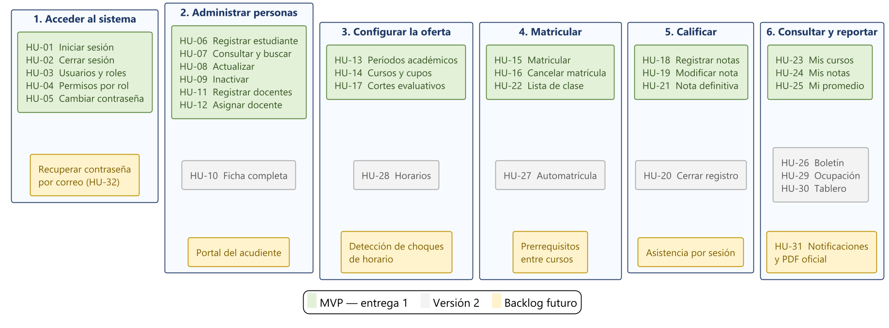

# Sistema de Gestión Académica (SGA)

Trabajo integrador — **Grupo 6**. Sistema de información web para centralizar la gestión académica
de una institución educativa: estudiantes, docentes, cursos, matrículas y calificaciones.

**Autor:** Jannier Johan Otavo

---

## El problema

La institución administra su información académica en hojas de cálculo independientes, formatos en
papel y la memoria de las personas. La misma información existe en varios lugares y ninguna copia
coincide con otra: la consolidación de notas toma semanas y no se puede responder con certeza
cuántos estudiantes hay matriculados en un curso o cuál es el promedio real de un estudiante.

El objetivo del proyecto es construir una **fuente única de verdad** con control de acceso por rol.

---

## Fases del trabajo

| Fase | Etapa | Entregable | Estado |
|------|-------|------------|--------|
| 1 | Épica y Stories | Épicas + historias de usuario | ✅ Completada |
| 2 | Requerimientos | Documento de requerimientos | ✅ Completada |
| 3 | Diagramas UML | Casos de uso, clases, secuencia, actividades | ✅ Completada |
| 4 | Base de datos | Modelo ER/UML + script SQL | ✅ Completada |
| 5 | Mockup / Prototipo | Prototipo navegable | ✅ Completada |
| 6 | Programa funcional | MVP funcional | ⏳ Pendiente |

---

## Cómo trabajamos

| Documento | Para qué sirve |
|---|---|
| [`CONTRIBUTING.md`](CONTRIBUTING.md) | Convención de commits, ramas, pull requests y manejo de los `.docx` |
| [`docs/adr/`](docs/adr/) | Decisiones de arquitectura: por qué el sistema es como es |
| [`docs/seguimiento/velocidad.md`](docs/seguimiento/velocidad.md) | Registro de velocidad por sprint y replanificación |
| [`.github/ISSUE_TEMPLATE/`](.github/ISSUE_TEMPLATE/) | Plantillas de historia de usuario, tarea técnica y reporte de error |

Los commits siguen **Conventional Commits** en español: `tipo(alcance): descripción`. Toda rama
entra a `main` por pull request con su autorrevisión escrita contra la lista de verificación, que
es como cumplimos el criterio de la Definición de Terminado.

---

## Fase 1 — Épicas e historias de usuario

📁 [`fase1-epicas-historias/`](fase1-epicas-historias/)

| Archivo | Descripción |
|---|---|
| [`Fase1-Epicas-e-Historias-SGA-APA7.docx`](fase1-epicas-historias/Fase1-Epicas-e-Historias-SGA-APA7.docx) | Documento formal en normas APA 7.ª edición (portada, resumen, 14 tablas, 8 figuras, referencias) |
| [`fase1-epicas-historias.md`](fase1-epicas-historias/fase1-epicas-historias.md) | Misma información en Markdown, para lectura rápida en el navegador |
| [`diagramas/`](fase1-epicas-historias/diagramas/) | 8 diagramas en PlantUML (fuentes `.puml` y renders `.png`) |

### Contenido de la fase

- Árbol de problemas y formulación del problema central
- Objetivo general y 7 objetivos específicos con métricas
- Alcance, exclusiones y backlog de versiones futuras
- 6 actores, 3 perfiles de usuario y matriz de interesados
- Glosario del dominio y 18 reglas de negocio candidatas
- **9 épicas** y **33 historias de usuario** con criterios de aceptación en formato Dado-Cuando-Entonces
- Priorización MoSCoW + índice valor/esfuerzo
- **MVP: 25 historias, 137 puntos de historia, 4 sprints**
- Definición de Listo y de Terminado, riesgos, métricas de éxito y matriz de trazabilidad

### Resumen del MVP

| Épica | Historias | Puntos |
|---|---|---|
| EP-01 Acceso y seguridad | HU-01 … HU-05, HU-32, HU-33 | 34 |
| EP-02 Gestión de estudiantes | HU-06 … HU-09 | 14 |
| EP-03 Gestión de docentes | HU-11, HU-12 | 8 |
| EP-04 Oferta académica | HU-13, HU-14, HU-17 | 18 |
| EP-05 Matrícula | HU-15, HU-16, HU-22 | 21 |
| EP-06 Registro de calificaciones | HU-18, HU-19, HU-21 | 29 |
| EP-07 Consultas del estudiante | HU-23, HU-24, HU-25 | 13 |
| **Total** | **25 historias** | **137** |

---

## Fase 2 — Documento de requerimientos

📁 [`fase2-requerimientos/`](fase2-requerimientos/)

| Archivo | Descripción |
|---|---|
| [`Fase2-Requerimientos-SGA-APA7.docx`](fase2-requerimientos/Fase2-Requerimientos-SGA-APA7.docx) | Documento formal en normas APA 7.ª edición (26 tablas, 6 figuras, referencias) |
| [`fase2-requerimientos.md`](fase2-requerimientos/fase2-requerimientos.md) | Misma información en Markdown, con los diagramas renderizados |
| [`diagramas/`](fase2-requerimientos/diagramas/) | 6 diagramas en PlantUML (fuentes `.puml` y renders `.png`) |

### Contenido de la fase

- **62 requerimientos funcionales** en 6 módulos, cada uno con entradas, proceso, salidas, precondición y postcondición
- **28 requerimientos no funcionales** según las 8 características de la norma ISO/IEC 25010, todos con métrica de verificación
- **33 reglas de negocio** formalizadas y clasificadas por tipo, con su origen institucional
- **10 restricciones** técnicas, de proyecto, de negocio y normativas
- **15 casos de prueba** de aceptación del sistema
- **5 matrices de trazabilidad** con cobertura completa
- Procedimiento de gestión de cambios de los requerimientos

### Requerimientos por módulo

| Módulo | Responsabilidad | RF |
|---|---|---|
| M1 Seguridad y control de acceso | Autenticación, cuentas, roles y autorización | 9 |
| M2 Gestión de personas | Directorio único de estudiantes y docentes | 10 |
| M3 Oferta académica | Períodos, cursos, cupos, cortes y asignación | 11 |
| M4 Matrícula | Vinculación con validaciones de negocio | 9 |
| M5 Calificaciones | Registro, corrección, auditoría y cálculo | 10 |
| M6 Consultas y reportes | Consultas del estudiante y reportes | 8 |

### Diagramas de la fase

| # | Diagrama | Fuente |
|---|---|---|
| 1 | Módulos funcionales y dependencias | [`01-modulos-funcionales.puml`](fase2-requerimientos/diagramas/01-modulos-funcionales.puml) |
| 2 | Requerimientos no funcionales ISO/IEC 25010 | [`02-rnf-iso25010.puml`](fase2-requerimientos/diagramas/02-rnf-iso25010.puml) |
| 3 | Cadena de trazabilidad | [`03-cadena-trazabilidad.puml`](fase2-requerimientos/diagramas/03-cadena-trazabilidad.puml) |
| 4 | Ciclo de vida de la matrícula | [`04-estados-matricula.puml`](fase2-requerimientos/diagramas/04-estados-matricula.puml) |
| 5 | Flujo de validaciones de la matrícula | [`05-flujo-validaciones-matricula.puml`](fase2-requerimientos/diagramas/05-flujo-validaciones-matricula.puml) |
| 6 | Ciclo de vida del período y del curso | [`06-estados-periodo-curso.puml`](fase2-requerimientos/diagramas/06-estados-periodo-curso.puml) |


---

## Fase 3 — Modelado UML

📁 [`fase3-modelado-uml/`](fase3-modelado-uml/)

| Archivo | Descripción |
|---|---|
| [`Fase3-Modelado-UML-SGA-APA7.docx`](fase3-modelado-uml/Fase3-Modelado-UML-SGA-APA7.docx) | Documento formal en normas APA 7.ª edición (13 tablas, 20 figuras, referencias) |
| [`fase3-modelado-uml.md`](fase3-modelado-uml/fase3-modelado-uml.md) | Misma información en Markdown, con los diagramas renderizados |
| [`diagramas/`](fase3-modelado-uml/diagramas/) | 20 diagramas en PlantUML (fuentes `.puml` y renders `.png`) |

### Contenido de la fase

- **29 casos de uso** con actor iniciador, módulo y requerimientos que agrupa
- **5 casos de uso expandidos** con flujo principal, flujos alternos y excepciones
- **11 clases de dominio** y 6 enumeraciones, con las reglas de negocio como restricciones anotadas
- Tabla de **relaciones y multiplicidades** con la justificación de cada una
- **Clases de diseño en capas** y organización del código en paquetes
- **4 diagramas de secuencia**, 2 de actividades con calles y 2 de máquinas de estado
- Vistas de **componentes, paquetes y despliegue**
- Matriz de trazabilidad y **verificación de consistencia en 6 condiciones**
- Registro de **decisiones de modelado** con su justificación y su costo

### Las cuatro vistas del modelo

| Vista | Diagramas | Responde a |
|---|---|---|
| Casos de uso | 4 | Qué hace el sistema y para quién |
| Estructural | 5 | Con qué información trabaja |
| Dinámica | 8 | Cómo se comporta en el tiempo |
| Implementación | 3 | Cómo se organiza e instala |


---

## Fase 4 — Diseño de la base de datos

📁 [`fase4-base-de-datos/`](fase4-base-de-datos/)

| Archivo | Descripción |
|---|---|
| [`Fase4-Base-de-Datos-SGA-APA7.docx`](fase4-base-de-datos/Fase4-Base-de-Datos-SGA-APA7.docx) | Documento formal en normas APA 7.ª edición (24 tablas, 9 figuras, referencias) |
| [`fase4-base-de-datos.md`](fase4-base-de-datos/fase4-base-de-datos.md) | Misma información en Markdown, con los diagramas renderizados |
| [`sql/`](fase4-base-de-datos/sql/) | 5 scripts SQL: esquema, reglas de negocio, índices y vistas, datos de prueba y verificación |
| [`diagramas/`](fase4-base-de-datos/diagramas/) | 9 diagramas en PlantUML (fuentes `.puml` y renders `.png`) |

### Contenido de la fase

- **Modelo conceptual** con 11 entidades, sus dominios y sus cardinalidades
- **Normalización** desde la planilla de cálculo actual hasta la tercera forma normal, con las dos desnormalizaciones deliberadas justificadas
- **Modelo lógico**: estrategia de herencia, claves subrogadas y política de nulos
- **Modelo físico** para PostgreSQL 16: **12 tablas, 16 índices, 9 disparadores, 10 funciones y 8 vistas**
- Las **33 reglas de negocio** ubicadas una por una: 27 impuestas por el motor y 6 en la capa de negocio
- **Script SQL completo** con datos de prueba y **26 comprobaciones** de las reglas, **ejecutadas contra PostgreSQL 16.10** con las 26 en verde
- Matrices de trazabilidad clase-tabla y módulo-objeto, y verificación de consistencia en 6 condiciones
- Dos decisiones nuevas de arquitectura: [ADR-009](docs/adr/ADR-009-motor-postgresql.md) y [ADR-010](docs/adr/ADR-010-mapeo-de-la-herencia.md)

### Los cinco scripts

| Archivo | Contenido |
|---|---|
| [`01-esquema.sql`](fase4-base-de-datos/sql/01-esquema.sql) | Esquema, tablas, claves y restricciones declarativas |
| [`02-reglas-de-negocio.sql`](fase4-base-de-datos/sql/02-reglas-de-negocio.sql) | Funciones de cálculo y disparadores de las reglas |
| [`03-indices-y-vistas.sql`](fase4-base-de-datos/sql/03-indices-y-vistas.sql) | Índices de rendimiento y vistas de consulta |
| [`04-datos-de-prueba.sql`](fase4-base-de-datos/sql/04-datos-de-prueba.sql) | Juego de datos ficticios con todos los estados del sistema |
| [`05-verificacion.sql`](fase4-base-de-datos/sql/05-verificacion.sql) | 22 pruebas que confirman que las reglas se cumplen |

### Crear la base de datos

Requiere PostgreSQL 16 o superior. Desde la carpeta `fase4-base-de-datos/sql/`:

```bash
createdb -E UTF8 sga
psql -d sga -f 01-esquema.sql
psql -d sga -f 02-reglas-de-negocio.sql
psql -d sga -f 03-indices-y-vistas.sql
psql -d sga -f 04-datos-de-prueba.sql
psql -d sga -f 05-verificacion.sql
```

### Diagramas de la fase

| # | Diagrama | Fuente |
|---|---|---|
| 1 | Modelo conceptual de datos | [`01-modelo-conceptual.puml`](fase4-base-de-datos/diagramas/01-modelo-conceptual.puml) |
| 2 | Modelo lógico relacional | [`02-modelo-logico.puml`](fase4-base-de-datos/diagramas/02-modelo-logico.puml) |
| 3 | Modelo físico para PostgreSQL 16 | [`03-modelo-fisico.puml`](fase4-base-de-datos/diagramas/03-modelo-fisico.puml) |
| 4 | Estrategias de mapeo de la herencia | [`04-estrategias-herencia.puml`](fase4-base-de-datos/diagramas/04-estrategias-herencia.puml) |
| 5 | Proceso de normalización | [`05-normalizacion.puml`](fase4-base-de-datos/diagramas/05-normalizacion.puml) |
| 6 | Acciones de integridad referencial | [`06-integridad-referencial.puml`](fase4-base-de-datos/diagramas/06-integridad-referencial.puml) |
| 7 | Dónde se hace cumplir cada regla | [`07-reglas-en-el-esquema.puml`](fase4-base-de-datos/diagramas/07-reglas-en-el-esquema.puml) |
| 8 | Transacción de la matrícula | [`08-transaccion-matricula.puml`](fase4-base-de-datos/diagramas/08-transaccion-matricula.puml) |
| 9 | De las tablas a los casos de uso | [`09-vistas-y-consultas.puml`](fase4-base-de-datos/diagramas/09-vistas-y-consultas.puml) |


---

## Fase 5 — Mockup y prototipo navegable

📁 [`fase5-mockup/`](fase5-mockup/)

| Archivo | Descripción |
|---|---|
| [`Fase5-Mockup-SGA-APA7.docx`](fase5-mockup/Fase5-Mockup-SGA-APA7.docx) | Documento formal en normas APA 7.ª edición |
| [`fase5-mockup.md`](fase5-mockup/fase5-mockup.md) | Misma información en Markdown, con los diagramas renderizados |
| [`capturas/`](fase5-mockup/capturas/) | Pantallazos del prototipo: seis pantallas, una de ellas a 360 píxeles |
| [`diagramas/`](fase5-mockup/diagramas/) | 8 diagramas en PlantUML (fuentes `.puml` y renders `.png`) |

### Abrir el prototipo

El prototipo es un archivo de Figma con las 24 pantallas, en escritorio y en móvil. El botón **Presentar**
arranca en la pantalla de acceso, que está fijada como punto de partida del flujo.

El prototipo se entrega en dos tamaños de ventana. No hace falta cuenta ni iniciar sesión:

- **[Escritorio, 1440 × 1024](https://www.figma.com/proto/0N23jzSCsiWpoBvI59fkup/SGA---Prototipo-Fase-5---Grupo-6?node-id=52-4743&starting-point-node-id=52%3A4743&scaling=contain&content-scaling=fixed)**
- **[Móvil, 360 × 800](https://www.figma.com/proto/0N23jzSCsiWpoBvI59fkup/SGA---Prototipo-Fase-5---Grupo-6?node-id=54-7377&starting-point-node-id=54%3A7377&scaling=contain&content-scaling=fixed)**

Las seis capturas de [`fase5-mockup/capturas/`](fase5-mockup/capturas/) y la sección 11 del informe
muestran las pantallas principales sin salir del repositorio.

### Contenido de la fase

- **Estructura de navegación** por rol, con la verificación de los tres clics (RNF-13)
- **Sistema de diseño**: tokens de color, tipografía y espaciado, y **16 componentes**
- **24 pantallas**: acceso, restablecimiento de contraseña, paneles de los tres roles, formularios, listados con filtros, fichas de detalle, consultas y el perfil del usuario
- **Catálogo de mensajes** completo: el Anexo A que la Fase 2 dejó pendiente, con sus reglas de redacción
- Verificación medida: **169 de 169 conexiones en escritorio, 96 de 96 en móvil y 0 desbordes a 360 px** en las 24 pantallas
- Plan de prueba de usabilidad para medir RNF-09 antes de programar
- Los datos del prototipo son los del juego de prueba de la Fase 4: lo que se ve en pantalla es lo que devuelve la base de datos
- Decisión nueva de arquitectura: [ADR-011](docs/adr/ADR-011-prototipo-en-figma.md)

### Diagramas de la fase

| # | Diagrama | Fuente |
|---|---|---|
| 1 | Mapa de navegación | [`01-mapa-navegacion.puml`](fase5-mockup/diagramas/01-mapa-navegacion.puml) |
| 2 | Flujo de la matrícula | [`02-flujo-matricula.puml`](fase5-mockup/diagramas/02-flujo-matricula.puml) |
| 3 | Flujo del registro de calificaciones | [`03-flujo-calificar.puml`](fase5-mockup/diagramas/03-flujo-calificar.puml) |
| 4 | Flujo de consulta del estudiante | [`04-flujo-consulta-estudiante.puml`](fase5-mockup/diagramas/04-flujo-consulta-estudiante.puml) |
| 5 | Boceto de Matricular estudiante | [`05-wireframe-matricular.puml`](fase5-mockup/diagramas/05-wireframe-matricular.puml) |
| 6 | Boceto de Mis notas | [`06-wireframe-mis-notas.puml`](fase5-mockup/diagramas/06-wireframe-mis-notas.puml) |
| 7 | Sistema de diseño | [`07-sistema-diseno.puml`](fase5-mockup/diagramas/07-sistema-diseno.puml) |
| 8 | Estados de una pantalla con datos | [`08-estados-interfaz.puml`](fase5-mockup/diagramas/08-estados-interfaz.puml) |


---

## Diagramas de la Fase 1

| # | Diagrama | Fuente |
|---|---|---|
| 1 | Contexto: actores y funciones principales | [`01-actores.puml`](fase1-epicas-historias/diagramas/01-actores.puml) |
| 2 | Árbol de problemas | [`02-arbol-problemas.puml`](fase1-epicas-historias/diagramas/02-arbol-problemas.puml) |
| 3 | Descomposición de épicas en historias | [`03-epicas-historias.puml`](fase1-epicas-historias/diagramas/03-epicas-historias.puml) |
| 4 | Mapa de historias (user story map) | [`04-story-map.puml`](fase1-epicas-historias/diagramas/04-story-map.puml) |
| 5 | Casos de uso del administrador | [`05-casos-uso-administrador.puml`](fase1-epicas-historias/diagramas/05-casos-uso-administrador.puml) |
| 6 | Casos de uso del docente y el estudiante | [`06-casos-uso-docente-estudiante.puml`](fase1-epicas-historias/diagramas/06-casos-uso-docente-estudiante.puml) |
| 7 | Matriz valor / esfuerzo | [`07-matriz-valor-esfuerzo.puml`](fase1-epicas-historias/diagramas/07-matriz-valor-esfuerzo.puml) |
| 8 | Cronograma de sprints (Gantt) | [`08-roadmap-sprints.puml`](fase1-epicas-historias/diagramas/08-roadmap-sprints.puml) |

### Regenerar los diagramas

Requiere Java y [PlantUML](https://plantuml.com/download). Desde la carpeta `diagramas/` de cualquiera de las fases:

```bash
java -jar plantuml.jar -tpng -charset UTF-8 *.puml
```

Los diagramas usan el motor de disposición **Smetana**, incluido en PlantUML, por lo que no es
necesario instalar Graphviz.

---

## Mapa de historias


