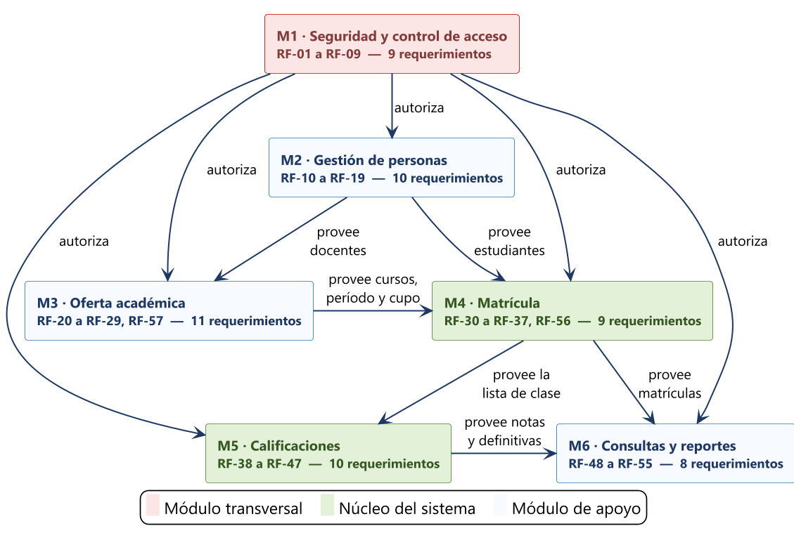
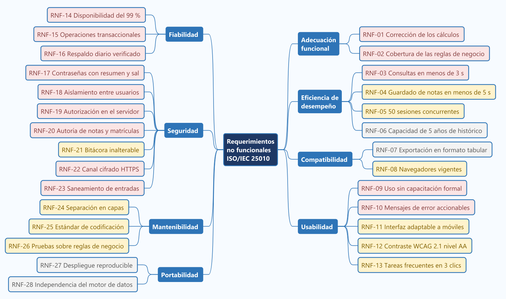
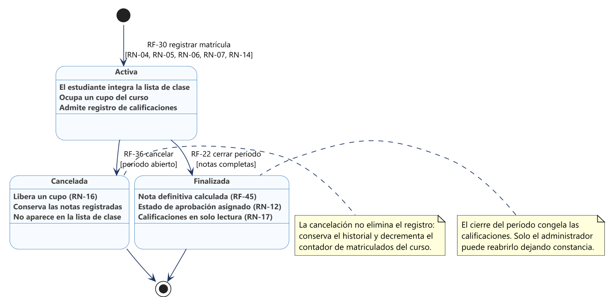
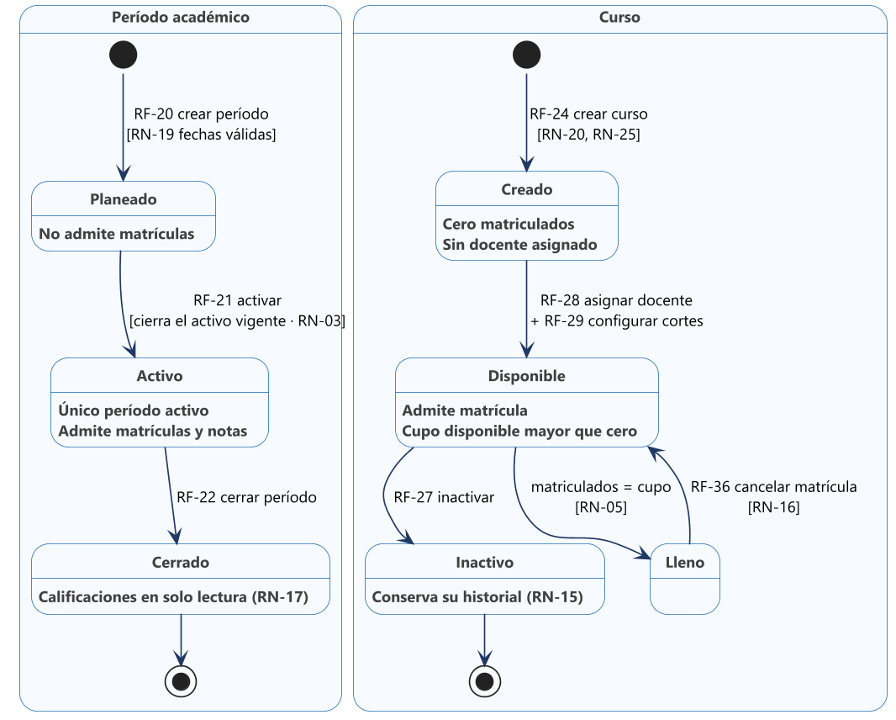
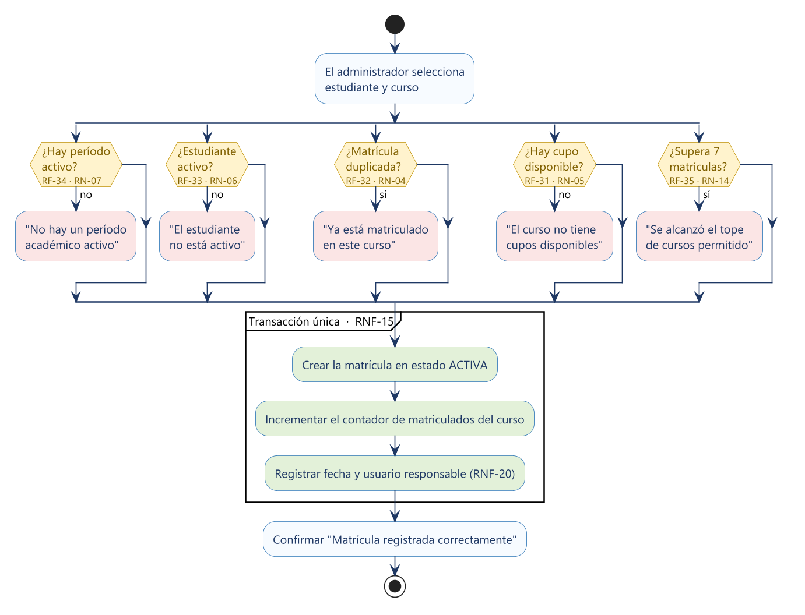
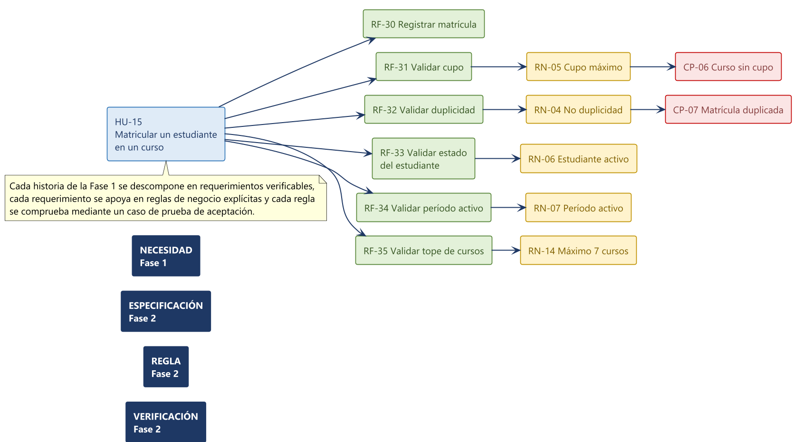

# Fase 2 — Documento de Requerimientos
## Sistema de Gestión Académica (SGA)

| Campo | Detalle |
|---|---|
| **Proyecto** | Sistema de Gestión Académica (SGA) |
| **Grupo** | 6 |
| **Integrante** | Jannier Johan Otavo |
| **Fase** | 2 de 6 — Requerimientos |
| **Entregable** | Documento de requerimientos funcionales, no funcionales, reglas de negocio y matriz de trazabilidad |
| **Versión** | 1.0 |
| **Fecha** | 20 de agosto de 2026 |
| **Fase anterior** | [Fase 1 — Épicas e historias de usuario](../fase1-epicas-historias/fase1-epicas-historias.md) |
| **Estado** | Listo para revisión / entrada a Fase 3 (UML) |

---

## Índice

1. [Introducción](#1-introduccion)
2. [Descripción General del Sistema](#2-descripcion-general-del-sistema)
3. [Requerimientos Funcionales](#3-requerimientos-funcionales)
4. [Requerimientos No Funcionales](#4-requerimientos-no-funcionales)
5. [Reglas de Negocio](#5-reglas-de-negocio)
6. [Restricciones](#6-restricciones)
7. [Criterios de Aceptación del Sistema](#7-criterios-de-aceptacion-del-sistema)
8. [Matrices de Trazabilidad](#8-matrices-de-trazabilidad)
9. [Priorización y Asignación de Requerimientos](#9-priorizacion-y-asignacion-de-requerimientos)
10. [Gestión de Cambios de los Requerimientos](#10-gestion-de-cambios-de-los-requerimientos)
11. [Conclusiones](#11-conclusiones)
12. [Referencias](#12-referencias)

---

## 1. Introducción

### 1.1 Propósito del Documento

En la Fase 1 dejamos escritas treinta y dos historias de usuario que describen lo que la institución necesita. Aquí las convertimos en requerimientos: enunciados verificables, sin ambigüedad y que se pueden rastrear hasta su origen. Buscamos dos cosas con eso. La primera, tener un acuerdo claro con la institución sobre qué hará el sistema. La segunda, entregarles a las fases siguientes una base sólida sobre la cual modelar en UML, diseñar la base de datos y escribir las pruebas.

La historia y el requerimiento no son lo mismo ni se reemplazan entre sí. La historia dice qué necesita una persona y por qué; el requerimiento dice a qué se obliga el sistema y cómo lo comprobamos. Conservamos las dos porque cada una responde una pregunta distinta. Wiegers y Beatty (2013) señalan que los defectos más caros de un sistema no nacen al programar, sino en requerimientos incompletos, ambiguos o que nadie verificó.

### 1.2 Alcance del Documento

Cubrimos los requerimientos funcionales de los seis módulos del sistema, los no funcionales organizados con el modelo de calidad de la norma ISO/IEC 25010, las reglas de negocio ya formalizadas, las restricciones del proyecto y del entorno, los criterios de aceptación escritos como casos de prueba y las matrices que relacionan todo lo anterior con las historias de la Fase 1.

Dejamos por fuera el diseño de la solución, la arquitectura interna, el modelo de datos y el diseño de las pantallas, porque eso les corresponde a las fases 3, 4 y 5. Nos mantuvimos a propósito en el qué y no en el cómo, con una sola excepción: las restricciones tecnológicas que impone la institución, que sí anotamos de forma explícita porque limitan lo que podamos decidir más adelante.

### 1.3 Audiencia

Escribimos pensando en cuatro lectores. La coordinación académica, que necesita confirmar que el sistema hará lo que la institución pide. Nosotros mismos, que trabajaremos con este texto como referencia mientras construimos. Quien haga las pruebas, que sacará de aquí los casos a verificar. Y el instructor del curso, que evalúa la fase.

### 1.4 Convenciones y Nomenclatura

Identificamos cada elemento con un prefijo que mantendremos en las fases siguientes. Los identificadores son únicos y no los reutilizamos: si un requerimiento desaparece, su número queda vacío y no se le asigna a otro.

**Tabla 1.** *Nomenclatura de los elementos de la especificación*

| Prefijo | Elemento | Ejemplo | Cantidad |
|---|---|---|---|
| HU | Historia de usuario (Fase 1) | HU-15 | 32 historias |
| RF | Requerimiento funcional | RF-30 | 60 requerimientos |
| RNF | Requerimiento no funcional | RNF-15 | 28 requerimientos |
| RN | Regla de negocio | RN-05 | 31 reglas |
| RE | Restricción | RE-02 | 10 restricciones |
| CP | Caso de prueba de aceptación | CP-06 | 18 casos |

Manejamos tres niveles de prioridad. Alta es lo que el sistema no puede dejar de hacer, y por eso va en el producto mínimo viable. Media aporta valor real, pero puede esperar dentro del mismo alcance. Baja la especificamos para no perder de vista el producto completo, aunque la construiremos en la versión 2.

Escribimos todos los requerimientos con la fórmula «el sistema debe», que expresa una obligación. Evitamos «debería» o «sería deseable» porque dejan en duda a qué nos comprometimos.

---

## 2. Descripción General del Sistema

### 2.1 Perspectiva del Producto

El SGA es un producto nuevo y autónomo. No reemplaza a otro sistema ni se conecta con aplicaciones de terceros en esta versión: lo que sustituye son prácticas manuales —hojas de cálculo sueltas, formatos en papel y conocimiento que solo está en la cabeza de algunas personas— por una aplicación web con una base de datos única y acceso controlado por rol.

Ser autónomo simplifica el alcance, pero nos deja encima una responsabilidad grande: como no habrá otra fuente de información, la integridad de los datos dependerá únicamente de las validaciones que programemos. Por eso les dimos un lugar central a las reglas de negocio y amarramos cada una a los requerimientos que la implementan.

### 2.2 Módulos Funcionales

Agrupamos los requerimientos en seis módulos que reúnen responsabilidades afines. La Figura 1 muestra los módulos y sus dependencias, y la Tabla 2 los describe.

**Figura 1.** *Módulos funcionales del sistema y sus dependencias*

*Nota.* Elaboración propia con PlantUML. El módulo de seguridad es transversal: autoriza toda operación de los demás módulos. Matrícula y Calificaciones constituyen el núcleo funcional del sistema.

**Tabla 2.** *Módulos funcionales del Sistema de Gestión Académica*

| ID | Módulo | Responsabilidad | RF |
|---|---|---|---|
| M1 | Seguridad y control de acceso | Autenticación, gestión de cuentas, roles y autorización de operaciones. | 9 |
| M2 | Gestión de personas | Registro y mantenimiento del directorio único de estudiantes y docentes. | 10 |
| M3 | Oferta académica | Períodos, cursos, cupos, cortes evaluativos y asignación de docentes. | 11 |
| M4 | Matrícula | Vinculación de estudiantes a cursos con las validaciones de negocio. | 9 |
| M5 | Calificaciones | Registro, corrección, auditoría y cálculo de notas. | 10 |
| M6 | Consultas y reportes | Consultas del estudiante y reportes operativos del administrador. | 8 |

*Nota.* Los requerimientos de cada módulo suman los 57 que especificamos en total.

### 2.3 Características de los Usuarios

Los tres perfiles que usarán el sistema tienen niveles de competencia técnica y frecuencia de uso muy distintos, y eso condiciona directamente los requerimientos de usabilidad. El administrador académico es un usuario intensivo, con dominio de herramientas ofimáticas pero sin formación técnica, que concentra su actividad en la semana de matrícula. El docente es un usuario esporádico que interactúa con el sistema principalmente al cierre de cada corte y cuya tolerancia a la fricción es baja. El estudiante es un usuario ocasional, familiarizado con aplicaciones móviles, que ejecuta consultas breves y espera respuestas inmediatas.

De ahí salieron RNF-09, RNF-11 y RNF-13: el sistema debe poder usarse sin capacitación formal, adaptarse a pantallas de celular y resolver las tareas frecuentes en tres interacciones o menos.

### 2.4 Entorno Operativo

El sistema funcionará como aplicación web, accesible desde los navegadores vigentes en los equipos de la secretaría y de la sala de docentes, y desde los celulares de los estudiantes. Guardaremos los datos en un motor relacional, y esa decisión nos la impone la matrícula: crear el registro y actualizar el cupo tienen que ocurrir juntos o no ocurrir.

### 2.5 Supuestos y Dependencias

Seguimos trabajando sobre los supuestos que declaramos en la Fase 1. Todavía no los hemos validado con la institución y varios requerimientos dependen de ellos: si alguno cambia, nos tocará revisar las reglas asociadas y, en dos casos, el modelo de datos.

**Tabla 3.** *Supuestos vigentes y requerimientos que dependen de ellos*

| ID | Supuesto | Elementos afectados | Criticidad |
|---|---|---|---|
| S-1 | Cada estudiante y cada docente dispone de un correo electrónico propio | RN-02, RF-01, RF-04 | Media |
| S-2 | La institución trabaja con dos períodos académicos por año | RF-20, RF-21 | Baja |
| S-3 | La escala de calificación es de 0.0 a 5.0 y se aprueba con 3.0 | RN-09, RN-12, RF-39, RF-46 | Alta |
| S-4 | Cada curso es dictado por un único docente responsable | RN-08, RF-28, RF-41 | Alta |
| S-5 | La secretaría dispone de conexión estable a internet | RNF-14 | Media |

*Nota.* Debemos validar S-3 y S-4 antes del segundo sprint: el primero define las validaciones de calificación y el segundo condiciona la relación entre curso y docente en el modelo de datos de la Fase 4.

---

## 3. Requerimientos Funcionales

Definimos 60 requerimientos funcionales a partir de las historias de usuario de la Fase 1. De ellos, 52 integran el producto mínimo viable y 8 los dejamos especificados para no perder de vista el producto completo, aunque los construiremos en la versión 2.

De cada requerimiento escribimos su identificador, su nombre y una descripción de lo que el sistema debe hacer, y además diez atributos: módulo, actor que lo invoca, entradas que recibe, proceso que ejecuta, salidas que produce, precondición que debe cumplirse antes, postcondición que queda garantizada después, prioridad, historia que lo origina y reglas de negocio que aplica. De los que dejamos para la versión 2 solo incluimos su fila en la tabla resumen del módulo.

### 3.1 Módulo M1: Seguridad y control de acceso

Autenticación, gestión de cuentas, roles y autorización de operaciones. Reunimos aquí 9 requerimientos funcionales.

**Tabla 4.** *Requerimientos funcionales del módulo M1*

| ID | Requerimiento | Prioridad | Origen | Versión |
|---|---|---|---|---|
| RF-01 | Autenticar usuario | Alta | HU-01 | MVP |
| RF-02 | Cerrar sesión | Alta | HU-02 | MVP |
| RF-03 | Expirar la sesión por inactividad | Media | HU-02 | MVP |
| RF-04 | Crear una cuenta de usuario | Alta | HU-03 | MVP |
| RF-05 | Modificar el rol de una cuenta | Media | HU-03 | MVP |
| RF-06 | Inactivar una cuenta de usuario | Media | HU-03 | MVP |
| RF-07 | Autorizar las operaciones según el rol | Alta | HU-04 | MVP |
| RF-08 | Cambiar la contraseña propia | Media | HU-05 | MVP |
| RF-09 | Registrar los eventos de seguridad | Media | HU-01, HU-04 | MVP |
| RF-58 | Solicitar el restablecimiento de la contraseña | Alta | HU-32 | MVP |
| RF-59 | Validar el enlace de restablecimiento | Alta | HU-32 | MVP |
| RF-60 | Fijar la contraseña nueva desde el enlace | Alta | HU-32 | MVP |

#### RF-01. Autenticar usuario

> El sistema debe validar las credenciales del usuario y crear una sesión asociada a su rol.

| Atributo | Especificación |
|---|---|
| **Módulo** | M1 — Seguridad y control de acceso |
| **Actor** | Administrador, docente, estudiante |
| **Entradas** | Correo electrónico y contraseña |
| **Proceso** | Verifica que el correo exista, que el usuario esté activo y que el resumen criptográfico de la contraseña coincida con el almacenado |
| **Salidas** | Sesión activa y redirección al panel del rol, o mensaje genérico de error |
| **Precondición** | El usuario existe y tiene estado activo |
| **Postcondición** | Existe una sesión válida asociada al usuario y a su rol |
| **Prioridad** | Alta |
| **Historia de origen** | HU-01 |
| **Reglas de negocio** | RN-02, RN-21 |

#### RF-02. Cerrar sesión

> El sistema debe permitir al usuario terminar su sesión de forma explícita e invalidarla en el servidor.

| Atributo | Especificación |
|---|---|
| **Módulo** | M1 — Seguridad y control de acceso |
| **Actor** | Administrador, docente, estudiante |
| **Entradas** | Solicitud de cierre de sesión |
| **Proceso** | Invalida el identificador de sesión en el servidor y descarta las credenciales del cliente |
| **Salidas** | Redirección a la pantalla de acceso |
| **Precondición** | Existe una sesión activa |
| **Postcondición** | La sesión queda invalidada y no es reutilizable |
| **Prioridad** | Alta |
| **Historia de origen** | HU-02 |
| **Reglas de negocio** | RN-22 |

#### RF-03. Expirar la sesión por inactividad

> El sistema debe cerrar automáticamente la sesión tras un período de inactividad.

| Atributo | Especificación |
|---|---|
| **Módulo** | M1 — Seguridad y control de acceso |
| **Actor** | Servicio de autenticación |
| **Entradas** | Marca temporal de la última interacción |
| **Proceso** | Compara la inactividad acumulada contra el límite configurado y, al superarlo, invalida la sesión |
| **Salidas** | Sesión invalidada y solicitud de nueva autenticación |
| **Precondición** | Existe una sesión activa |
| **Postcondición** | La sesión expirada no permite ejecutar ninguna operación |
| **Prioridad** | Media |
| **Historia de origen** | HU-02 |
| **Reglas de negocio** | RN-22 |

#### RF-04. Crear una cuenta de usuario

> El sistema debe permitir al administrador crear cuentas de acceso asociadas a un rol.

| Atributo | Especificación |
|---|---|
| **Módulo** | M1 — Seguridad y control de acceso |
| **Actor** | Administrador |
| **Entradas** | Correo, nombre y rol |
| **Proceso** | Valida la unicidad del correo, genera una contraseña temporal y crea la cuenta en estado activo |
| **Salidas** | Cuenta creada y contraseña temporal comunicada al usuario |
| **Precondición** | El solicitante tiene rol administrador |
| **Postcondición** | Existe una cuenta activa con el rol asignado |
| **Prioridad** | Alta |
| **Historia de origen** | HU-03 |
| **Reglas de negocio** | RN-02, RN-21 |

#### RF-05. Modificar el rol de una cuenta

> El sistema debe permitir cambiar el rol asignado a una cuenta existente.

| Atributo | Especificación |
|---|---|
| **Módulo** | M1 — Seguridad y control de acceso |
| **Actor** | Administrador |
| **Entradas** | Identificador de la cuenta y nuevo rol |
| **Proceso** | Actualiza el rol y deja constancia del cambio en la bitácora |
| **Salidas** | Cuenta actualizada y permisos vigentes desde el siguiente inicio de sesión |
| **Precondición** | La cuenta existe |
| **Postcondición** | La cuenta opera con los permisos del nuevo rol |
| **Prioridad** | Media |
| **Historia de origen** | HU-03 |
| **Reglas de negocio** | RN-23 |

#### RF-06. Inactivar una cuenta de usuario

> El sistema debe permitir inactivar una cuenta sin eliminar su información histórica.

| Atributo | Especificación |
|---|---|
| **Módulo** | M1 — Seguridad y control de acceso |
| **Actor** | Administrador |
| **Entradas** | Identificador de la cuenta |
| **Proceso** | Cambia el estado de la cuenta a inactiva y conserva sus registros asociados |
| **Salidas** | Cuenta inactiva e imposibilitada para autenticarse |
| **Precondición** | La cuenta existe y está activa |
| **Postcondición** | La cuenta no puede iniciar sesión y su historial permanece disponible |
| **Prioridad** | Media |
| **Historia de origen** | HU-03 |
| **Reglas de negocio** | RN-15 |

#### RF-07. Autorizar las operaciones según el rol

> El sistema debe verificar en el servidor, para cada operación, que el rol del usuario esté autorizado a ejecutarla.

| Atributo | Especificación |
|---|---|
| **Módulo** | M1 — Seguridad y control de acceso |
| **Actor** | Servicio de autenticación |
| **Entradas** | Sesión del usuario y operación solicitada |
| **Proceso** | Contrasta el rol de la sesión con la matriz de permisos de la operación y deniega cuando no corresponde |
| **Salidas** | Operación ejecutada o error de autorización registrado |
| **Precondición** | Existe una sesión activa |
| **Postcondición** | Ninguna operación se ejecuta sin rol autorizado |
| **Prioridad** | Alta |
| **Historia de origen** | HU-04 |
| **Reglas de negocio** | RN-08, RN-23 |

#### RF-08. Cambiar la contraseña propia

> El sistema debe permitir al usuario reemplazar su contraseña, incluida la temporal asignada al crear la cuenta.

| Atributo | Especificación |
|---|---|
| **Módulo** | M1 — Seguridad y control de acceso |
| **Actor** | Administrador, docente, estudiante |
| **Entradas** | Contraseña actual, nueva contraseña y confirmación |
| **Proceso** | Verifica la contraseña actual, valida la robustez de la nueva y almacena su resumen criptográfico |
| **Salidas** | Contraseña actualizada y sesión renovada |
| **Precondición** | Existe una sesión activa |
| **Postcondición** | La contraseña anterior deja de ser válida |
| **Prioridad** | Media |
| **Historia de origen** | HU-05 |
| **Reglas de negocio** | RN-21 |

#### RF-09. Registrar los eventos de seguridad

> El sistema debe registrar los intentos fallidos de autenticación y los accesos denegados por autorización.

| Atributo | Especificación |
|---|---|
| **Módulo** | M1 — Seguridad y control de acceso |
| **Actor** | Servicio de autenticación |
| **Entradas** | Evento, usuario, fecha, hora y operación solicitada |
| **Proceso** | Persiste el evento en la bitácora sin permitir su modificación posterior |
| **Salidas** | Registro en la bitácora de seguridad |
| **Precondición** | El evento se produjo en el sistema |
| **Postcondición** | El evento queda disponible para auditoría |
| **Prioridad** | Media |
| **Historia de origen** | HU-01, HU-04 |
| **Reglas de negocio** | RN-23 |

#### RF-58. Solicitar el restablecimiento de la contraseña

> El sistema debe permitir que un usuario que olvidó su contraseña solicite un enlace de restablecimiento indicando su correo institucional.

| Atributo | Especificación |
|---|---|
| **Módulo** | M1 — Seguridad y control de acceso |
| **Actor** | Usuario |
| **Entradas** | Correo institucional |
| **Proceso** | Busca una cuenta activa con ese correo. Si existe, genera un enlace de un solo uso con vencimiento y lo envía por correo. Responde siempre lo mismo, exista o no la cuenta |
| **Salidas** | Mensaje neutro de confirmación y, cuando corresponde, un correo con el enlace |
| **Precondición** | Ninguna: la pantalla es pública |
| **Postcondición** | Queda registrada la solicitud y, si aplica, un enlace vigente |
| **Prioridad** | Alta |
| **Historia de origen** | HU-32 |
| **Reglas de negocio** | RN-28, RN-29, RN-30 |

#### RF-59. Validar el enlace de restablecimiento

> El sistema debe verificar que el enlace recibido esté vigente, no haya sido usado y corresponda a una cuenta activa.

| Atributo | Especificación |
|---|---|
| **Módulo** | M1 — Seguridad y control de acceso |
| **Actor** | Usuario |
| **Entradas** | Identificador del enlace |
| **Proceso** | Compara el resumen criptográfico del enlace recibido con el almacenado, comprueba que no esté vencido ni usado y que la cuenta siga activa |
| **Salidas** | Formulario de contraseña nueva, o mensaje de enlace no válido con la opción de solicitar otro |
| **Precondición** | Existe una solicitud de restablecimiento |
| **Postcondición** | El enlace queda habilitado para fijar la contraseña, o rechazado |
| **Prioridad** | Alta |
| **Historia de origen** | HU-32 |
| **Reglas de negocio** | RN-28 |

#### RF-60. Fijar la contraseña nueva desde el enlace

> El sistema debe permitir que el usuario establezca una contraseña nueva a través de un enlace válido, sin conocer la anterior.

| Atributo | Especificación |
|---|---|
| **Módulo** | M1 — Seguridad y control de acceso |
| **Actor** | Usuario |
| **Entradas** | Identificador del enlace, contraseña nueva y su confirmación |
| **Proceso** | Verifica la longitud mínima y que ambas coincidan, almacena el resumen criptográfico con una sal nueva, marca el enlace como usado, invalida cualquier otro enlace vigente de la cuenta y cierra las sesiones abiertas |
| **Salidas** | Confirmación y redirección a la pantalla de acceso |
| **Precondición** | El enlace es válido según RF-59 |
| **Postcondición** | La contraseña queda cambiada y el enlace inutilizable |
| **Prioridad** | Alta |
| **Historia de origen** | HU-32 |
| **Reglas de negocio** | RN-21, RN-28, RN-31 |

### 3.2 Módulo M2: Gestión de personas

Registro y mantenimiento del directorio único de estudiantes y docentes. Reunimos aquí 10 requerimientos funcionales.

**Tabla 5.** *Requerimientos funcionales del módulo M2*

| ID | Requerimiento | Prioridad | Origen | Versión |
|---|---|---|---|---|
| RF-10 | Registrar un estudiante | Alta | HU-06 | MVP |
| RF-11 | Validar la unicidad del documento | Alta | HU-06, HU-08, HU-11 | MVP |
| RF-12 | Consultar el listado de estudiantes | Alta | HU-07 | MVP |
| RF-13 | Buscar estudiantes por criterio | Alta | HU-07 | MVP |
| RF-14 | Filtrar estudiantes por estado | Media | HU-07 | MVP |
| RF-15 | Actualizar los datos de un estudiante | Alta | HU-08 | MVP |
| RF-16 | Inactivar un estudiante | Media | HU-09 | MVP |
| RF-17 | Registrar un docente | Alta | HU-11 | MVP |
| RF-18 | Actualizar o inactivar un docente | Media | HU-11 | MVP |
| RF-19 | Consultar la ficha consolidada del estudiante | Baja | HU-10 | v2 |

#### RF-10. Registrar un estudiante

> El sistema debe permitir registrar un estudiante con sus datos personales y de contacto, y generarle un código interno.

| Atributo | Especificación |
|---|---|
| **Módulo** | M2 — Gestión de personas |
| **Actor** | Administrador |
| **Entradas** | Tipo y número de documento, nombres, apellidos, fecha de nacimiento, correo y teléfono |
| **Proceso** | Valida obligatoriedad y formato, verifica la unicidad del documento, genera el código interno y crea la cuenta de acceso asociada |
| **Salidas** | Estudiante creado en estado activo con código y usuario |
| **Precondición** | El solicitante tiene rol administrador |
| **Postcondición** | El estudiante puede ser matriculado y autenticarse |
| **Prioridad** | Alta |
| **Historia de origen** | HU-06 |
| **Reglas de negocio** | RN-01 |

#### RF-11. Validar la unicidad del documento

> El sistema debe impedir el registro de dos personas con el mismo número de documento.

| Atributo | Especificación |
|---|---|
| **Módulo** | M2 — Gestión de personas |
| **Actor** | Administrador |
| **Entradas** | Tipo y número de documento |
| **Proceso** | Consulta la existencia previa del documento y rechaza la operación cuando ya está registrado |
| **Salidas** | Confirmación de unicidad o mensaje de rechazo |
| **Precondición** | Se está creando o actualizando una persona |
| **Postcondición** | No existen documentos duplicados en el sistema |
| **Prioridad** | Alta |
| **Historia de origen** | HU-06, HU-08, HU-11 |
| **Reglas de negocio** | RN-01 |

#### RF-12. Consultar el listado de estudiantes

> El sistema debe presentar el listado de estudiantes de forma paginada con sus datos de identificación y su estado.

| Atributo | Especificación |
|---|---|
| **Módulo** | M2 — Gestión de personas |
| **Actor** | Administrador |
| **Entradas** | Número de página y tamaño de página |
| **Proceso** | Recupera los estudiantes ordenados alfabéticamente y los entrega paginados |
| **Salidas** | Listado paginado con código, documento, nombre, correo y estado |
| **Precondición** | El solicitante tiene rol administrador |
| **Postcondición** | El administrador visualiza la población estudiantil registrada |
| **Prioridad** | Alta |
| **Historia de origen** | HU-07 |
| **Reglas de negocio** | No aplica |

#### RF-13. Buscar estudiantes por criterio

> El sistema debe permitir la búsqueda por coincidencia parcial en nombre, apellido o número de documento.

| Atributo | Especificación |
|---|---|
| **Módulo** | M2 — Gestión de personas |
| **Actor** | Administrador |
| **Entradas** | Texto de búsqueda |
| **Proceso** | Aplica una coincidencia parcial sobre los campos indexados y devuelve el subconjunto resultante |
| **Salidas** | Listado filtrado o mensaje de ausencia de coincidencias |
| **Precondición** | Existen estudiantes registrados |
| **Postcondición** | El administrador localiza al estudiante sin recorrer el listado completo |
| **Prioridad** | Alta |
| **Historia de origen** | HU-07 |
| **Reglas de negocio** | No aplica |

#### RF-14. Filtrar estudiantes por estado

> El sistema debe permitir filtrar el listado por estado activo o inactivo.

| Atributo | Especificación |
|---|---|
| **Módulo** | M2 — Gestión de personas |
| **Actor** | Administrador |
| **Entradas** | Estado seleccionado |
| **Proceso** | Restringe el conjunto de resultados al estado indicado |
| **Salidas** | Listado filtrado por estado |
| **Precondición** | Existen estudiantes registrados |
| **Postcondición** | El listado refleja únicamente el estado solicitado |
| **Prioridad** | Media |
| **Historia de origen** | HU-07 |
| **Reglas de negocio** | No aplica |

#### RF-15. Actualizar los datos de un estudiante

> El sistema debe permitir modificar los datos personales y de contacto conservando el historial académico.

| Atributo | Especificación |
|---|---|
| **Módulo** | M2 — Gestión de personas |
| **Actor** | Administrador |
| **Entradas** | Identificador del estudiante y campos modificados |
| **Proceso** | Valida los campos, verifica la unicidad del documento y persiste los cambios sin afectar matrículas ni notas |
| **Salidas** | Estudiante actualizado |
| **Precondición** | El estudiante existe |
| **Postcondición** | Los datos quedan actualizados y el historial intacto |
| **Prioridad** | Alta |
| **Historia de origen** | HU-08 |
| **Reglas de negocio** | RN-01 |

#### RF-16. Inactivar un estudiante

> El sistema debe permitir inactivar a un estudiante retirado, conservando su historial académico.

| Atributo | Especificación |
|---|---|
| **Módulo** | M2 — Gestión de personas |
| **Actor** | Administrador |
| **Entradas** | Identificador del estudiante y confirmación explícita |
| **Proceso** | Cambia el estado a inactivo, impide nuevas matrículas y bloquea su autenticación |
| **Salidas** | Estudiante inactivo |
| **Precondición** | El estudiante existe y está activo |
| **Postcondición** | El estudiante no puede matricularse ni autenticarse, y su historial permanece |
| **Prioridad** | Media |
| **Historia de origen** | HU-09 |
| **Reglas de negocio** | RN-06, RN-15 |

#### RF-17. Registrar un docente

> El sistema debe permitir registrar un docente con sus datos y su área de conocimiento, y crearle su cuenta de acceso.

| Atributo | Especificación |
|---|---|
| **Módulo** | M2 — Gestión de personas |
| **Actor** | Administrador |
| **Entradas** | Documento, nombres, apellidos, correo, teléfono y área |
| **Proceso** | Valida obligatoriedad y unicidad del documento y crea el docente junto con su cuenta de rol docente |
| **Salidas** | Docente creado en estado activo con usuario asociado |
| **Precondición** | El solicitante tiene rol administrador |
| **Postcondición** | El docente puede recibir cursos y registrar calificaciones |
| **Prioridad** | Alta |
| **Historia de origen** | HU-11 |
| **Reglas de negocio** | RN-01 |

#### RF-18. Actualizar o inactivar un docente

> El sistema debe permitir modificar los datos de un docente e impedir su inactivación mientras tenga cursos asignados en el período activo.

| Atributo | Especificación |
|---|---|
| **Módulo** | M2 — Gestión de personas |
| **Actor** | Administrador |
| **Entradas** | Identificador del docente y campos modificados o solicitud de inactivación |
| **Proceso** | Valida los datos y, ante una inactivación, verifica que no existan cursos asignados en el período activo |
| **Salidas** | Docente actualizado o advertencia con la cantidad de cursos asignados |
| **Precondición** | El docente existe |
| **Postcondición** | Ningún curso activo queda sin docente responsable |
| **Prioridad** | Media |
| **Historia de origen** | HU-11 |
| **Reglas de negocio** | RN-24, RN-15 |

Los requerimientos RF-19 quedan para la versión 2; los especificaremos en detalle cuando planifiquemos esa entrega.

### 3.3 Módulo M3: Oferta académica

Períodos, cursos, cupos, cortes evaluativos y asignación de docentes. Reunimos aquí 11 requerimientos funcionales.

**Tabla 6.** *Requerimientos funcionales del módulo M3*

| ID | Requerimiento | Prioridad | Origen | Versión |
|---|---|---|---|---|
| RF-20 | Crear un período académico | Alta | HU-13 | MVP |
| RF-21 | Activar un período académico | Alta | HU-13 | MVP |
| RF-22 | Cerrar un período académico | Alta | HU-13 | MVP |
| RF-23 | Validar las fechas del período | Media | HU-13 | MVP |
| RF-24 | Crear un curso | Alta | HU-14 | MVP |
| RF-25 | Validar la unicidad del código de curso | Alta | HU-14 | MVP |
| RF-26 | Modificar un curso y validar la reducción de cupo | Alta | HU-14 | MVP |
| RF-27 | Inactivar un curso | Media | HU-14 | MVP |
| RF-28 | Asignar el docente responsable de un curso | Alta | HU-12 | MVP |
| RF-29 | Configurar los cortes evaluativos | Alta | HU-17 | MVP |
| RF-57 | Registrar el horario de un curso | Baja | HU-28 | v2 |

#### RF-20. Crear un período académico

> El sistema debe permitir crear períodos académicos identificados por un código y delimitados por fechas.

| Atributo | Especificación |
|---|---|
| **Módulo** | M3 — Oferta académica |
| **Actor** | Administrador |
| **Entradas** | Código, fecha de inicio y fecha de fin |
| **Proceso** | Valida la coherencia de las fechas y crea el período en estado planeado |
| **Salidas** | Período creado en estado planeado |
| **Precondición** | El solicitante tiene rol administrador |
| **Postcondición** | El período queda disponible para su activación |
| **Prioridad** | Alta |
| **Historia de origen** | HU-13 |
| **Reglas de negocio** | RN-19 |

#### RF-21. Activar un período académico

> El sistema debe permitir activar un período y garantizar que solo exista uno activo a la vez.

| Atributo | Especificación |
|---|---|
| **Módulo** | M3 — Oferta académica |
| **Actor** | Administrador |
| **Entradas** | Identificador del período |
| **Proceso** | Cierra el período activo vigente, si existe, y marca el seleccionado como activo |
| **Salidas** | Período activo único |
| **Precondición** | El período existe en estado planeado |
| **Postcondición** | Existe exactamente un período en estado activo |
| **Prioridad** | Alta |
| **Historia de origen** | HU-13 |
| **Reglas de negocio** | RN-03 |

#### RF-22. Cerrar un período académico

> El sistema debe permitir cerrar un período y dejar sus calificaciones en modo de solo lectura.

| Atributo | Especificación |
|---|---|
| **Módulo** | M3 — Oferta académica |
| **Actor** | Administrador |
| **Entradas** | Identificador del período |
| **Proceso** | Cambia el estado a cerrado y bloquea la modificación de notas y matrículas asociadas |
| **Salidas** | Período cerrado |
| **Precondición** | El período está activo |
| **Postcondición** | Las notas del período no admiten modificación |
| **Prioridad** | Alta |
| **Historia de origen** | HU-13 |
| **Reglas de negocio** | RN-17 |

#### RF-23. Validar las fechas del período

> El sistema debe impedir el registro de períodos cuya fecha de fin sea anterior o igual a la de inicio.

| Atributo | Especificación |
|---|---|
| **Módulo** | M3 — Oferta académica |
| **Actor** | Administrador |
| **Entradas** | Fecha de inicio y fecha de fin |
| **Proceso** | Compara ambas fechas y rechaza la operación cuando el intervalo es inválido |
| **Salidas** | Confirmación o mensaje de error de validación |
| **Precondición** | Se está creando o editando un período |
| **Postcondición** | Todos los períodos tienen un intervalo temporal válido |
| **Prioridad** | Media |
| **Historia de origen** | HU-13 |
| **Reglas de negocio** | RN-19 |

#### RF-24. Crear un curso

> El sistema debe permitir crear cursos con código, nombre, créditos, cupo máximo y período.

| Atributo | Especificación |
|---|---|
| **Módulo** | M3 — Oferta académica |
| **Actor** | Administrador |
| **Entradas** | Código, nombre, créditos, cupo y período |
| **Proceso** | Valida la unicidad del código dentro del período y la positividad de créditos y cupo, y crea el curso sin matriculados |
| **Salidas** | Curso creado con cero estudiantes matriculados |
| **Precondición** | Existe un período registrado |
| **Postcondición** | El curso queda disponible para asignación y matrícula |
| **Prioridad** | Alta |
| **Historia de origen** | HU-14 |
| **Reglas de negocio** | RN-20, RN-25 |

#### RF-25. Validar la unicidad del código de curso

> El sistema debe impedir la existencia de dos cursos con el mismo código dentro de un mismo período.

| Atributo | Especificación |
|---|---|
| **Módulo** | M3 — Oferta académica |
| **Actor** | Administrador |
| **Entradas** | Código del curso y período |
| **Proceso** | Consulta la existencia previa de la combinación y rechaza la operación cuando ya existe |
| **Salidas** | Confirmación de unicidad o mensaje de rechazo |
| **Precondición** | Se está creando o editando un curso |
| **Postcondición** | No existen códigos de curso duplicados por período |
| **Prioridad** | Alta |
| **Historia de origen** | HU-14 |
| **Reglas de negocio** | RN-20 |

#### RF-26. Modificar un curso y validar la reducción de cupo

> El sistema debe permitir editar los datos del curso e impedir que el cupo se reduzca por debajo del número de estudiantes matriculados.

| Atributo | Especificación |
|---|---|
| **Módulo** | M3 — Oferta académica |
| **Actor** | Administrador |
| **Entradas** | Identificador del curso y campos modificados |
| **Proceso** | Compara el nuevo cupo con la cantidad de matrículas activas y rechaza la reducción inconsistente |
| **Salidas** | Curso actualizado o mensaje con la cantidad de matriculados |
| **Precondición** | El curso existe |
| **Postcondición** | El cupo nunca es inferior al número de matriculados |
| **Prioridad** | Alta |
| **Historia de origen** | HU-14 |
| **Reglas de negocio** | RN-26 |

#### RF-27. Inactivar un curso

> El sistema debe impedir la eliminación física de cursos con historial y permitir únicamente su inactivación.

| Atributo | Especificación |
|---|---|
| **Módulo** | M3 — Oferta académica |
| **Actor** | Administrador |
| **Entradas** | Identificador del curso |
| **Proceso** | Verifica la existencia de matrículas asociadas y, de haberlas, solo permite el cambio de estado |
| **Salidas** | Curso inactivo con su historial preservado |
| **Precondición** | El curso existe |
| **Postcondición** | El historial académico del curso permanece consultable |
| **Prioridad** | Media |
| **Historia de origen** | HU-14 |
| **Reglas de negocio** | RN-15 |

#### RF-28. Asignar el docente responsable de un curso

> El sistema debe permitir asignar y reasignar el docente responsable, transfiriendo con ello el acceso al registro de calificaciones.

| Atributo | Especificación |
|---|---|
| **Módulo** | M3 — Oferta académica |
| **Actor** | Administrador |
| **Entradas** | Identificador del curso y del docente |
| **Proceso** | Verifica que el docente esté activo, asigna la responsabilidad y revoca el acceso del docente anterior |
| **Salidas** | Curso con docente responsable asignado |
| **Precondición** | El curso y el docente existen y el docente está activo |
| **Postcondición** | El docente asignado accede a la lista de clase y al registro de notas |
| **Prioridad** | Alta |
| **Historia de origen** | HU-12 |
| **Reglas de negocio** | RN-08 |

#### RF-29. Configurar los cortes evaluativos

> El sistema debe permitir definir los cortes de evaluación de un curso con su porcentaje, validando que sumen 100 %.

| Atributo | Especificación |
|---|---|
| **Módulo** | M3 — Oferta académica |
| **Actor** | Administrador |
| **Entradas** | Cortes y porcentaje de cada uno |
| **Proceso** | Suma los porcentajes, rechaza la configuración cuando el total difiere de 100 % y, si existen notas, recalcula las definitivas advirtiendo el impacto |
| **Salidas** | Esquema de evaluación del curso |
| **Precondición** | El curso existe |
| **Postcondición** | El curso cuenta con un esquema válido para el cálculo de la nota definitiva |
| **Prioridad** | Alta |
| **Historia de origen** | HU-17 |
| **Reglas de negocio** | RN-10, RN-11 |

Los requerimientos RF-57 quedan para la versión 2; los especificaremos en detalle cuando planifiquemos esa entrega.

### 3.4 Módulo M4: Matrícula

Vinculación de estudiantes a cursos con las validaciones de negocio. Reunimos aquí 9 requerimientos funcionales.

**Tabla 7.** *Requerimientos funcionales del módulo M4*

| ID | Requerimiento | Prioridad | Origen | Versión |
|---|---|---|---|---|
| RF-30 | Registrar una matrícula | Alta | HU-15 | MVP |
| RF-31 | Validar la disponibilidad de cupo | Alta | HU-15 | MVP |
| RF-32 | Validar la no duplicidad de la matrícula | Alta | HU-15 | MVP |
| RF-33 | Validar el estado del estudiante | Alta | HU-15 | MVP |
| RF-34 | Validar la existencia de un período activo | Alta | HU-15 | MVP |
| RF-35 | Validar el tope de cursos por estudiante | Media | HU-15 | MVP |
| RF-36 | Cancelar una matrícula | Alta | HU-16 | MVP |
| RF-37 | Consultar la lista de clase | Alta | HU-22 | MVP |
| RF-56 | Registrar la matrícula por autogestión del estudiante | Baja | HU-27 | v2 |

#### RF-30. Registrar una matrícula

> El sistema debe vincular un estudiante a un curso del período activo, de forma transaccional, aplicando todas las validaciones de negocio.

| Atributo | Especificación |
|---|---|
| **Módulo** | M4 — Matrícula |
| **Actor** | Administrador |
| **Entradas** | Identificador del estudiante y del curso |
| **Proceso** | Ejecuta en una sola transacción las validaciones RF-31 a RF-35, crea la matrícula en estado activa e incrementa el contador de matriculados |
| **Salidas** | Matrícula activa con fecha y usuario responsable |
| **Precondición** | Existe un período activo, el estudiante está activo y el curso tiene cupo |
| **Postcondición** | El estudiante integra la lista de clase y el cupo disponible disminuye en una unidad |
| **Prioridad** | Alta |
| **Historia de origen** | HU-15 |
| **Reglas de negocio** | RN-04, RN-05, RN-06, RN-07, RN-14 |

#### RF-31. Validar la disponibilidad de cupo

> El sistema debe impedir la matrícula cuando el número de matriculados iguala el cupo máximo del curso.

| Atributo | Especificación |
|---|---|
| **Módulo** | M4 — Matrícula |
| **Actor** | Administrador |
| **Entradas** | Identificador del curso |
| **Proceso** | Compara los matriculados activos con el cupo máximo y rechaza la operación al alcanzarlo |
| **Salidas** | Confirmación de cupo o mensaje de curso sin cupos disponibles |
| **Precondición** | Se está registrando una matrícula |
| **Postcondición** | Ningún curso supera su cupo máximo |
| **Prioridad** | Alta |
| **Historia de origen** | HU-15 |
| **Reglas de negocio** | RN-05 |

#### RF-32. Validar la no duplicidad de la matrícula

> El sistema debe impedir que un estudiante se matricule dos veces en el mismo curso dentro del mismo período.

| Atributo | Especificación |
|---|---|
| **Módulo** | M4 — Matrícula |
| **Actor** | Administrador |
| **Entradas** | Identificador del estudiante, del curso y del período |
| **Proceso** | Consulta la existencia de una matrícula activa para la misma combinación y rechaza la operación |
| **Salidas** | Confirmación o mensaje de matrícula existente |
| **Precondición** | Se está registrando una matrícula |
| **Postcondición** | No existen matrículas duplicadas |
| **Prioridad** | Alta |
| **Historia de origen** | HU-15 |
| **Reglas de negocio** | RN-04 |

#### RF-33. Validar el estado del estudiante

> El sistema debe permitir la matrícula únicamente de estudiantes en estado activo.

| Atributo | Especificación |
|---|---|
| **Módulo** | M4 — Matrícula |
| **Actor** | Administrador |
| **Entradas** | Identificador del estudiante |
| **Proceso** | Verifica el estado del estudiante y rechaza la operación cuando es inactivo |
| **Salidas** | Confirmación o mensaje de estudiante inactivo |
| **Precondición** | Se está registrando una matrícula |
| **Postcondición** | Solo los estudiantes activos integran las listas de clase |
| **Prioridad** | Alta |
| **Historia de origen** | HU-15 |
| **Reglas de negocio** | RN-06 |

#### RF-34. Validar la existencia de un período activo

> El sistema debe permitir el registro de matrículas únicamente sobre el período en estado activo.

| Atributo | Especificación |
|---|---|
| **Módulo** | M4 — Matrícula |
| **Actor** | Administrador |
| **Entradas** | Período vigente del sistema |
| **Proceso** | Verifica la existencia de un período activo y, en su ausencia, deshabilita la operación |
| **Salidas** | Confirmación o mensaje de ausencia de período activo |
| **Precondición** | Se está registrando una matrícula |
| **Postcondición** | Toda matrícula queda asociada al período activo |
| **Prioridad** | Alta |
| **Historia de origen** | HU-15 |
| **Reglas de negocio** | RN-03, RN-07 |

#### RF-35. Validar el tope de cursos por estudiante

> El sistema debe impedir que un estudiante registre más de siete matrículas activas en un mismo período.

| Atributo | Especificación |
|---|---|
| **Módulo** | M4 — Matrícula |
| **Actor** | Administrador |
| **Entradas** | Identificador del estudiante y período |
| **Proceso** | Cuenta las matrículas activas del estudiante en el período y rechaza la operación al superar el tope |
| **Salidas** | Confirmación o mensaje con el tope permitido |
| **Precondición** | Se está registrando una matrícula |
| **Postcondición** | Ningún estudiante supera la carga académica máxima |
| **Prioridad** | Media |
| **Historia de origen** | HU-15 |
| **Reglas de negocio** | RN-14 |

#### RF-36. Cancelar una matrícula

> El sistema debe permitir cancelar una matrícula activa y liberar el cupo correspondiente del curso.

| Atributo | Especificación |
|---|---|
| **Módulo** | M4 — Matrícula |
| **Actor** | Administrador |
| **Entradas** | Identificador de la matrícula y confirmación |
| **Proceso** | Cambia el estado a cancelada, decrementa el contador de matriculados y conserva las notas registradas |
| **Salidas** | Matrícula cancelada y cupo liberado |
| **Precondición** | La matrícula está activa y el período no está cerrado |
| **Postcondición** | El estudiante deja la lista de clase y el cupo queda disponible |
| **Prioridad** | Alta |
| **Historia de origen** | HU-16 |
| **Reglas de negocio** | RN-16, RN-17 |

#### RF-37. Consultar la lista de clase

> El sistema debe presentar los estudiantes con matrícula activa en un curso, junto con el total de matriculados y los cupos disponibles.

| Atributo | Especificación |
|---|---|
| **Módulo** | M4 — Matrícula |
| **Actor** | Docente, administrador |
| **Entradas** | Identificador del curso |
| **Proceso** | Recupera las matrículas activas del curso, las ordena alfabéticamente y calcula los cupos disponibles |
| **Salidas** | Lista de clase con encabezado de ocupación |
| **Precondición** | El curso existe y el solicitante está autorizado sobre él |
| **Postcondición** | El docente conoce con exactitud la composición de su grupo |
| **Prioridad** | Alta |
| **Historia de origen** | HU-22 |
| **Reglas de negocio** | RN-08 |

Los requerimientos RF-56 quedan para la versión 2; los especificaremos en detalle cuando planifiquemos esa entrega.

### 3.5 Módulo M5: Calificaciones

Registro, corrección, auditoría y cálculo de notas. Reunimos aquí 10 requerimientos funcionales.

**Tabla 8.** *Requerimientos funcionales del módulo M5*

| ID | Requerimiento | Prioridad | Origen | Versión |
|---|---|---|---|---|
| RF-38 | Registrar las calificaciones de un corte | Alta | HU-18 | MVP |
| RF-39 | Validar el rango de la calificación | Alta | HU-18 | MVP |
| RF-40 | Permitir el guardado parcial de calificaciones | Media | HU-18 | MVP |
| RF-41 | Restringir el registro al docente titular | Alta | HU-18, HU-19 | MVP |
| RF-42 | Modificar una calificación registrada | Alta | HU-19 | MVP |
| RF-43 | Auditar los cambios de calificación | Alta | HU-19 | MVP |
| RF-44 | Bloquear las calificaciones de un período cerrado | Alta | HU-19 | MVP |
| RF-45 | Calcular la nota definitiva | Alta | HU-21 | MVP |
| RF-46 | Determinar el estado de aprobación | Alta | HU-21 | MVP |
| RF-47 | Cerrar el registro de calificaciones de un curso | Baja | HU-20 | v2 |

#### RF-38. Registrar las calificaciones de un corte

> El sistema debe permitir al docente registrar la nota de cada estudiante de la lista de clase para un corte determinado.

| Atributo | Especificación |
|---|---|
| **Módulo** | M5 — Calificaciones |
| **Actor** | Docente |
| **Entradas** | Curso, corte y nota de cada estudiante |
| **Proceso** | Verifica la titularidad del docente, valida el rango de cada nota, persiste los valores y almacena autor y marca temporal |
| **Salidas** | Calificaciones registradas con autoría |
| **Precondición** | El docente es titular del curso y el período está abierto |
| **Postcondición** | Las notas del corte quedan disponibles para el cálculo y la consulta |
| **Prioridad** | Alta |
| **Historia de origen** | HU-18 |
| **Reglas de negocio** | RN-08, RN-09 |

#### RF-39. Validar el rango de la calificación

> El sistema debe aceptar únicamente calificaciones comprendidas entre 0.0 y 5.0 con un decimal como máximo.

| Atributo | Especificación |
|---|---|
| **Módulo** | M5 — Calificaciones |
| **Actor** | Docente |
| **Entradas** | Valor de la calificación |
| **Proceso** | Verifica el rango y la cantidad de decimales, y rechaza el registro completo cuando algún valor es inválido |
| **Salidas** | Confirmación o mensaje de rango inválido |
| **Precondición** | Se está registrando o modificando una nota |
| **Postcondición** | Ninguna calificación almacenada está fuera del rango permitido |
| **Prioridad** | Alta |
| **Historia de origen** | HU-18 |
| **Reglas de negocio** | RN-09 |

#### RF-40. Permitir el guardado parcial de calificaciones

> El sistema debe permitir guardar las notas diligenciadas dejando pendientes las restantes, e informar cuántas faltan.

| Atributo | Especificación |
|---|---|
| **Módulo** | M5 — Calificaciones |
| **Actor** | Docente |
| **Entradas** | Conjunto parcial de calificaciones |
| **Proceso** | Persiste los valores diligenciados, mantiene los vacíos como pendientes y calcula el faltante |
| **Salidas** | Notas parciales guardadas y contador de pendientes |
| **Precondición** | El docente es titular del curso |
| **Postcondición** | El docente puede registrar notas en varias sesiones de trabajo |
| **Prioridad** | Media |
| **Historia de origen** | HU-18 |
| **Reglas de negocio** | RN-08 |

#### RF-41. Restringir el registro al docente titular

> El sistema debe impedir que un docente registre o modifique calificaciones de cursos que no tiene asignados.

| Atributo | Especificación |
|---|---|
| **Módulo** | M5 — Calificaciones |
| **Actor** | Servicio de autenticación |
| **Entradas** | Sesión del docente e identificador del curso |
| **Proceso** | Contrasta la titularidad del curso con el docente de la sesión y deniega la operación cuando no coincide |
| **Salidas** | Operación permitida o denegada y registrada |
| **Precondición** | Existe una sesión de rol docente |
| **Postcondición** | Las calificaciones solo son alteradas por el docente responsable |
| **Prioridad** | Alta |
| **Historia de origen** | HU-18, HU-19 |
| **Reglas de negocio** | RN-08 |

#### RF-42. Modificar una calificación registrada

> El sistema debe permitir corregir una calificación mientras el período permanezca abierto, y recalcular la nota definitiva.

| Atributo | Especificación |
|---|---|
| **Módulo** | M5 — Calificaciones |
| **Actor** | Docente, administrador |
| **Entradas** | Identificador de la calificación y nuevo valor |
| **Proceso** | Valida el rango y el estado del período, actualiza el valor y dispara el recálculo de la definitiva |
| **Salidas** | Calificación actualizada y definitiva recalculada |
| **Precondición** | La calificación existe y el período está abierto |
| **Postcondición** | La nota corregida se refleja en todas las consultas |
| **Prioridad** | Alta |
| **Historia de origen** | HU-19 |
| **Reglas de negocio** | RN-09, RN-17, RN-18 |

#### RF-43. Auditar los cambios de calificación

> El sistema debe conservar, por cada modificación de una nota, el valor anterior, el nuevo valor, el autor y la fecha.

| Atributo | Especificación |
|---|---|
| **Módulo** | M5 — Calificaciones |
| **Actor** | Servicio de auditoría |
| **Entradas** | Calificación anterior y nueva, usuario y marca temporal |
| **Proceso** | Persiste el registro de auditoría de forma inalterable y lo asocia a la calificación |
| **Salidas** | Traza de auditoría consultable |
| **Precondición** | Se modificó una calificación |
| **Postcondición** | Toda alteración de una nota es reconstruible |
| **Prioridad** | Alta |
| **Historia de origen** | HU-19 |
| **Reglas de negocio** | RN-18 |

#### RF-44. Bloquear las calificaciones de un período cerrado

> El sistema debe impedir el registro y la modificación de calificaciones pertenecientes a un período cerrado.

| Atributo | Especificación |
|---|---|
| **Módulo** | M5 — Calificaciones |
| **Actor** | Servicio de autenticación |
| **Entradas** | Identificador del período de la calificación |
| **Proceso** | Verifica el estado del período y deniega toda operación de escritura |
| **Salidas** | Operación denegada con mensaje explicativo |
| **Precondición** | El período está cerrado |
| **Postcondición** | Las calificaciones históricas permanecen inalteradas |
| **Prioridad** | Alta |
| **Historia de origen** | HU-19 |
| **Reglas de negocio** | RN-17 |

#### RF-45. Calcular la nota definitiva

> El sistema debe calcular la nota definitiva de cada matrícula como la suma ponderada de las notas de los cortes por su porcentaje.

| Atributo | Especificación |
|---|---|
| **Módulo** | M5 — Calificaciones |
| **Actor** | Motor de cálculo |
| **Entradas** | Notas de los cortes y porcentajes del curso |
| **Proceso** | Multiplica cada nota por su porcentaje, acumula el resultado y lo redondea a un decimal; si faltan cortes, entrega un valor parcial marcado como pendiente |
| **Salidas** | Nota definitiva o definitiva parcial |
| **Precondición** | El curso tiene configurados sus cortes |
| **Postcondición** | Cada matrícula cuenta con una nota definitiva verificable |
| **Prioridad** | Alta |
| **Historia de origen** | HU-21 |
| **Reglas de negocio** | RN-10, RN-11, RN-27 |

#### RF-46. Determinar el estado de aprobación

> El sistema debe clasificar cada matrícula como aprobada o reprobada según el umbral institucional.

| Atributo | Especificación |
|---|---|
| **Módulo** | M5 — Calificaciones |
| **Actor** | Motor de cálculo |
| **Entradas** | Nota definitiva de la matrícula |
| **Proceso** | Compara la definitiva con el umbral de 3.0 y asigna el estado correspondiente |
| **Salidas** | Estado de aprobación de la matrícula |
| **Precondición** | Existe una nota definitiva completa |
| **Postcondición** | El resultado académico queda determinado de forma uniforme |
| **Prioridad** | Alta |
| **Historia de origen** | HU-21 |
| **Reglas de negocio** | RN-12 |

Los requerimientos RF-47 quedan para la versión 2; los especificaremos en detalle cuando planifiquemos esa entrega.

### 3.6 Módulo M6: Consultas y reportes

Consultas del estudiante y reportes operativos del administrador. Reunimos aquí 8 requerimientos funcionales.

**Tabla 9.** *Requerimientos funcionales del módulo M6*

| ID | Requerimiento | Prioridad | Origen | Versión |
|---|---|---|---|---|
| RF-48 | Consultar los cursos matriculados | Alta | HU-23 | MVP |
| RF-49 | Consultar las calificaciones propias | Alta | HU-24 | MVP |
| RF-50 | Calcular el promedio general del período | Media | HU-25 | MVP |
| RF-51 | Alertar sobre el riesgo académico | Baja | HU-25 | MVP |
| RF-52 | Generar el boletín del estudiante | Baja | HU-26 | v2 |
| RF-53 | Generar el reporte de ocupación de cursos | Baja | HU-29 | v2 |
| RF-54 | Presentar el tablero de indicadores | Baja | HU-30 | v2 |
| RF-55 | Exportar los reportes | Baja | HU-26, HU-29 | v2 |

#### RF-48. Consultar los cursos matriculados

> El sistema debe presentar al estudiante los cursos en los que tiene matrícula activa en el período vigente.

| Atributo | Especificación |
|---|---|
| **Módulo** | M6 — Consultas y reportes |
| **Actor** | Estudiante |
| **Entradas** | Sesión del estudiante |
| **Proceso** | Recupera las matrículas activas del estudiante en el período y las presenta con curso, créditos y docente |
| **Salidas** | Listado de cursos matriculados |
| **Precondición** | Existe una sesión de rol estudiante |
| **Postcondición** | El estudiante confirma su matrícula sin acudir a la secretaría |
| **Prioridad** | Alta |
| **Historia de origen** | HU-23 |
| **Reglas de negocio** | RN-23 |

#### RF-49. Consultar las calificaciones propias

> El sistema debe presentar al estudiante sus notas por corte, la definitiva y el estado de aprobación, en modo de solo lectura.

| Atributo | Especificación |
|---|---|
| **Módulo** | M6 — Consultas y reportes |
| **Actor** | Estudiante |
| **Entradas** | Sesión del estudiante |
| **Proceso** | Recupera las calificaciones de sus matrículas, marca como pendientes los cortes sin registrar y las presenta sin opciones de edición |
| **Salidas** | Consulta de calificaciones por curso y corte |
| **Precondición** | Existe una sesión de rol estudiante |
| **Postcondición** | El estudiante conoce su desempeño de forma autónoma |
| **Prioridad** | Alta |
| **Historia de origen** | HU-24 |
| **Reglas de negocio** | RN-12, RN-23 |

#### RF-50. Calcular el promedio general del período

> El sistema debe calcular el promedio del estudiante ponderando cada nota definitiva por los créditos del curso.

| Atributo | Especificación |
|---|---|
| **Módulo** | M6 — Consultas y reportes |
| **Actor** | Motor de cálculo |
| **Entradas** | Notas definitivas y créditos de los cursos matriculados |
| **Proceso** | Acumula el producto de cada definitiva por sus créditos, divide entre el total de créditos y redondea a un decimal |
| **Salidas** | Promedio general o promedio parcial advertido |
| **Precondición** | Existe al menos una nota definitiva |
| **Postcondición** | El estudiante dispone de un indicador consolidado de su período |
| **Prioridad** | Media |
| **Historia de origen** | HU-25 |
| **Reglas de negocio** | RN-13, RN-27 |

#### RF-51. Alertar sobre el riesgo académico

> El sistema debe advertir al estudiante cuando su promedio general sea inferior al umbral de aprobación.

| Atributo | Especificación |
|---|---|
| **Módulo** | M6 — Consultas y reportes |
| **Actor** | Motor de cálculo |
| **Entradas** | Promedio general del estudiante |
| **Proceso** | Compara el promedio con el umbral de 3.0 y genera el aviso correspondiente |
| **Salidas** | Aviso de riesgo académico |
| **Precondición** | Existe un promedio calculado |
| **Postcondición** | El estudiante conoce oportunamente su situación académica |
| **Prioridad** | Baja |
| **Historia de origen** | HU-25 |
| **Reglas de negocio** | RN-12 |

Los requerimientos RF-52, RF-53, RF-54, RF-55 quedan para la versión 2; los especificaremos en detalle cuando planifiquemos esa entrega.

---

## 4. Requerimientos No Funcionales

Organizamos los 28 requerimientos no funcionales con las ocho características del modelo de calidad de la norma ISO/IEC 25010 (International Organization for Standardization, 2011). A cada uno le pusimos una métrica de verificación, porque sin ella no hay forma de comprobarlo: decir que «el sistema debe ser rápido» no es un requerimiento, es un deseo.

**Figura 2.** *Requerimientos no funcionales según el modelo ISO/IEC 25010*

*Nota.* Elaboración propia con PlantUML. El color indica la prioridad: rojo alta, ámbar media y gris baja. La concentración de requerimientos de prioridad alta en seguridad y fiabilidad responde a que el sistema custodia el registro académico oficial de la institución.

### 4.1 Adecuación funcional

**Tabla 10.** *Requerimientos no funcionales de adecuación funcional*

| ID | Subcaracterística | Enunciado | Métrica de verificación | Prior. |
|---|---|---|---|---|
| RNF-01 | Corrección funcional | Los cálculos de nota definitiva y de promedio general deben producir el mismo resultado que el cálculo manual verificado. | Cero discrepancias en una muestra de 30 matrículas contrastadas manualmente | Alta |
| RNF-02 | Pertinencia funcional | El sistema debe implementar la totalidad de las reglas de negocio declaradas en este documento. | 100 % de las reglas RN-01 a RN-31 con al menos un requerimiento funcional asociado | Alta |

### 4.2 Eficiencia de desempeño

**Tabla 11.** *Requerimientos no funcionales de eficiencia de desempeño*

| ID | Subcaracterística | Enunciado | Métrica de verificación | Prior. |
|---|---|---|---|---|
| RNF-03 | Comportamiento temporal | Las consultas de listados y calificaciones deben responder en menos de tres segundos con la población proyectada. | Tiempo de respuesta inferior a 3 s con 600 estudiantes y 40 cursos cargados | Alta |
| RNF-04 | Comportamiento temporal | El registro de calificaciones de un grupo completo debe confirmarse en menos de cinco segundos. | Guardado de 40 calificaciones en menos de 5 s | Media |
| RNF-05 | Capacidad | El sistema debe soportar la operación simultánea de los usuarios de la semana de matrícula. | 50 sesiones concurrentes sin degradación superior al 20 % del tiempo de respuesta | Media |
| RNF-06 | Capacidad | El sistema debe almacenar el histórico académico de al menos cinco años sin rediseño. | Capacidad para 5.000 estudiantes y 20 períodos académicos | Baja |

### 4.3 Compatibilidad

**Tabla 12.** *Requerimientos no funcionales de compatibilidad*

| ID | Subcaracterística | Enunciado | Métrica de verificación | Prior. |
|---|---|---|---|---|
| RNF-07 | Interoperabilidad | El sistema debe permitir la exportación de listados y reportes en un formato tabular estándar. | Exportación válida en formato CSV abierta sin errores en una hoja de cálculo | Baja |
| RNF-08 | Coexistencia | El sistema debe funcionar en las versiones vigentes de los navegadores de escritorio y móviles. | Operación verificada en las dos últimas versiones de Chrome, Edge y Firefox | Media |

### 4.4 Usabilidad

**Tabla 13.** *Requerimientos no funcionales de usabilidad*

| ID | Subcaracterística | Enunciado | Métrica de verificación | Prior. |
|---|---|---|---|---|
| RNF-09 | Capacidad de aprendizaje | Un docente debe completar el registro de notas de un curso sin capacitación previa formal. | El 80 % de los docentes de prueba completa la tarea en menos de diez minutos | Alta |
| RNF-10 | Protección contra errores de usuario | Los mensajes de error deben indicar la causa y la acción correctiva, redactados en español y sin códigos técnicos. | 100 % de los mensajes del catálogo del Anexo A cumplen el criterio | Alta |
| RNF-11 | Estética de la interfaz | La interfaz debe adaptarse a pantallas de escritorio y de dispositivos móviles. | Operación sin desplazamiento horizontal desde 360 px de ancho | Media |
| RNF-12 | Accesibilidad | El contraste y el tamaño tipográfico deben cumplir el nivel AA de las pautas WCAG 2.1. | Relación de contraste mínima de 4.5:1 en texto normal | Media |
| RNF-13 | Reconocibilidad | Las tareas frecuentes deben alcanzarse en un máximo de tres interacciones desde el panel principal. | Matricular, registrar notas y consultar notas en tres clics o menos | Media |

### 4.5 Fiabilidad

**Tabla 14.** *Requerimientos no funcionales de fiabilidad*

| ID | Subcaracterística | Enunciado | Métrica de verificación | Prior. |
|---|---|---|---|---|
| RNF-14 | Disponibilidad | El sistema debe estar disponible durante la jornada académica. | Disponibilidad igual o superior al 99 % entre las 6:00 y las 22:00 | Alta |
| RNF-15 | Tolerancia a fallos | Las operaciones que afectan varios registros deben ejecutarse de forma transaccional. | Ante un fallo en la matrícula, ni la matrícula ni el contador de cupo quedan alterados | Alta |
| RNF-16 | Capacidad de recuperación | El sistema debe contar con respaldos periódicos de la base de datos. | Respaldo diario automático con restauración verificada en menos de cuatro horas | Alta |

### 4.6 Seguridad

**Tabla 15.** *Requerimientos no funcionales de seguridad*

| ID | Subcaracterística | Enunciado | Métrica de verificación | Prior. |
|---|---|---|---|---|
| RNF-17 | Confidencialidad | Las contraseñas deben almacenarse mediante una función de resumen criptográfico con sal. | Ninguna contraseña legible en la base de datos ni en las bitácoras | Alta |
| RNF-18 | Confidencialidad | Un usuario no debe poder acceder a la información académica de otro usuario. | Cero accesos exitosos en las pruebas de acceso cruzado entre estudiantes | Alta |
| RNF-19 | Integridad | La autorización debe verificarse en el servidor y no depender de la ocultación de opciones en la interfaz. | Toda invocación directa a una operación no autorizada retorna error de autorización | Alta |
| RNF-20 | No repudio | Las operaciones sobre calificaciones y matrículas deben registrar autor, fecha y hora. | 100 % de los registros de notas y matrículas con autoría verificable | Alta |
| RNF-21 | Responsabilidad | La bitácora de auditoría no debe admitir modificación ni eliminación desde la aplicación. | Inexistencia de operaciones de actualización o borrado sobre la bitácora | Media |
| RNF-22 | Autenticidad | La comunicación entre el navegador y el servidor debe realizarse sobre un canal cifrado. | Certificado vigente y redirección forzada de HTTP a HTTPS | Alta |
| RNF-23 | Integridad | El sistema debe validar y sanear toda entrada del usuario para evitar inyección de código. | Cero hallazgos de inyección SQL o secuencias de comandos en la revisión de seguridad | Alta |

### 4.7 Mantenibilidad

**Tabla 16.** *Requerimientos no funcionales de mantenibilidad*

| ID | Subcaracterística | Enunciado | Métrica de verificación | Prior. |
|---|---|---|---|---|
| RNF-24 | Modularidad | La solución debe organizarse en capas separadas de presentación, lógica de negocio y acceso a datos. | Ninguna sentencia SQL en la capa de presentación | Media |
| RNF-25 | Analizabilidad | El código debe seguir un estándar de codificación único acordado por el equipo. | Verificación automática sin advertencias críticas en la integración continua | Media |
| RNF-26 | Capacidad de ser probado | Las reglas de negocio deben estar cubiertas por pruebas automatizadas. | Al menos el 70 % de las reglas RN con prueba unitaria asociada | Media |

### 4.8 Portabilidad

**Tabla 17.** *Requerimientos no funcionales de portabilidad*

| ID | Subcaracterística | Enunciado | Métrica de verificación | Prior. |
|---|---|---|---|---|
| RNF-27 | Instalabilidad | El despliegue debe ser reproducible mediante un procedimiento documentado. | Instalación completa en un entorno limpio siguiendo el manual, sin intervención manual adicional | Baja |
| RNF-28 | Adaptabilidad | El acceso a datos debe aislarse para permitir el cambio de motor de base de datos. | Cambio de motor sin modificar la capa de lógica de negocio | Baja |

---

## 5. Reglas de Negocio

Las reglas de negocio vienen del dominio y no de la tecnología: existirían igual aunque la institución nunca tuviera un sistema de información. Las documentamos aparte de los requerimientos funcionales por dos razones. Porque siguen vigentes sin importar qué aplicación las implemente, y porque si mañana cambia el reglamento estudiantil necesitamos rastrear de inmediato todos los requerimientos afectados. Clasificamos las 31 reglas según lo que expresa cada una.

**Tabla 18.** *Tipos de regla de negocio empleados en la especificación*

| Tipo | Qué expresa | Reglas |
|---|---|---|
| Restricción de unicidad | Un atributo o combinación no puede repetirse en el sistema | RN-01, RN-02, RN-20 |
| Restricción de estado | Limita las transiciones o la coexistencia de estados | RN-03, RN-07, RN-17, RN-22, RN-28 |
| Restricción de integridad | Protege la consistencia histórica de la información | RN-15, RN-31 |
| Validación | Condición que debe cumplirse para aceptar una operación | RN-04, RN-05, RN-06, RN-09, RN-10, RN-14, RN-19, RN-21, RN-24, RN-25, RN-26, RN-30 |
| Cálculo | Define cómo se obtiene un valor a partir de otros | RN-11, RN-13, RN-27 |
| Derivación | Establece un hecho que se deduce de otros datos | RN-12, RN-16 |
| Autorización | Determina quién puede ejecutar o consultar qué | RN-08, RN-23, RN-29 |
| Auditoría | Obliga a conservar evidencia de una operación | RN-18 |

**Tabla 19.** *Catálogo de reglas de negocio*

| ID | Tipo | Enunciado | Origen | Implementada en |
|---|---|---|---|---|
| RN-01 | Restricción de unicidad | El número de documento identifica de manera única a una persona en el sistema, sea estudiante o docente. | Secretaría académica | RF-10, RF-11, RF-15, RF-17 |
| RN-02 | Restricción de unicidad | El correo electrónico de un usuario es único y constituye su nombre de acceso. | Equipo de desarrollo | RF-01, RF-04 |
| RN-03 | Restricción de estado | Solo puede existir un período académico en estado activo en un mismo instante. | Coordinación académica | RF-21, RF-34 |
| RN-04 | Validación | Un estudiante no puede matricularse dos veces en el mismo curso dentro del mismo período. | Coordinación académica | RF-30, RF-32 |
| RN-05 | Validación | No se puede registrar una matrícula si el número de matriculados del curso iguala su cupo máximo. | Coordinación académica | RF-30, RF-31, RF-53 |
| RN-06 | Validación | Solo se pueden matricular estudiantes cuyo estado sea activo. | Coordinación académica | RF-16, RF-30, RF-33 |
| RN-07 | Restricción de estado | Las matrículas solo se registran sobre el período académico activo. | Coordinación académica | RF-30, RF-34 |
| RN-08 | Autorización | Un docente solo puede consultar y modificar la información académica de los cursos que tiene asignados. | Rectoría | RF-07, RF-28, RF-37, RF-38, RF-40, RF-41 |
| RN-09 | Validación | Una calificación debe estar comprendida entre 0.0 y 5.0, con un decimal como máximo. | Reglamento estudiantil | RF-38, RF-39, RF-42 |
| RN-10 | Validación | Los porcentajes de los cortes evaluativos de un curso deben sumar exactamente 100 %. | Reglamento estudiantil | RF-29, RF-45 |
| RN-11 | Cálculo | La nota definitiva es la suma del producto de la nota de cada corte por su porcentaje. | Reglamento estudiantil | RF-29, RF-45, RF-52 |
| RN-12 | Derivación | Una matrícula se considera aprobada cuando su nota definitiva es igual o superior a 3.0. | Reglamento estudiantil | RF-46, RF-49, RF-51 |
| RN-13 | Cálculo | El promedio general del período se pondera por los créditos de cada curso. | Reglamento estudiantil | RF-50, RF-52 |
| RN-14 | Validación | Un estudiante no puede tener más de siete matrículas activas en un mismo período. | Coordinación académica | RF-30, RF-35 |
| RN-15 | Restricción de integridad | Las personas y los cursos con historial académico no se eliminan físicamente: se inactivan. | Rectoría | RF-06, RF-16, RF-18, RF-27 |
| RN-16 | Derivación | La cancelación de una matrícula libera un cupo del curso correspondiente. | Coordinación académica | RF-36 |
| RN-17 | Restricción de estado | Una vez cerrado el período académico, sus calificaciones quedan en modo de solo lectura. | Rectoría | RF-22, RF-36, RF-42, RF-44, RF-47 |
| RN-18 | Auditoría | Toda modificación de una calificación conserva el valor anterior, el nuevo valor, el autor y la fecha. | Rectoría | RF-42, RF-43 |
| RN-19 | Validación | La fecha de fin de un período académico debe ser posterior a su fecha de inicio. | Equipo de desarrollo | RF-20, RF-23 |
| RN-20 | Restricción de unicidad | El código de un curso es único dentro de un mismo período académico. | Coordinación académica | RF-24, RF-25 |
| RN-21 | Validación | La contraseña debe tener una longitud mínima de ocho caracteres. | Equipo de desarrollo | RF-01, RF-04, RF-08 |
| RN-22 | Restricción de estado | La sesión de usuario expira tras treinta minutos de inactividad. | Equipo de desarrollo | RF-02, RF-03 |
| RN-23 | Autorización | Un usuario solo puede consultar la información académica que le pertenece o que su rol le autoriza. | Rectoría | RF-05, RF-07, RF-09, RF-48, RF-49 |
| RN-24 | Validación | Un docente con cursos asignados en el período activo no puede ser inactivado sin reasignarlos previamente. | Coordinación académica | RF-18 |
| RN-25 | Validación | Los créditos y el cupo de un curso deben ser números enteros positivos. | Coordinación académica | RF-24 |
| RN-26 | Validación | El cupo de un curso no puede reducirse por debajo del número de estudiantes matriculados. | Coordinación académica | RF-26 |
| RN-27 | Cálculo | Los resultados de nota definitiva y promedio se presentan con un decimal, aplicando redondeo estándar. | Reglamento estudiantil | RF-45, RF-50 |
| RN-28 | Restricción de estado | El enlace de restablecimiento de contraseña sirve una sola vez y vence a los treinta minutos de haberse generado. | Equipo de desarrollo | RF-58, RF-59, RF-60 |
| RN-29 | Autorización | La solicitud de restablecimiento responde lo mismo exista o no una cuenta con ese correo, para no revelar qué correos están registrados. | Rectoría | RF-58 |
| RN-30 | Validación | Una cuenta admite como máximo tres solicitudes de restablecimiento por hora. | Equipo de desarrollo | RF-58 |
| RN-31 | Restricción de integridad | Al fijar una contraseña nueva se invalidan los demás enlaces vigentes de la cuenta y se cierran sus sesiones abiertas. | Equipo de desarrollo | RF-60 |

*Nota.* Anotamos el origen de cada regla para saber a quién consultar cuando alguien pida cambiarla.

### 5.1 Ciclo de Vida de las Entidades con Estado

Cuatro reglas —RN-03, RN-07, RN-16 y RN-17— no encajan bien como validaciones puntuales, porque lo que describen son transiciones entre estados. Las modelamos en las Figuras 3 y 4 para la matrícula, el período académico y el curso; con eso adelantamos parte del diagrama de estados que formalizaremos en la Fase 3.

**Figura 3.** *Ciclo de vida de la matrícula*

*Nota.* Elaboración propia con PlantUML. Las transiciones indican el requerimiento que las ejecuta y, entre corchetes, las reglas de negocio que las condicionan.

**Figura 4.** *Ciclo de vida del período académico y del curso*

*Nota.* Elaboración propia con PlantUML. El estado Lleno del curso no se almacena: se deriva de la comparación entre matriculados y cupo, conforme a la regla RN-05.

### 5.2 Aplicación Encadenada de las Reglas en la Matrícula

RF-30 es el requerimiento con más reglas de negocio encima: cinco validaciones tienen que cumplirse a la vez para que una matrícula quede registrada. En la Figura 5 dibujamos el flujo completo, con las salidas de rechazo y la transacción que mantiene consistentes la matrícula y el contador de cupo.

**Figura 5.** *Flujo de validaciones del registro de matrícula*

*Nota.* Elaboración propia con PlantUML. Las cinco validaciones son independientes entre sí y todas deben cumplirse; el sistema las evalúa en el orden indicado en RF-30 para determinar cuál mensaje presentar cuando más de una falla.

---

## 6. Restricciones

Las restricciones son condiciones que no podemos cambiar y que nos reducen las alternativas de diseño. No dicen qué debe hacer el sistema, como sí lo hacen los requerimientos, sino dentro de qué marco nos toca construirlo.

**Tabla 20.** *Restricciones del proyecto y de la solución*

| ID | Tipo | Enunciado |
|---|---|---|
| RE-01 | Técnica | La solución debe ser una aplicación web accesible desde navegadores vigentes, sin instalación en el equipo del usuario. |
| RE-02 | Técnica | La persistencia debe realizarse sobre un motor de base de datos relacional, por la naturaleza transaccional de la matrícula. |
| RE-03 | Técnica | El sistema debe operar sobre la infraestructura disponible en la institución, sin requerir servidores dedicados de alto costo. |
| RE-04 | De proyecto | El trabajo se desarrolla en seis fases con entregables definidos por la metodología del curso. |
| RE-05 | De proyecto | El equipo dispone de cuatro sprints de dos semanas para construir el producto mínimo viable. |
| RE-06 | De proyecto | El desarrollo lo realiza una sola persona, lo que limita la capacidad por sprint y elimina la revisión por pares. |
| RE-07 | De negocio | El sistema no administrará información financiera ni procesos de pago. |
| RE-08 | De negocio | La escala de calificación y el umbral de aprobación son los definidos por el reglamento estudiantil y no son configurables en esta versión. |
| RE-09 | Normativa | El tratamiento de datos personales de menores de edad debe ceñirse a la normativa de protección de datos aplicable. |
| RE-10 | Normativa | La información académica debe conservarse durante el tiempo que establezca la institución, sin eliminación física de registros. |
| RE-11 | Técnica | El restablecimiento de contraseña por autoservicio requiere un servidor de correo saliente institucional. Se asume disponible porque la institución ya provee correo propio a estudiantes y docentes (supuesto S-1). |

*Nota.* Las restricciones RE-01 y RE-02 condicionan las decisiones tecnológicas de la Fase 6; RE-05 y RE-06 determinan la capacidad de trabajo por sprint definida en la Fase 1.

---

## 7. Criterios de Aceptación del Sistema

Reunimos los criterios de aceptación que escribimos historia por historia en la Fase 1 y los convertimos en 18 casos de prueba que verifican el sistema completo. Cada caso tiene una precondición, una acción y un resultado observable, de modo que al ejecutarlo quede claro si pasa o no pasa.

Escogimos a propósito más casos de excepción que de camino feliz. El problema que originó el proyecto no es que la institución no pueda registrar una matrícula: es que hoy nada le impide registrar una matrícula inválida. El valor del sistema está tanto en lo que permite como en lo que bloquea.

**Tabla 21.** *Casos de prueba de aceptación del sistema*

| ID | Caso | Precondición | Acción | Resultado esperado |
|---|---|---|---|---|
| CP-01 | Acceso con credenciales válidas y por rol | Existen tres cuentas activas, una por cada rol | Autenticarse con cada cuenta y revisar el menú disponible | Cada rol accede a su panel y solo visualiza las opciones que le corresponden |
| CP-02 | Acceso denegado por invocación directa | Existe una sesión de rol estudiante | Invocar directamente la dirección de la gestión de estudiantes | El sistema responde con error de autorización y registra el intento en la bitácora |
| CP-03 | Registro de estudiante con documento duplicado | Existe un estudiante con documento 1.001.002.003 | Registrar un segundo estudiante con el mismo documento | El sistema rechaza el registro y no crea ningún registro nuevo |
| CP-04 | Activación de un segundo período académico | El período 2026-1 se encuentra activo | Activar el período 2026-2 | El período 2026-2 queda activo y el 2026-1 pasa automáticamente a cerrado |
| CP-05 | Configuración de cortes con suma inválida | Existe el curso MAT-101 | Configurar cortes con porcentajes de 30 %, 30 % y 30 % | El sistema rechaza la configuración e informa que los porcentajes deben sumar 100 % |
| CP-06 | Matrícula en curso sin cupo disponible | El curso MAT-101 tiene cupo de 30 y 30 matriculados activos | Matricular un estudiante adicional | El sistema rechaza la operación y el contador de matriculados permanece en 30 |
| CP-07 | Matrícula duplicada del mismo estudiante | El estudiante ya tiene matrícula activa en MAT-101 | Matricularlo nuevamente en MAT-101 | El sistema rechaza la operación indicando que ya está matriculado |
| CP-08 | Cancelación de matrícula y liberación de cupo | El curso MAT-101 tiene 30 matriculados y cupo de 30 | Cancelar una matrícula activa y consultar la lista de clase | El curso queda con 29 matriculados, un cupo disponible y el estudiante sale de la lista |
| CP-09 | Registro de calificación fuera de rango | El docente es titular de MAT-101 y el período está abierto | Registrar una calificación de 5.8 para un estudiante | El sistema rechaza el registro completo e informa el rango permitido |
| CP-10 | Registro de notas en curso ajeno | El docente no es titular del curso SOC-201 | Intentar registrar calificaciones en SOC-201 | El sistema deniega la operación |
| CP-11 | Cálculo de la nota definitiva | El curso tiene cortes de 30 %, 30 % y 40 % y el estudiante notas de 4.0, 3.0 y 5.0 | Consultar la nota definitiva del estudiante | El sistema presenta 4.1 y clasifica la matrícula como aprobada |
| CP-12 | Auditoría de la corrección de una nota | Existe una calificación de 4.0 registrada en un período abierto | Modificar la calificación a 4.5 y consultar la traza de auditoría | La nota queda en 4.5, la definitiva se recalcula y la traza conserva el valor anterior, el autor y la fecha |
| CP-13 | Bloqueo de notas de un período cerrado | El período 2026-1 se encuentra cerrado | Intentar modificar una calificación de ese período | El sistema impide la operación indicando que el período está cerrado |
| CP-14 | Consulta de calificaciones por el estudiante | El estudiante tiene matrículas con notas parciales registradas | Ingresar con la cuenta del estudiante y consultar cursos, notas y promedio | Visualiza sus cursos, las notas registradas, los cortes pendientes marcados como tales y su promedio parcial |
| CP-15 | Aislamiento de la información entre estudiantes | Existen dos estudiantes con matrículas distintas | Ingresar con un estudiante e intentar consultar la información del otro | El sistema solo entrega la información del estudiante autenticado |
| CP-16 | Restablecimiento de la contraseña olvidada | Existe una cuenta activa con correo conocido | Solicitar el restablecimiento, abrir el enlace recibido y fijar una contraseña nueva | Se puede iniciar sesión con la contraseña nueva, y el mismo enlace deja de funcionar |
| CP-17 | Enlace de restablecimiento vencido o reutilizado | Existe un enlace ya usado o con más de treinta minutos | Abrir ese enlace | El sistema informa que no es válido y ofrece solicitar uno nuevo |
| CP-18 | La solicitud no revela qué correos existen | Un correo registrado y otro inexistente | Solicitar el restablecimiento con cada uno | El sistema responde exactamente lo mismo en ambos casos |

*Nota.* Los requerimientos que verifica cada caso aparecen en la matriz de trazabilidad de la sección siguiente.

Daremos el sistema por aceptado cuando todos los casos de prueba pasen y las métricas de los requerimientos no funcionales de prioridad alta se cumplan en el entorno de despliegue definitivo.

---

## 8. Matrices de Trazabilidad

La trazabilidad nos deja responder dos preguntas. Hacia adelante: dada una necesidad del usuario, ¿qué partes del sistema la resuelven y cómo se comprueba? Hacia atrás: dado un elemento del sistema, ¿qué necesidad lo justifica? Un requerimiento sin origen es algo que nadie pidió, y una historia sin requerimientos es una necesidad que nadie se comprometió a resolver.

**Figura 6.** *Cadena de trazabilidad aplicada a la historia HU-15*

*Nota.* Elaboración propia con PlantUML. Se ilustra la cadena completa para la historia de mayor densidad de reglas del sistema: la necesidad se descompone en seis requerimientos, cinco de ellos apoyados en reglas de negocio verificadas mediante casos de prueba.

### 8.1 Matriz de Historias contra Requerimientos Funcionales

En la Tabla 22 enlazamos cada historia de la Fase 1 con los requerimientos que la especifican y con el sprint en que la construiremos.

**Tabla 22.** *Trazabilidad de historias de usuario a requerimientos funcionales*

| Historia | Título | Requerimientos funcionales | Sprint |
|---|---|---|---|
| HU-01 | Iniciar sesión | RF-01, RF-09 | 1 |
| HU-02 | Cerrar sesión | RF-02, RF-03 | 1 |
| HU-03 | Administrar usuarios y roles | RF-04, RF-05, RF-06 | 1 |
| HU-04 | Restringir funcionalidades por rol | RF-07, RF-09 | 1 |
| HU-05 | Cambiar mi contraseña | RF-08 | 4 |
| HU-32 | Restablecer mi contraseña olvidada | RF-58, RF-59, RF-60 | 1 |
| HU-06 | Registrar un estudiante | RF-10, RF-11 | 1 |
| HU-07 | Consultar y buscar estudiantes | RF-12, RF-13, RF-14 | 1 |
| HU-08 | Actualizar los datos de un estudiante | RF-11, RF-15 | 2 |
| HU-09 | Inactivar un estudiante | RF-16 | 4 |
| HU-10 | Ver la ficha completa de un estudiante | RF-19 | v2 |
| HU-11 | Registrar y administrar docentes | RF-11, RF-17, RF-18 | 2 |
| HU-12 | Asignar un docente a un curso | RF-28 | 2 |
| HU-13 | Administrar períodos académicos | RF-20, RF-21, RF-22, RF-23 | 2 |
| HU-14 | Administrar cursos | RF-24, RF-25, RF-26, RF-27 | 2 |
| HU-17 | Configurar los cortes evaluativos de un curso | RF-29 | 2 |
| HU-28 | Definir el horario de un curso | RF-57 | v2 |
| HU-15 | Matricular un estudiante en un curso | RF-30, RF-31, RF-32, RF-33, RF-34, RF-35 | 3 |
| HU-16 | Cancelar una matrícula | RF-36 | 3 |
| HU-22 | Consultar la lista de clase de un curso | RF-37 | 3 |
| HU-27 | Autogestión de matrícula por el estudiante | RF-56 | v2 |
| HU-18 | Registrar las calificaciones de un corte | RF-38, RF-39, RF-40, RF-41 | 4 |
| HU-19 | Modificar una calificación registrada | RF-41, RF-42, RF-43, RF-44 | 4 |
| HU-21 | Calcular la nota definitiva | RF-45, RF-46 | 4 |
| HU-20 | Cerrar el registro de notas de un curso | RF-47 | v2 |
| HU-23 | Consultar mis cursos matriculados | RF-48 | 3 |
| HU-24 | Consultar mis calificaciones | RF-49 | 4 |
| HU-25 | Consultar mi promedio general | RF-50, RF-51 | 4 |
| HU-26 | Generar el boletín de un estudiante | RF-52, RF-55 | v2 |
| HU-29 | Consultar la ocupación de los cursos | RF-53, RF-55 | v2 |
| HU-30 | Tablero resumen del administrador | RF-54 | v2 |
| HU-31 | Notificar la publicación de notas | Sin requerimiento: fuera del alcance | — |

*Nota.* En la Fase 1 clasificamos HU-31 y HU-32 como excluidas de esta versión, así que no les escribimos requerimientos. La ausencia es intencional y no es un vacío.

### 8.2 Matriz de Reglas de Negocio contra Requerimientos y Pruebas

En la Tabla 23 revisamos que ninguna regla de negocio se quede sin implementación y señalamos qué caso de prueba la comprueba.

**Tabla 23.** *Trazabilidad de reglas de negocio a requerimientos y casos de prueba*

| Regla | Requerimientos que la implementan | Casos de prueba | Cobertura |
|---|---|---|---|
| RN-01 | RF-10, RF-11, RF-15, RF-17 | CP-03 | Directa |
| RN-02 | RF-01, RF-04 | CP-01 | Directa |
| RN-03 | RF-21, RF-34 | CP-04 | Directa |
| RN-04 | RF-30, RF-32 | CP-06, CP-07 | Directa |
| RN-05 | RF-30, RF-31, RF-53 | CP-06, CP-07 | Directa |
| RN-06 | RF-16, RF-30, RF-33 | CP-06, CP-07 | Directa |
| RN-07 | RF-30, RF-34 | CP-06, CP-07 | Directa |
| RN-08 | RF-07, RF-28, RF-37, RF-38, RF-40, RF-41 | CP-01, CP-02, CP-09, CP-10 | Directa |
| RN-09 | RF-38, RF-39, RF-42 | CP-09, CP-12 | Directa |
| RN-10 | RF-29, RF-45 | CP-05, CP-11 | Directa |
| RN-11 | RF-29, RF-45, RF-52 | CP-05, CP-11 | Directa |
| RN-12 | RF-46, RF-49, RF-51 | CP-11, CP-14, CP-15 | Directa |
| RN-13 | RF-50, RF-52 | CP-14 | Directa |
| RN-14 | RF-30, RF-35 | CP-06, CP-07 | Directa |
| RN-15 | RF-06, RF-16, RF-18, RF-27 | Verificación indirecta | Indirecta |
| RN-16 | RF-36 | CP-08 | Directa |
| RN-17 | RF-22, RF-36, RF-42, RF-44, RF-47 | CP-08, CP-12, CP-13 | Directa |
| RN-18 | RF-42, RF-43 | CP-12 | Directa |
| RN-19 | RF-20, RF-23 | Verificación indirecta | Indirecta |
| RN-20 | RF-24, RF-25 | Verificación indirecta | Indirecta |
| RN-21 | RF-01, RF-04, RF-08 | CP-01 | Directa |
| RN-22 | RF-02, RF-03 | Verificación indirecta | Indirecta |
| RN-23 | RF-05, RF-07, RF-09, RF-48, RF-49 | CP-01, CP-02, CP-14, CP-15 | Directa |
| RN-24 | RF-18 | Verificación indirecta | Indirecta |
| RN-25 | RF-24 | Verificación indirecta | Indirecta |
| RN-26 | RF-26 | Verificación indirecta | Indirecta |
| RN-27 | RF-45, RF-50 | CP-11, CP-14 | Directa |
| RN-28 | RF-58, RF-59, RF-60 | CP-16 | Directa |
| RN-29 | RF-58 | CP-16 | Directa |
| RN-30 | RF-58 | CP-16 | Directa |
| RN-31 | RF-60 | CP-16 | Directa |

*Nota.* Las reglas con cobertura indirecta quedan verificadas a través de los casos que ejercitan los requerimientos que las contienen; les escribiremos prueba propia en el plan de la Fase 6.

### 8.3 Cobertura de la Especificación

**Tabla 24.** *Indicadores de cobertura de la especificación*

| Indicador | Resultado | Meta |
|---|---|---|
| Requerimientos funcionales con historia de origen identificada | 57 de 57 | 100 % |
| Historias dentro del alcance con al menos un requerimiento | 30 de 30 | 100 % |
| Reglas de negocio implementadas por al menos un requerimiento | 27 de 27 | 100 % |
| Requerimientos no funcionales con métrica de verificación | 28 de 28 | 100 % |
| Casos de prueba asociados a requerimientos existentes | 15 de 15 | 100 % |

*Nota.* Las dos historias excluidas del alcance (HU-31 y HU-32) no se contabilizan en el segundo indicador.

---

## 9. Priorización y Asignación de Requerimientos

Cada requerimiento hereda la prioridad de la historia que lo origina, salvo en un caso: cuando implementa una regla crítica para la integridad de los datos le pusimos prioridad alta aunque su historia no la tuviera. Eso hicimos con RF-31 a RF-35, porque aplazar esas validaciones sería aceptar un registro académico poco confiable.

**Tabla 25.** *Distribución de los requerimientos funcionales por sprint*

| Sprint | Módulos involucrados | Requerimientos | Cantidad |
|---|---|---|---|
| 1 | M1, M2 | RF-01, RF-02, RF-03, RF-04, RF-05, RF-06, RF-07, RF-09, RF-10, RF-11, RF-12, RF-13, RF-14 | 13 |
| 2 | M2, M3 | RF-15, RF-17, RF-18, RF-20, RF-21, RF-22, RF-23, RF-24, RF-25, RF-26, RF-27, RF-28, RF-29 | 13 |
| 3 | M4, M6 | RF-30, RF-31, RF-32, RF-33, RF-34, RF-35, RF-36, RF-37, RF-48 | 9 |
| 4 | M1, M2, M5, M6 | RF-08, RF-16, RF-38, RF-39, RF-40, RF-41, RF-42, RF-43, RF-44, RF-45, RF-46, RF-49, RF-50, RF-51 | 14 |
| v2 | M2, M3, M4, M5, M6 | RF-19, RF-47, RF-52, RF-53, RF-54, RF-55, RF-56, RF-57 | 8 |
| Excluido | — | — | 0 |

*Nota.* Le asignamos a cada requerimiento el sprint de la primera historia que lo origina. Los de la fila v2 los especificamos, pero no los construiremos en esta entrega.

**Tabla 26.** *Distribución de los requerimientos por prioridad*

| Prioridad | Requerimientos funcionales | Requerimientos no funcionales | Interpretación |
|---|---|---|---|
| Alta | 35 | 14 | Indispensable para el MVP |
| Media | 13 | 10 | Diferible dentro del alcance |
| Baja | 9 | 4 | Trasladable a la versión 2 |

## 10. Gestión de Cambios de los Requerimientos

Sabemos que esto va a cambiar: una especificación es un acuerdo válido hoy, no un texto inmutable. El riesgo RG-1 que identificamos en la Fase 1 —que el alcance crezca sin control— se materializa justamente cuando los cambios entran sin quedar registrados. Para evitarlo acordamos este procedimiento.

1. Registramos por escrito toda solicitud de cambio, con quién la pide, en qué fecha y por qué la necesita.
2. Evaluamos el impacto sobre los requerimientos existentes, sobre las reglas de negocio y sobre la estimación del sprint en curso.
3. Si el cambio toca una regla de negocio, lo confirmamos con la instancia institucional que figura como origen de esa regla.
4. Cuando aprobamos un cambio, lo incorporamos con un nuevo número de versión y actualizamos las matrices de trazabilidad.
5. Si el cambio aumenta el alcance del sprint en curso, lo pasamos al siguiente, salvo que la coordinación académica decida otra cosa.

No reutilizamos identificadores. Si eliminamos un requerimiento, conserva su número y lo marcamos como derogado, para que las referencias de las fases anteriores sigan teniendo sentido.

## 11. Conclusiones

Convertimos las treinta y dos historias de la Fase 1 en 60 requerimientos funcionales, 28 no funcionales y 31 reglas de negocio, que podemos verificar con 18 casos de prueba. La correspondencia no fue de uno a uno: HU-15 necesitó seis requerimientos para quedar bien especificada, mientras que varias historias de consulta se resolvieron con uno solo. Esa diferencia confirma lo que ya habíamos visto en la fase anterior: la matrícula y el registro de calificaciones concentran el esfuerzo del proyecto.

Al formalizar aparecieron nueve reglas que no habíamos identificado en la Fase 1 —RN-19 a RN-27—, casi todas validaciones de datos y restricciones de sesión que las historias daban por hechas. Eso justifica el orden que seguimos: la historia captura el propósito, pero solo al especificar en detalle uno se ve obligado a decir bajo qué condiciones ese propósito se cumple.

Ordenar los requerimientos no funcionales con la norma ISO/IEC 25010 nos dejó ver algo más: la mayoría de las exigencias se concentran en seguridad y fiabilidad. Tiene sentido si volvemos al problema original. El sistema pasará a custodiar el registro académico oficial de la institución, y una calificación alterada o perdida ya no es lo mismo que un error en una hoja de cálculo, porque ahora no habrá otra copia contra la cual compararla.

Las matrices alcanzan cobertura completa en los cinco indicadores, con la única excepción deliberada de las dos historias que dejamos fuera del alcance. Con eso cerramos la fase: entramos a la Fase 3 con requerimientos que podemos modelar en UML sin tener que volver a interpretar lo que la institución necesita.

---

## 12. Referencias

- Beck, K., Beedle, M., van Bennekum, A., Cockburn, A., Cunningham, W., Fowler, M., Grenning, J., Highsmith, J., Hunt, A., Jeffries, R., Kern, J., Marick, B., Martin, R. C., Mellor, S., Schwaber, K., Sutherland, J., & Thomas, D. (2001). Manifiesto por el desarrollo ágil de software. https://agilemanifesto.org/iso/es/manifesto.html
- Cockburn, A. (2001). Writing effective use cases. Addison-Wesley.
- Cohn, M. (2004). User stories applied: For agile software development. Addison-Wesley.
- Institute of Electrical and Electronics Engineers. (1998). IEEE recommended practice for software requirements specifications (IEEE Std 830-1998).
- International Organization for Standardization. (2011). ISO/IEC 25010:2011. Systems and software engineering — Systems and software Quality Requirements and Evaluation (SQuaRE) — System and software quality models.
- International Organization for Standardization. (2018). ISO/IEC/IEEE 29148:2018. Systems and software engineering — Life cycle processes — Requirements engineering.
- North, D. (2006, marzo). Introducing BDD. Better Software Magazine. https://dannorth.net/introducing-bdd/
- Object Management Group. (2017). OMG Unified Modeling Language (OMG UML), version 2.5.1. https://www.omg.org/spec/UML/2.5.1/
- Patton, J., & Economy, P. (2014). User story mapping: Discover the whole story, build the right product. O’Reilly Media.
- Pressman, R. S., & Maxim, B. R. (2021). Ingeniería del software: Un enfoque práctico (9.ª ed.). McGraw-Hill.
- Schwaber, K., & Sutherland, J. (2020). La guía de Scrum: Las reglas del juego. https://scrumguides.org/
- Sommerville, I. (2011). Ingeniería de software (9.ª ed.). Pearson Educación.
- Wiegers, K., & Beatty, J. (2013). Software requirements (3.ª ed.). Microsoft Press.

---

**Resumen del entregable:** 60 requerimientos funcionales · 28 requerimientos no funcionales · 31 reglas de negocio · 18 casos de prueba de aceptación · 5 matrices de trazabilidad con cobertura completa.
