# Fase 3 — Modelado UML del Sistema
## Sistema de Gestión Académica (SGA)

| Campo | Detalle |
|---|---|
| **Proyecto** | Sistema de Gestión Académica (SGA) |
| **Grupo** | 6 |
| **Integrante** | Jannier Johan Otavo |
| **Fase** | 3 de 6 — Diagramas UML |
| **Entregable** | Modelo UML: casos de uso, clases, secuencia, actividades, estados, componentes, paquetes, objetos y despliegue |
| **Versión** | 1.0 |
| **Fecha** | 1 de septiembre de 2026 |
| **Fase anterior** | [Fase 2 — Documento de requerimientos](../fase2-requerimientos/fase2-requerimientos.md) |
| **Estado** | Listo para revisión / entrada a Fase 4 (Base de datos) |

---

## Índice

1. [Introducción](#1-introduccion)
2. [Vista de Casos de Uso](#2-vista-de-casos-de-uso)
3. [Vista Estructural](#3-vista-estructural)
4. [Vista Dinámica](#4-vista-dinamica)
5. [Vista de Implementación](#5-vista-de-implementacion)
6. [Trazabilidad y Verificación del Modelo](#6-trazabilidad-y-verificacion-del-modelo)
7. [Decisiones de Modelado](#7-decisiones-de-modelado)
8. [Conclusiones](#8-conclusiones)
9. [Referencias](#9-referencias)

---

## 1. Introducción

### 1.1 Propósito

En la Fase 2 dejamos escrito qué debe hacer el sistema: 62 requerimientos funcionales, 28 no funcionales y 33 reglas de negocio. Aquí damos el paso siguiente y modelamos cómo se organiza por dentro para cumplirlos. El resultado son veinte diagramas en notación UML que muestran el sistema desde cuatro ángulos distintos: qué hace y para quién, con qué información trabaja, cómo se comporta en el tiempo y cómo se instala.

No es un ejercicio de dibujo. Cada diagrama responde una pregunta que la Fase 4 y la Fase 6 nos van a hacer: qué tablas necesitamos, qué clases hay que programar, en qué orden ocurren las validaciones y qué pasa cuando una falla. Modelar antes de programar es lo que evita descubrir esas respuestas a mitad de un sprint.

### 1.2 Del requerimiento al modelo

La correspondencia entre lo escrito en la Fase 2 y lo modelado aquí no es de uno a uno, y conviene decir cómo la manejamos. Un requerimiento funcional describe una obligación del sistema; un caso de uso describe un objetivo completo del usuario. Por eso los 49 requerimientos del producto mínimo viable se agrupan en 28 casos de uso: RF-30 a RF-35, por ejemplo, describen la matrícula y sus cinco validaciones, y todos juntos forman el caso de uso CU-14.

Con las reglas de negocio hicimos lo contrario: en vez de dejarlas en el texto, las llevamos al modelo como restricciones anotadas sobre las clases. Así, quien lea el diagrama de clases ve al lado del atributo cupoMaximo la restricción que lo gobierna, sin tener que volver al documento anterior.

### 1.3 Notación y herramienta

Usamos UML 2.5.1 (Object Management Group, 2017), la versión vigente del estándar. Los diagramas están escritos en PlantUML y se versionan como texto junto a su imagen, según la decisión ADR-006 del repositorio. Se modifican sin depender de una herramienta gráfica instalada, y el control de versiones muestra exactamente qué cambió en cada revisión.

### 1.4 Cómo leer este documento

Los diagramas se agrupan en cuatro vistas, siguiendo la organización clásica de Booch, Rumbaugh y Jacobson (2005): la vista de casos de uso, que recoge lo que el sistema hace para cada actor; la vista estructural, con las clases y sus relaciones; la vista dinámica, con secuencias, actividades y estados; y la vista de implementación, con componentes, paquetes y despliegue.

Cada figura va acompañada de la explicación de lo que muestra y de los elementos de las fases anteriores que la sustentan. Al final, la sección de trazabilidad verifica que ningún requerimiento se haya quedado sin modelar.

---

## 2. Vista de Casos de Uso

### 2.1 Actores y su Jerarquía

Mantenemos los seis actores identificados en la Fase 1, con una precisión que el modelado obliga a hacer explícita: administrador, docente y estudiante comparten dos capacidades —iniciar sesión y cambiar su contraseña— porque los tres son, antes que nada, usuarios del sistema. Esa relación se modela con una generalización desde el actor Usuario, lo que evita repetir esos dos casos de uso en los tres actores.

**Tabla 1.** *Actores del modelo de casos de uso*

| Actor | Tipo | Casos de uso que inicia | Generalización |
|---|---|---|---|
| Usuario | Primario, humano | CU-01, CU-03 | Actor padre de los tres siguientes |
| Administrador académico | Primario, humano | CU-02, CU-04 a CU-16 | Hereda de Usuario |
| Docente | Primario, humano | CU-16, CU-17, CU-18 | Hereda de Usuario |
| Estudiante | Primario, humano | CU-20, CU-21, CU-22 | Hereda de Usuario |
| Servicio de autenticación | Secundario, software | CU-23 | No aplica |
| Motor de cálculo | Secundario, software | CU-19 | No aplica |

*Nota.* El acudiente, identificado en la Fase 1, no aparece porque su portal quedó fuera del alcance de esta versión.

### 2.2 Diagramas de Casos de Uso

El sistema tiene 28 casos de uso. Dibujarlos en una sola lámina produce una figura ilegible, así que la dividimos en tres por afinidad de módulos. Las tres juntas conforman el modelo completo.

**Figura 1.** *Casos de uso de seguridad y gestión de personas*

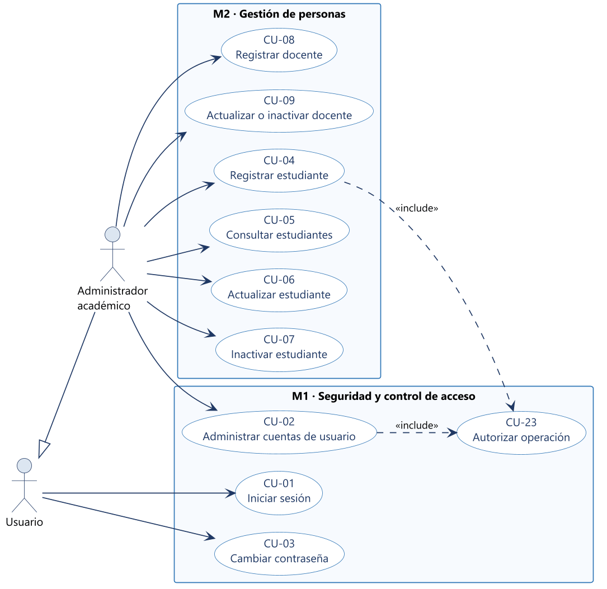

*Nota.* Elaboración propia con PlantUML. La generalización entre Usuario y Administrador evita repetir CU-01 y CU-03 en cada actor.

**Figura 2.** *Casos de uso de oferta académica y matrícula*

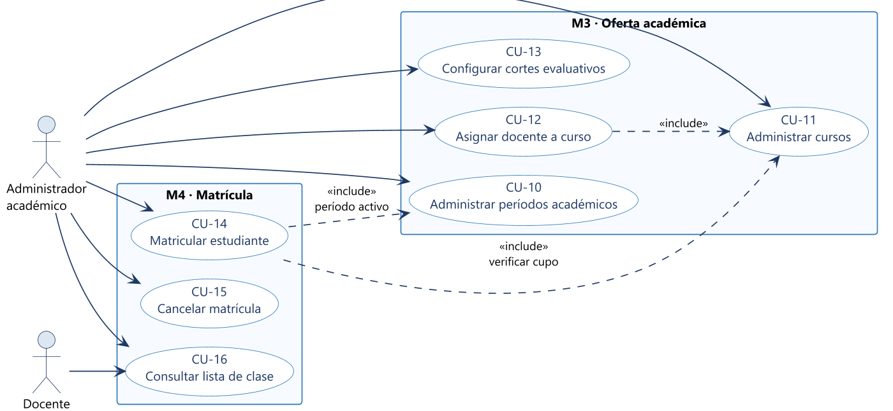

*Nota.* Elaboración propia con PlantUML. CU-14 incluye la consulta de cupo y de período activo, que son precondiciones verificadas dentro del propio caso.

**Figura 3.** *Casos de uso de calificaciones y consultas*

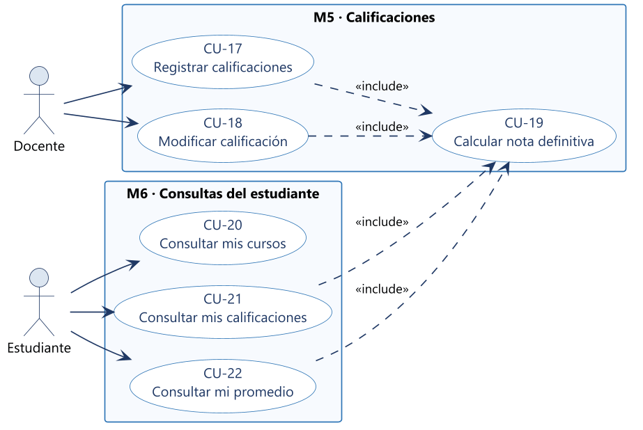

*Nota.* Elaboración propia con PlantUML. CU-19 se incluye en los cuatro casos que necesitan la nota definitiva, lo que evita cuatro implementaciones distintas del mismo cálculo.

### 2.3 Relaciones de Inclusión y Extensión

Dos relaciones de UML nos permiten no repetir descripciones. La inclusión indica que un caso de uso siempre ejecuta a otro como parte de su comportamiento: CU-14 siempre valida las reglas de matrícula. La extensión indica un comportamiento que solo ocurre bajo una condición: el aviso de riesgo académico solo aparece si el promedio baja de 3.0.

La distinción no es decorativa. Lo incluido es obligatorio y por lo tanto debe probarse siempre; lo extendido es condicional y necesita un caso de prueba que active la condición.

**Figura 4.** *Relaciones de inclusión y extensión entre casos de uso*

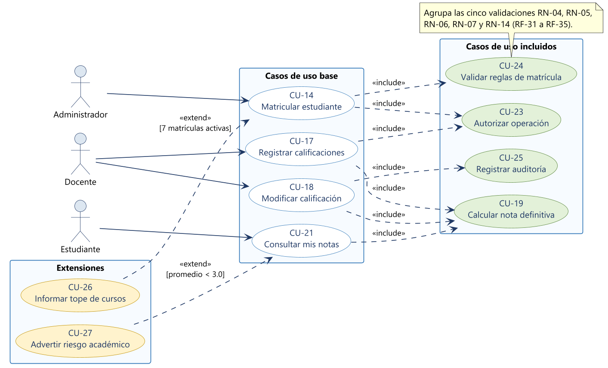

*Nota.* Elaboración propia con PlantUML. En verde los casos incluidos, obligatorios en cada ejecución; en ámbar las extensiones, que solo se activan cuando se cumple la condición entre corchetes.

### 2.4 Catálogo de Casos de Uso

La tabla siguiente relaciona cada caso de uso con su actor iniciador, su módulo y los requerimientos funcionales que agrupa. Es la primera mitad de la trazabilidad que se cierra al final del documento.

**Tabla 2.** *Catálogo de casos de uso del sistema*

| ID | Caso de uso | Actor iniciador | Requerimientos | Tipo |
|---|---|---|---|---|
| CU-01 | Iniciar sesión | Usuario | RF-01, RF-02, RF-03 | Base |
| CU-02 | Administrar cuentas de usuario | Administrador | RF-04, RF-05, RF-06 | Base |
| CU-03 | Cambiar contraseña | Usuario | RF-08 | Base |
| CU-04 | Registrar estudiante | Administrador | RF-10, RF-11 | Base |
| CU-05 | Consultar estudiantes | Administrador | RF-12, RF-13, RF-14 | Base |
| CU-06 | Actualizar estudiante | Administrador | RF-15 | Base |
| CU-07 | Inactivar estudiante | Administrador | RF-16 | Base |
| CU-08 | Registrar docente | Administrador | RF-17 | Base |
| CU-09 | Actualizar o inactivar docente | Administrador | RF-18 | Base |
| CU-10 | Administrar períodos académicos | Administrador | RF-20 a RF-23 | Base |
| CU-11 | Administrar cursos | Administrador | RF-24 a RF-27 | Base |
| CU-12 | Asignar docente a curso | Administrador | RF-28 | Base |
| CU-13 | Configurar cortes evaluativos | Administrador | RF-29 | Base |
| CU-14 | Matricular estudiante | Administrador | RF-30 | Base |
| CU-15 | Cancelar matrícula | Administrador | RF-36 | Base |
| CU-16 | Consultar lista de clase | Docente, Administrador | RF-37 | Base |
| CU-17 | Registrar calificaciones | Docente | RF-38, RF-39, RF-40 | Base |
| CU-18 | Modificar calificación | Docente, Administrador | RF-42, RF-44 | Base |
| CU-19 | Calcular nota definitiva | Motor de cálculo | RF-45, RF-46 | Incluido |
| CU-20 | Consultar mis cursos | Estudiante | RF-48 | Base |
| CU-21 | Consultar mis calificaciones | Estudiante | RF-49 | Base |
| CU-22 | Consultar mi promedio | Estudiante | RF-50 | Base |
| CU-23 | Autorizar operación | Servicio de autenticación | RF-07, RF-09 | Incluido |
| CU-24 | Validar reglas de matrícula | Sistema | RF-31 a RF-35 | Incluido |
| CU-25 | Registrar auditoría | Servicio de auditoría | RF-43 | Incluido |
| CU-26 | Informar tope de cursos alcanzado | Sistema | RF-35 | Extensión |
| CU-27 | Advertir riesgo académico | Sistema | RF-51 | Extensión |
| CU-28 | Restablecer contraseña olvidada | Usuario | RF-58, RF-59, RF-60 | Base |
| CU-29 | Consultar y actualizar mi perfil | Usuario | RF-61, RF-62 | Base |

*Nota.* Los casos marcados como incluidos no los inicia un actor humano: se ejecutan siempre dentro de otro caso de uso. Las extensiones se activan solo cuando se cumple su condición.

### 2.5 Especificación Expandida de los Casos de Uso Críticos

Cinco casos de uso concentran la complejidad del sistema y merecen una especificación detallada con su flujo principal, sus caminos alternos y sus excepciones. Los escogimos por criterios distintos: CU-01 porque es la puerta de entrada de todos los usuarios, CU-14 y CU-17 porque agrupan la mayor densidad de reglas de negocio, CU-19 porque es el cálculo del que depende la confianza en el sistema, y CU-21 porque es la consulta que descongestiona la ventanilla.

#### CU-01. Iniciar sesión

**Tabla 3.** *Especificación del caso de uso CU-01*

| Elemento | Descripción |
|---|---|
| Actor principal | Usuario (administrador, docente o estudiante) |
| Interesados | La institución, que necesita que solo las personas autorizadas accedan al registro académico. |
| Precondición | El usuario tiene una cuenta creada y en estado activo. |
| Garantía de éxito | Existe una sesión asociada al usuario y a su rol, o no se crea ninguna sesión. |
| Frecuencia de uso | Muy alta: varias veces al día por usuario. |
| Requerimientos | RF-01, RF-02, RF-03, RF-09 |
| Reglas de negocio | RN-02, RN-21, RN-22 |

Flujo principal:

1. El usuario abre la pantalla de acceso.
2. El usuario escribe su correo y su contraseña.
3. El sistema verifica que ambos campos estén diligenciados.
4. El sistema busca la cuenta por el correo recibido.
5. El sistema calcula el resumen criptográfico de la contraseña con la sal de la cuenta y lo compara con el almacenado.
6. El sistema verifica que la cuenta esté activa.
7. El sistema crea la sesión con el rol de la cuenta y registra la fecha de acceso.
8. El sistema redirige al usuario al panel correspondiente a su rol.

Flujos alternos:

- 3a. Algún campo está vacío: El sistema marca el campo faltante y no envía la solicitud. Se retorna al paso 2.
- 7a. Es el primer ingreso con la contraseña temporal: El sistema exige el cambio de contraseña antes de continuar (CU-03).

Excepciones:

- 4a. El correo no está registrado: El sistema muestra "Usuario o contraseña incorrectos", sin revelar cuál falló, registra el intento en la bitácora y termina el caso.
- 5a. La contraseña no coincide: Mismo tratamiento que 4a: mensaje genérico y registro del intento.
- 6a. La cuenta está inactiva: El sistema informa que la cuenta está inactiva y no crea la sesión.

#### CU-14. Matricular estudiante

**Tabla 4.** *Especificación del caso de uso CU-14*

| Elemento | Descripción |
|---|---|
| Actor principal | Administrador académico |
| Interesados | El estudiante, que queda en la lista de clase; el docente, que recibe el grupo definitivo; la coordinación, que necesita cupos exactos. |
| Precondición | Existe un período activo, el estudiante está registrado y activo, y el curso pertenece a ese período. |
| Garantía de éxito | La matrícula queda creada en estado activa y el cupo del curso disminuye en una unidad, o no se modifica nada. |
| Frecuencia de uso | Muy alta durante la semana de matrícula; nula el resto del período. |
| Requerimientos | RF-30 a RF-35 |
| Reglas de negocio | RN-04, RN-05, RN-06, RN-07, RN-14 |

Flujo principal:

1. El administrador selecciona al estudiante y el curso.
2. El sistema verifica que exista un período académico activo.
3. El sistema verifica que el estudiante esté en estado activo.
4. El sistema verifica que el estudiante no tenga ya una matrícula activa en ese curso y período.
5. El sistema verifica que el curso tenga cupos disponibles.
6. El sistema verifica que el estudiante no supere las siete matrículas activas del período.
7. El sistema crea la matrícula en estado activa dentro de una transacción, incrementa el contador de matriculados del curso y registra la fecha y el usuario responsable.
8. El sistema confirma "Matrícula registrada correctamente".

Flujos alternos:

- 6a. El estudiante llega a siete matrículas con esta inscripción: El sistema completa la matrícula y advierte que alcanzó el tope permitido (CU-26).

Excepciones:

- 2a. No hay período activo: El sistema informa "No hay un período académico activo" y deshabilita la operación.
- 3a. El estudiante está inactivo: El sistema rechaza la operación e informa que el estudiante no está activo.
- 4a. Ya existe una matrícula activa: El sistema informa "El estudiante ya está matriculado en este curso".
- 5a. El curso alcanzó su cupo: El sistema informa "El curso no tiene cupos disponibles" y el contador no cambia.
- 6b. El estudiante ya tiene siete matrículas: El sistema rechaza la operación indicando el tope permitido.
- 7a. Falla la escritura en la base de datos: La transacción se revierte por completo: ni la matrícula ni el contador quedan alterados.

#### CU-17. Registrar calificaciones

**Tabla 5.** *Especificación del caso de uso CU-17*

| Elemento | Descripción |
|---|---|
| Actor principal | Docente |
| Interesados | El estudiante, que espera ver su nota; la secretaría, que ya no consolida archivos a mano. |
| Precondición | El docente es titular del curso, el período está abierto y el curso tiene cortes configurados. |
| Garantía de éxito | Las notas válidas quedan almacenadas con autor y fecha, y las definitivas afectadas quedan recalculadas. |
| Frecuencia de uso | Tres veces por período y por curso, concentradas en la semana de cierre de cada corte. |
| Requerimientos | RF-38, RF-39, RF-40, RF-41 |
| Reglas de negocio | RN-08, RN-09, RN-17 |

Flujo principal:

1. El docente selecciona uno de sus cursos y el corte a calificar.
2. El sistema verifica que el docente sea el titular del curso.
3. El sistema verifica que el período esté abierto.
4. El sistema muestra la lista de clase con las notas ya registradas del corte.
5. El docente digita la nota de cada estudiante.
6. El docente guarda el formulario.
7. El sistema valida que cada nota esté entre 0.0 y 5.0 con un decimal.
8. El sistema almacena las notas junto con el docente que las registró y la marca temporal.
9. El sistema recalcula la nota definitiva de las matrículas afectadas (CU-19).
10. El sistema confirma el registro e informa cuántas notas quedaron pendientes.

Flujos alternos:

- 5a. El docente deja notas en blanco: El sistema guarda las diligenciadas, deja las demás como pendientes e informa cuántas faltan.
- 8a. Ya existía una nota para ese estudiante y corte: La operación se trata como una modificación y se aplica CU-18.

Excepciones:

- 2a. El docente no es titular del curso: El sistema deniega la operación y registra el intento en la bitácora.
- 3a. El período está cerrado: El sistema informa que el período está cerrado y no permite escribir.
- 7a. Alguna nota está fuera de rango: El sistema señala el campo y no guarda ninguna fila del lote.

#### CU-19. Calcular nota definitiva

**Tabla 6.** *Especificación del caso de uso CU-19*

| Elemento | Descripción |
|---|---|
| Actor principal | Motor de cálculo (invocado por CU-17, CU-18, CU-21 y CU-22) |
| Interesados | El estudiante y la institución, que necesitan un resultado uniforme y reproducible. |
| Precondición | La matrícula existe y el curso tiene sus cortes configurados con porcentajes que suman 100 %. |
| Garantía de éxito | Se entrega la nota definitiva con un decimal, o un valor parcial marcado como pendiente. |
| Frecuencia de uso | Se ejecuta en cada registro o corrección de nota y en cada consulta del estudiante. |
| Requerimientos | RF-45, RF-46 |
| Reglas de negocio | RN-10, RN-11, RN-12, RN-27 |

Flujo principal:

1. El sistema recupera las calificaciones registradas de la matrícula.
2. El sistema recupera los cortes del curso con su porcentaje.
3. El sistema multiplica cada nota por el porcentaje de su corte.
4. El sistema acumula los productos obtenidos.
5. El sistema redondea el resultado a un decimal.
6. El sistema compara el resultado con el umbral de 3.0 y asigna el estado de aprobación.
7. El sistema entrega la nota definitiva y su estado.

Flujos alternos:

- 1a. Faltan notas de uno o más cortes: El sistema calcula el aporte de los cortes registrados y entrega el valor marcado como parcial, sin asignar estado de aprobación.

Excepciones:

- 2a. Los porcentajes de los cortes no suman 100 %: El sistema no calcula y reporta una inconsistencia de configuración del curso, que debe corregirse con CU-13.

#### CU-21. Consultar mis calificaciones

**Tabla 7.** *Especificación del caso de uso CU-21*

| Elemento | Descripción |
|---|---|
| Actor principal | Estudiante |
| Interesados | El acudiente, que consulta a través del estudiante mientras no exista su propio portal. |
| Precondición | El estudiante tiene sesión activa y al menos una matrícula en el período. |
| Garantía de éxito | El estudiante ve únicamente su propia información, sin posibilidad de modificarla. |
| Frecuencia de uso | Alta al cierre de cada corte. |
| Requerimientos | RF-49 |
| Reglas de negocio | RN-12, RN-23 |

Flujo principal:

1. El estudiante abre la opción "Mis notas".
2. El sistema toma el identificador del estudiante de la sesión, no de la petición.
3. El sistema recupera sus matrículas activas del período vigente.
4. El sistema recupera las calificaciones de cada matrícula.
5. El sistema calcula la nota definitiva de cada una (CU-19).
6. El sistema presenta por cada curso las notas de los cortes, la definitiva y el estado de aprobación, en modo de solo lectura.

Flujos alternos:

- 4a. Un corte no tiene nota registrada: El sistema lo presenta como "Pendiente" y no como 0.0.
- 6a. El promedio general es inferior a 3.0: El sistema añade un aviso de riesgo académico (CU-27).

Excepciones:

- 3a. El estudiante no tiene matrículas en el período: El sistema informa que no tiene cursos matriculados en el período actual.
- 2a. Se intenta consultar el identificador de otro estudiante: El sistema ignora el dato recibido y responde con la información del estudiante autenticado.

#### CU-28. Restablecer contraseña olvidada

**Tabla 7b.** *Especificación del caso de uso CU-28*

| Elemento | Descripción |
|---|---|
| Actor principal | Usuario (administrador, docente o estudiante) |
| Interesados | La secretaría académica, que deja de ser el único camino para recuperar el acceso. |
| Precondición | Ninguna: la solicitud se hace desde la pantalla pública de acceso. |
| Garantía de éxito | La contraseña queda cambiada y el enlace usado deja de servir, o no cambia nada. |
| Frecuencia de uso | Baja y dispersa, con picos al inicio de cada período. |
| Requerimientos | RF-58, RF-59, RF-60 |
| Reglas de negocio | RN-21, RN-28, RN-29, RN-30, RN-31 |

Flujo principal:

1. El usuario pulsa «Olvidé mi contraseña» en la pantalla de acceso.
2. El usuario escribe su correo institucional.
3. El sistema verifica que no se hayan hecho más de tres solicitudes de esa cuenta en la última hora.
4. El sistema busca una cuenta activa con ese correo.
5. El sistema genera un identificador aleatorio, almacena su resumen criptográfico con fecha de vencimiento a treinta minutos y envía el enlace al correo.
6. El sistema muestra el mensaje neutro: si la cuenta existe, llegará un enlace.
7. El usuario abre el enlace recibido.
8. El sistema compara el resumen del identificador recibido con el almacenado y comprueba que no esté vencido ni usado.
9. El usuario escribe la contraseña nueva dos veces.
10. El sistema valida la longitud mínima y la coincidencia, guarda el resumen con una sal nueva, marca el enlace como usado, invalida los demás enlaces de la cuenta y cierra sus sesiones abiertas.
11. El sistema confirma el cambio y lleva a la pantalla de acceso.

Flujos alternos:

- 4a. El correo no corresponde a ninguna cuenta, o la cuenta está inactiva: El sistema muestra el mismo mensaje del paso 6 y no envía nada. Revelar la diferencia confirmaría qué correos están registrados (RN-29).

Excepciones:

- 3a. Se superó el límite de tres solicitudes por hora: El sistema lo informa e indica a partir de cuándo se puede reintentar.
- 8a. El enlace está vencido o ya se usó: El sistema informa que no es válido y ofrece solicitar uno nuevo.
- 10a. Las dos contraseñas no coinciden o son más cortas de ocho caracteres: El sistema marca el campo y no cambia nada.

---

## 3. Vista Estructural

### 3.1 Panorama del Modelo de Clases

El modelo tiene doce clases y seis enumeraciones. Presentamos primero la vista sin atributos ni operaciones, que permite entender la estructura de un vistazo, y luego dos vistas detalladas: una de personas y seguridad, otra del núcleo académico. Las tres muestran el mismo modelo con distinto nivel de detalle.

**Figura 5.** *Vista general del modelo de clases*

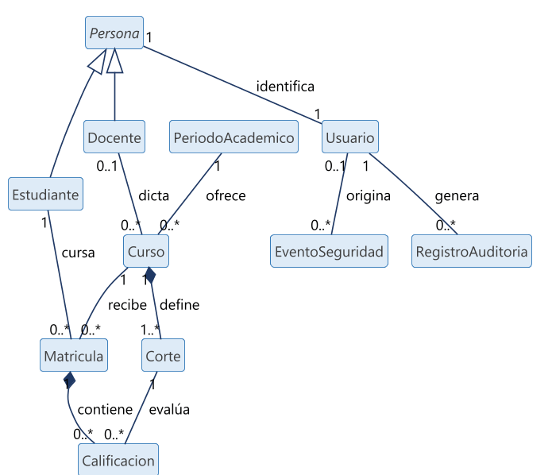

*Nota.* Elaboración propia con PlantUML. Se omiten atributos y operaciones para dejar visible la estructura de relaciones.

### 3.2 Clases de Personas y Seguridad

Persona es abstracta: nunca se instancia por sí sola. Concentra los datos de identificación y contacto que Estudiante y Docente comparten, junto con la regla RN-01 que exige documento único. La cuenta de acceso se modela aparte, en Usuario, porque sus datos son sensibles y su ciclo de vida es distinto: una persona puede existir en el sistema antes de que su cuenta se active.

**Figura 6.** *Clases de personas, cuentas y auditoría*

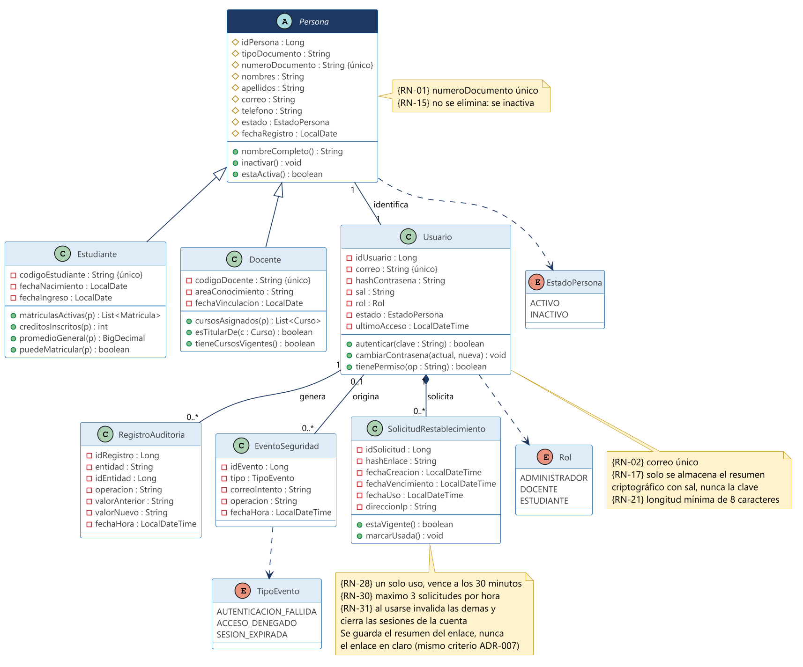

*Nota.* Elaboración propia con PlantUML. Las notas en ámbar recogen las reglas de negocio que restringen cada clase.

### 3.3 Clases del Núcleo Académico

Aquí está el corazón del sistema. Curso custodia el cupo, que es el recurso escaso; Matrícula convierte a un estudiante en parte de una lista de clase; y Calificación guarda cada nota con el autor que la registró. Las composiciones —el rombo relleno— indican que Corte no existe sin su Curso y que las Calificaciones no sobreviven a su Matrícula.

**Figura 7.** *Clases del núcleo académico*

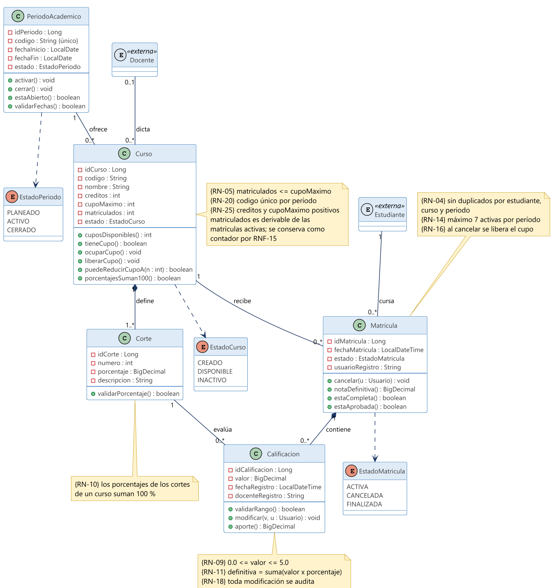

*Nota.* Elaboración propia con PlantUML. Estudiante y Docente aparecen marcados como externos porque su detalle está en la figura anterior.

### 3.4 Responsabilidad de Cada Clase

**Tabla 8.** *Clases del modelo de dominio y su responsabilidad*

| Clase | Responsabilidad | Operaciones principales | Reglas |
|---|---|---|---|
| Persona | Concentra los datos de identificación y contacto comunes a estudiantes y docentes, y el estado que permite inactivar sin borrar. | nombreCompleto(), inactivar(), estaActiva() | RN-01, RN-15 |
| Estudiante | Especializa a Persona con los datos propios de quien cursa asignaturas y con las consultas de su carga académica. | matriculasActivas(), promedioGeneral(), puedeMatricular() | RN-06, RN-14 |
| Docente | Especializa a Persona con el área de conocimiento y la relación con los cursos que dicta. | cursosAsignados(), esTitularDe(), tieneCursosVigentes() | RN-08, RN-24 |
| Usuario | Representa la cuenta de acceso. Se separa de Persona porque su ciclo de vida y sus datos sensibles son distintos. | autenticar(), cambiarContrasena(), tienePermiso() | RN-02, RN-21, RN-22, RN-23 |
| PeriodoAcademico | Delimita temporalmente la operación académica y controla qué se puede escribir y qué queda en solo lectura. | activar(), cerrar(), estaAbierto(), validarFechas() | RN-03, RN-17, RN-19 |
| Curso | Unidad académica ofrecida en un período. Custodia el cupo, que es el recurso escaso del sistema. | tieneCupo(), ocuparCupo(), liberarCupo(), puedeReducirCupoA() | RN-05, RN-20, RN-25, RN-26 |
| Corte | Momento de evaluación con su peso porcentual. No existe fuera de su curso, por lo que se modela como composición. | validarPorcentaje() | RN-10 |
| Matricula | Vincula estudiante y curso en un período. Es la entidad que convierte datos sueltos en una lista de clase. | cancelar(), notaDefinitiva(), estaAprobada() | RN-04, RN-07, RN-14, RN-16 |
| Calificacion | Nota de un estudiante en un corte. Pertenece a la matrícula y desaparece con ella. | validarRango(), modificar(), aporte() | RN-09, RN-11, RN-18 |
| RegistroAuditoria | Conserva el rastro de toda modificación de una calificación: valor anterior, nuevo, autor y fecha. | — | RN-18 |
| EventoSeguridad | Registra los intentos fallidos de autenticación y los accesos denegados. | — | RN-23 |
| SolicitudRestablecimiento | Representa un enlace de restablecimiento de contraseña: guarda su resumen criptográfico, su vencimiento y si ya se usó. | estaVigente(), marcarUsada() | RN-28, RN-30, RN-31 |

*Nota.* Las reglas de la última columna son las que la clase hace cumplir por sí misma, sin depender de la capa de servicios.

### 3.5 Relaciones y Multiplicidades

Las multiplicidades no son un adorno de la notación: cada una es una decisión con consecuencias directas en la base de datos de la Fase 4. Que la relación entre Docente y Curso sea 0..1 y no 1, por ejemplo, significa que la columna correspondiente admitirá nulos, porque un curso recién creado todavía no tiene docente asignado.

**Tabla 9.** *Relaciones del modelo de clases*

| Relación | Tipo | Multiplicidad | Por qué es así |
|---|---|---|---|
| Persona — Estudiante / Docente | Generalización | — | Estudiante y Docente comparten identificación y contacto, pero difieren en comportamiento. |
| Persona — Usuario | Asociación | 1 a 1 | Toda persona tiene exactamente una cuenta; toda cuenta pertenece a una persona. |
| PeriodoAcademico — Curso | Asociación | 1 a 0..* | Un curso pertenece a un solo período; el período ofrece muchos cursos. |
| Docente — Curso | Asociación | 0..1 a 0..* | Un curso recién creado aún no tiene docente; por eso el extremo es 0..1 y no 1. |
| Curso — Corte | Composición | 1 a 1..* | Los cortes no existen sin el curso y se eliminan con él. |
| Estudiante — Matricula | Asociación | 1 a 0..* | Un estudiante puede tener varias matrículas; cada matrícula es de un solo estudiante. |
| Curso — Matricula | Asociación | 1 a 0..* | La lista de clase del curso son sus matrículas activas. |
| Matricula — Calificacion | Composición | 1 a 0..* | Las calificaciones pertenecen a la matrícula y no sobreviven a su eliminación. |
| Corte — Calificacion | Asociación | 1 a 0..* | Cada calificación corresponde a un corte, que aporta su porcentaje al cálculo. |
| Usuario — RegistroAuditoria | Asociación | 1 a 0..* | Cada registro de auditoría identifica al usuario que hizo el cambio. |
| Usuario — SolicitudRestablecimiento | Composición | 1 a 0..* | Las solicitudes pertenecen a la cuenta y no sobreviven a su eliminación. |

### 3.6 Clases de Diseño y Arquitectura en Capas

Las clases anteriores modelan el dominio: existirían aunque el sistema se construyera de otra manera. Las de esta sección son de diseño y materializan la decisión ADR-005: separar presentación, lógica de negocio y acceso a datos. La regla que hace verificable esa separación es simple y la aplicamos en cada revisión de código: si aparece una sentencia SQL en la capa de presentación, el pull request no se aprueba.

**Figura 8.** *Clases de diseño organizadas en capas*

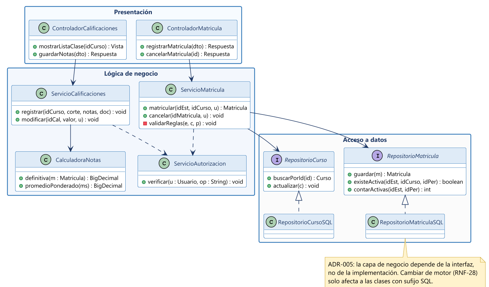

*Nota.* Elaboración propia con PlantUML. La capa de negocio depende de las interfaces de repositorio, no de sus implementaciones, lo que permite cambiar de motor de datos según RNF-28.

### 3.7 Diagrama de Objetos

Un diagrama de clases describe lo que puede existir; uno de objetos muestra una situación concreta en un instante. Modelamos aquí el escenario de humo que definimos en la Fase 1: Valentina matriculada en Matemáticas I, con notas de 4.0, 3.0 y 5.0 en cortes de 30 %, 30 % y 40 %.

**Figura 9.** *Instantánea del modelo con una matrícula y sus calificaciones*

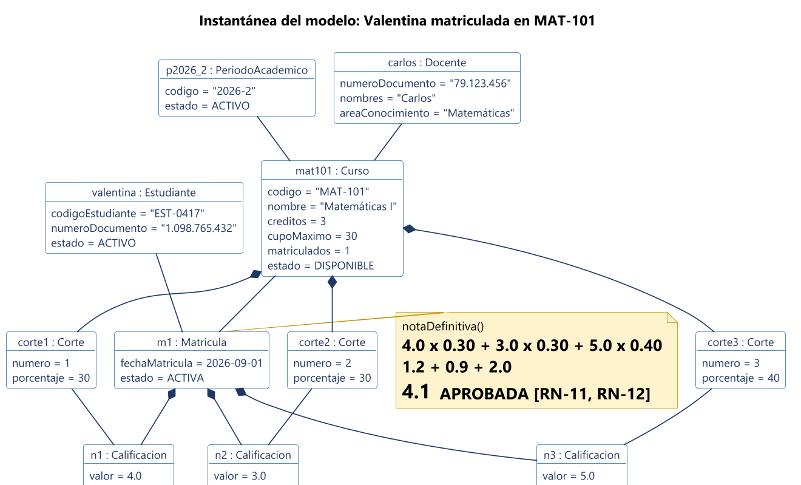

*Nota.* Elaboración propia con PlantUML. El cálculo de la nota definitiva ilustra la regla RN-11 con los mismos valores usados en el criterio de aceptación CA-1 de HU-21.

---

## 4. Vista Dinámica

Los diagramas anteriores muestran una fotografía del sistema. Los de esta sección muestran la película: en qué orden ocurren las cosas, quién le pide qué a quién y cómo cambia el estado de la información con el tiempo.

### 4.1 Diagramas de Secuencia

Cada diagrama de secuencia toma un caso de uso y muestra los mensajes entre los objetos que lo realizan. Los participantes corresponden a las clases de diseño de la Figura 8. Por legibilidad representamos la capa de datos con un único participante llamado Repositorios, en lugar de dibujar cada repositorio por separado.

#### Inicio de sesión

Muestra por qué el mensaje de error es genérico: tanto si el correo no existe como si la contraseña no coincide, el sistema responde lo mismo y registra el intento. Revelar cuál de los dos falló le confirmaría a un atacante qué correos están registrados.

**Figura 10.** *Diagrama de secuencia del caso de uso CU-01*

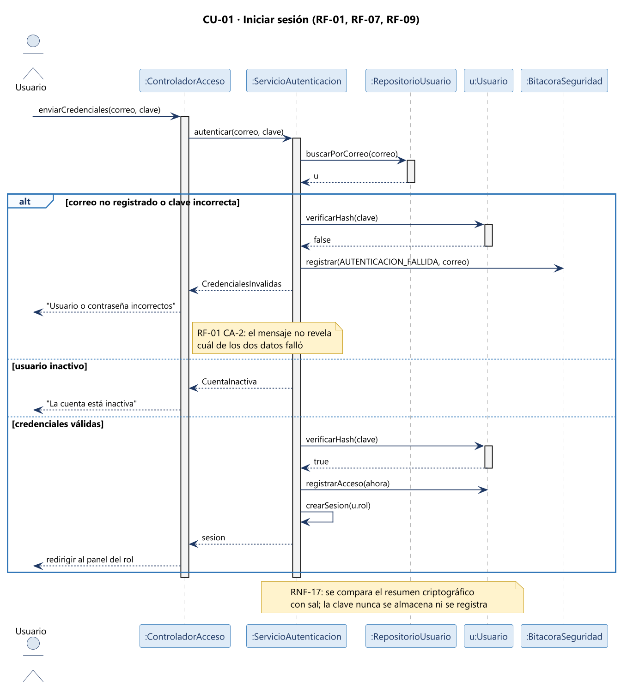

*Nota.* Elaboración propia con PlantUML. El fragmento alt recoge las tres salidas posibles del caso de uso.

#### Matrícula de un estudiante

Es el diagrama más denso del modelo, y con razón: cinco reglas de negocio deben cumplirse antes de escribir nada. El fragmento alt muestra las seis salidas posibles y el bloque de transacción agrupa las tres escrituras que deben ocurrir juntas o no ocurrir, según RNF-15.

**Figura 11.** *Diagrama de secuencia del caso de uso CU-14*

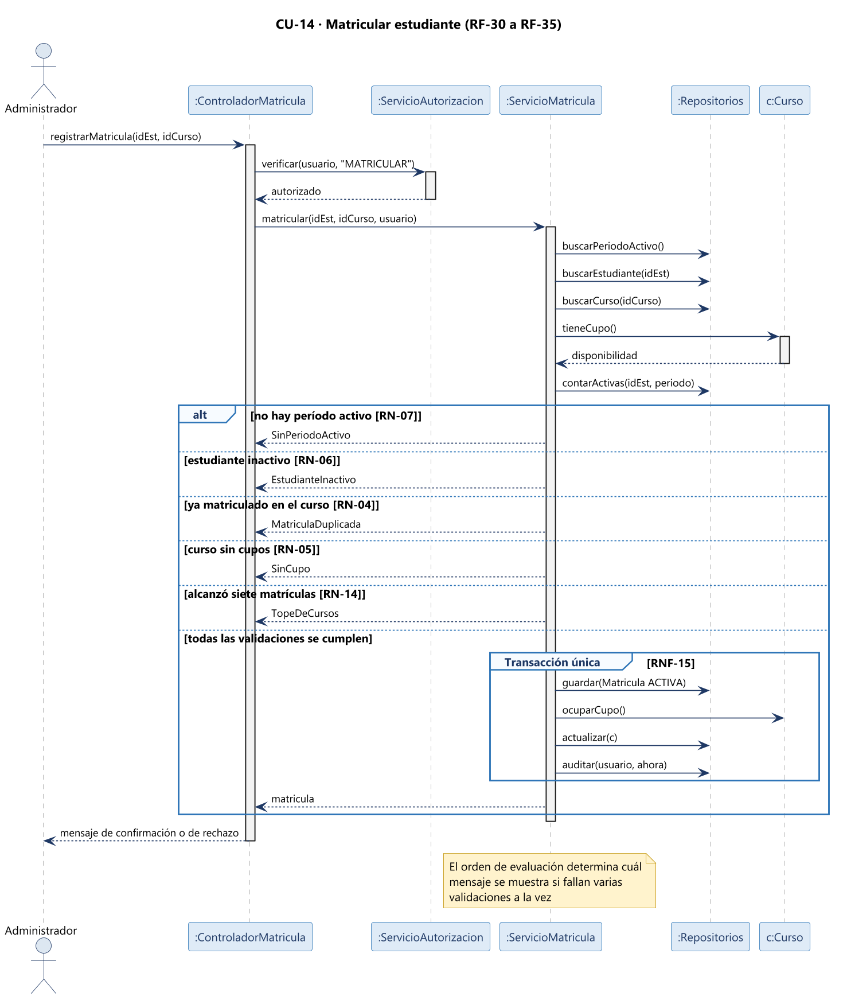

*Nota.* Elaboración propia con PlantUML. El orden de evaluación de las validaciones determina cuál mensaje se le presenta al administrador cuando falla más de una.

#### Registro de calificaciones

Combina CU-17 con CU-19, porque el cálculo de la definitiva se dispara automáticamente al guardar. El bucle sobre las matrículas afectadas explica por qué el requerimiento no funcional RNF-04 fija un tiempo de respuesta para el guardado de un grupo completo.

**Figura 12.** *Diagrama de secuencia de los casos de uso CU-17 y CU-19*

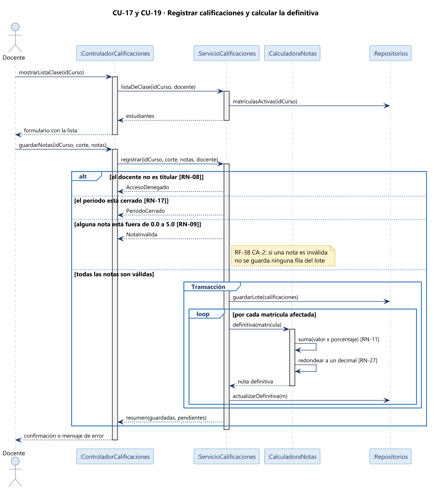

*Nota.* Elaboración propia con PlantUML. Si una sola nota del lote es inválida no se guarda ninguna, conforme al criterio CA-2 de HU-18.

#### Consulta de calificaciones por el estudiante

El detalle importante está en el segundo mensaje: el identificador del estudiante se toma de la sesión y nunca de la petición. Esa decisión es la que hace cumplir RN-23 e impide que alguien consulte las notas de otro cambiando un parámetro.

**Figura 13.** *Diagrama de secuencia de los casos de uso CU-21 y CU-22*

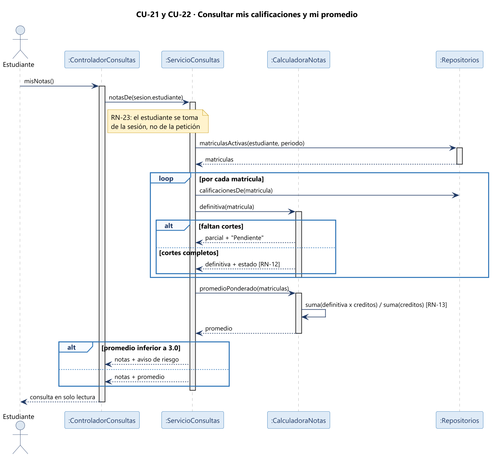

*Nota.* Elaboración propia con PlantUML. Los cortes sin nota se devuelven marcados como pendientes y no como cero.

### 4.2 Diagramas de Actividades

#### Proceso académico de un período

Esta es la vista de conjunto del sistema: desde que el administrador abre el período hasta que lo cierra, pasando por el docente que califica, el sistema que calcula y el estudiante que consulta. Las calles verticales muestran de quién es la responsabilidad en cada paso, algo que ninguna otra vista deja tan claro.

**Figura 14.** *Diagrama de actividades del proceso académico completo*

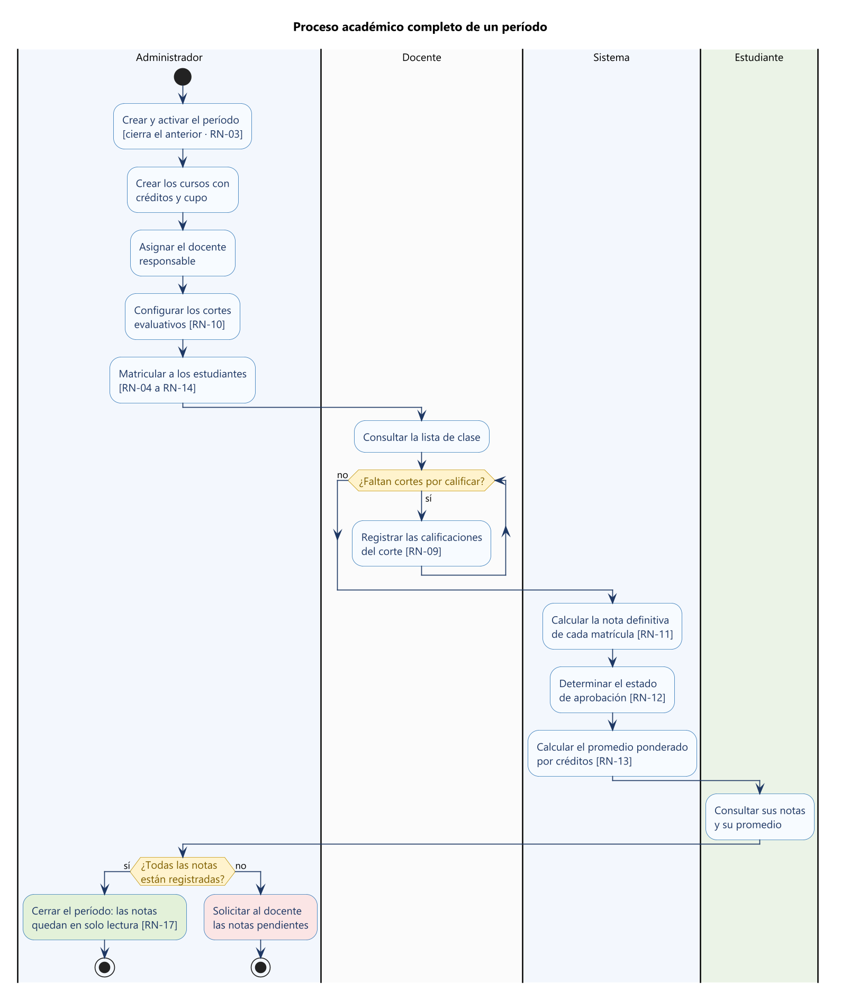

*Nota.* Elaboración propia con PlantUML. El período solo se cierra si todas las notas están registradas; de lo contrario el flujo regresa al docente.

#### Registro de calificaciones

Detalla el subproceso más frecuente del docente, con sus dos puntos de rechazo: no ser titular del curso y tener el período cerrado. Muestra también el guardado parcial, que permite al docente registrar notas en varias sesiones sin perder lo ya digitado.

**Figura 15.** *Diagrama de actividades del registro de calificaciones*

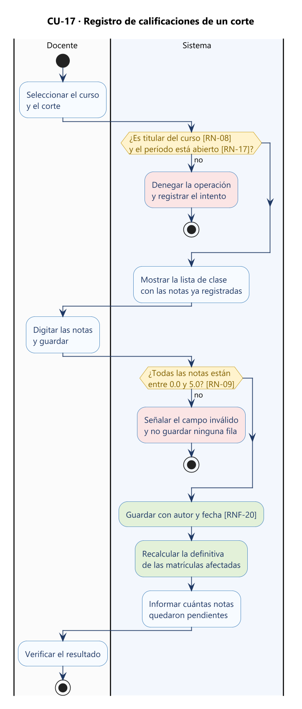

*Nota.* Elaboración propia con PlantUML. En rojo las salidas de rechazo, en verde las acciones que modifican datos.

### 4.3 Diagramas de Estados

Dos entidades del sistema tienen un ciclo de vida con reglas asociadas a cada transición, y por eso las modelamos como máquinas de estados. En ambos casos las acciones de entrada y salida documentan efectos que de otro modo quedarían escondidos en el código.

#### Ciclo de vida de la matrícula

Las acciones de entrada dicen algo que el diagrama de clases no puede expresar: al entrar en Cancelada se libera el cupo del curso, y al entrar en Finalizada se calcula la definitiva y se determina la aprobación. Esos efectos son obligatorios, no opcionales.

**Figura 16.** *Diagrama de estados de la Matrícula*

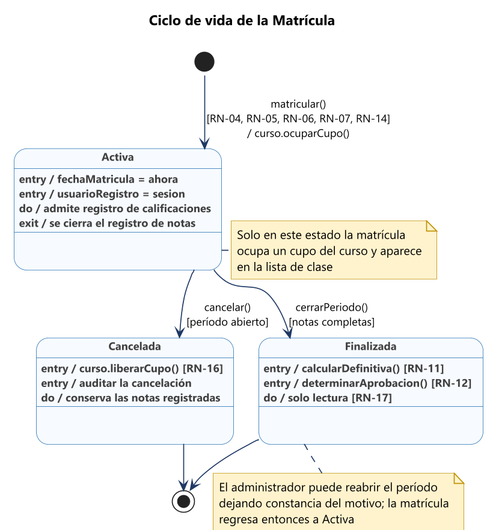

*Nota.* Elaboración propia con PlantUML. Solo en el estado Activa la matrícula ocupa un cupo y aparece en la lista de clase.

#### Ciclo de vida de la calificación

Incluimos el estado Pendiente porque una nota que no se ha registrado no es lo mismo que una nota de 0.0, y confundirlas sería el peor error que este sistema podría cometer. La transición de Pendiente a Bloqueada, cuando el período se cierra sin nota, es la señal de un cierre prematuro.

**Figura 17.** *Diagrama de estados de la Calificación*

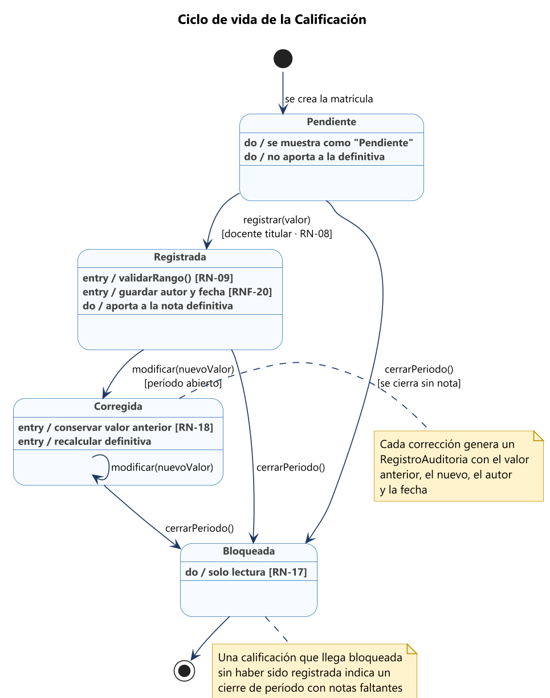

*Nota.* Elaboración propia con PlantUML. Cada paso por el estado Corregida genera un registro de auditoría, conforme a RN-18.

---

## 5. Vista de Implementación

### 5.1 Componentes

El diagrama de componentes muestra las piezas ejecutables del sistema y las interfaces por las que se comunican. Dos hechos saltan a la vista: el módulo de seguridad es transversal —todos dependen de su interfaz de autorización— y la capa de acceso a datos es el único componente que conoce el motor de base de datos concreto.

**Figura 18.** *Vista de componentes del sistema*

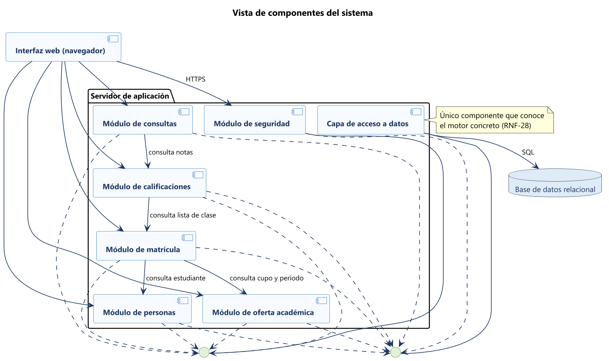

*Nota.* Elaboración propia con PlantUML. Las dependencias entre módulos reflejan las que ya aparecían en el modelo funcional de la Fase 2.

### 5.2 Paquetes

La organización del código en paquetes materializa la arquitectura en capas. La dependencia clave es la que no existe: el paquete de dominio no depende de ningún otro. Las clases del negocio no saben si los datos vienen de una base relacional o de una prueba en memoria, que es exactamente lo que permite cumplir RNF-26 y probar las reglas sin levantar la aplicación.

**Figura 19.** *Organización del código en paquetes*

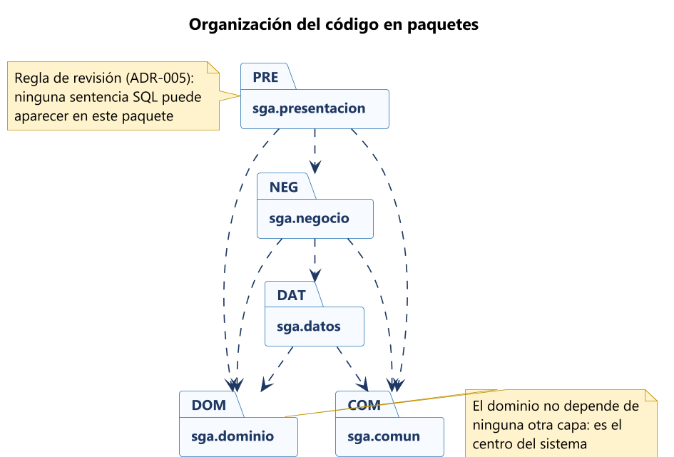

*Nota.* Elaboración propia con PlantUML. Las flechas indican dependencia de compilación y todas apuntan hacia el dominio.

**Tabla 10.** *Contenido de cada paquete*

| Paquete | Contenido | Depende de |
|---|---|---|
| sga.presentacion | Controladores y vistas; traduce peticiones del navegador a llamadas de negocio | sga.negocio, sga.dominio, sga.comun |
| sga.negocio | Servicios y reglas de negocio; es donde viven las 33 reglas RN | sga.dominio, sga.datos, sga.comun |
| sga.dominio | Clases del modelo y enumeraciones; no depende de ninguna otra capa | — |
| sga.datos | Interfaces de repositorio y su implementación para el motor concreto | sga.dominio, sga.comun |
| sga.comun | Utilidades compartidas: validaciones de formato, manejo de fechas y excepciones | — |

### 5.3 Despliegue

El sistema se instala en tres tipos de nodo: los equipos donde se usa, el servidor de aplicación y el servidor de base de datos. La separación de los dos servidores no es obligatoria en una institución de este tamaño, pero la modelamos así porque permite respaldar y restaurar la base sin detener la aplicación, que es lo que exige RNF-16.

**Figura 20.** *Vista de despliegue del sistema*

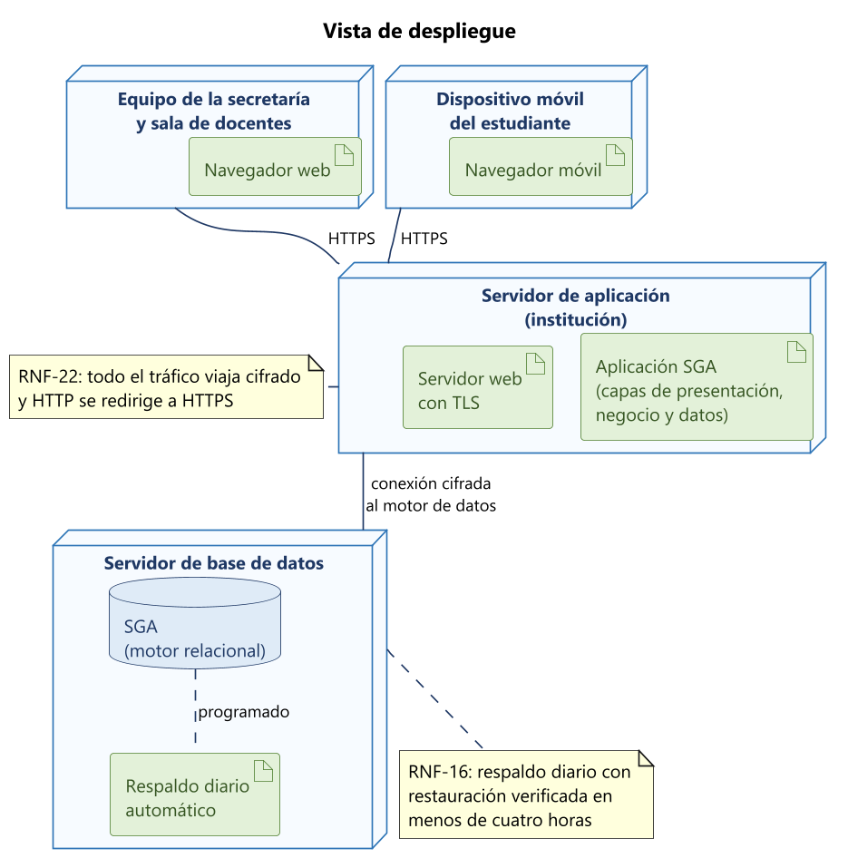

*Nota.* Elaboración propia con PlantUML. Todo el tráfico entre los navegadores y el servidor viaja cifrado, conforme a RNF-22.

---

## 6. Trazabilidad y Verificación del Modelo

### 6.1 De los Requerimientos a los Diagramas

La trazabilidad de esta fase responde una pregunta concreta: ¿quedó algún requerimiento sin modelar? La tabla siguiente recorre los seis módulos y señala en qué diagramas aparece cada uno.

**Tabla 11.** *Trazabilidad de módulos, casos de uso y diagramas*

| Módulo | Casos de uso | Clases implicadas | Figuras |
|---|---|---|---|
| M1 Seguridad | CU-01, CU-02, CU-03, CU-23, CU-28, CU-29 | Usuario, Persona, EventoSeguridad, SolicitudRestablecimiento | 1, 6, 10 |
| M2 Personas | CU-04 a CU-09 | Persona, Estudiante, Docente | 1, 5, 6 |
| M3 Oferta académica | CU-10 a CU-13 | PeriodoAcademico, Curso, Corte | 2, 7, 14 |
| M4 Matrícula | CU-14, CU-15, CU-16, CU-24, CU-26 | Matricula, Curso, Estudiante | 2, 4, 7, 9, 11, 16 |
| M5 Calificaciones | CU-17, CU-18, CU-19, CU-25 | Calificacion, Corte, RegistroAuditoria | 3, 4, 7, 12, 15, 17 |
| M6 Consultas | CU-20, CU-21, CU-22, CU-27 | Matricula, Calificacion | 3, 4, 13 |

### 6.2 Verificación de Consistencia

Antes de dar la fase por terminada revisamos seis condiciones que el modelo debe cumplir. No son una formalidad: cada una detecta un tipo de error distinto y las revisamos una por una sobre los diagramas.

**Tabla 12.** *Verificación de consistencia del modelo*

| Condición verificada | Resultado | Detalle |
|---|---|---|
| Todo requerimiento funcional del MVP pertenece a un caso de uso | Cumple | 52 de 52 |
| Todo caso de uso tiene un actor que lo inicia o es incluido por otro | Cumple | 28 de 28 |
| Toda regla de negocio aparece como restricción en una clase o en un diagrama dinámico | Cumple | 31 de 31 |
| Toda clase del dominio participa en al menos una relación | Cumple | 12 de 12 |
| Todo estado de las enumeraciones aparece en un diagrama de estados o de actividades | Cumple | 11 de 11 |
| Los diagramas de secuencia solo usan clases declaradas en la vista de diseño | Cumple | 4 de 4 |

*Nota.* Las condiciones se verificaron manualmente sobre los veinte diagramas. En la Fase 6 esta verificación se automatizará parcialmente mediante las pruebas de las reglas de negocio.

## 7. Decisiones de Modelado

Modelar es decidir, y varias decisiones de esta fase admitían otra respuesta razonable. Las dejamos escritas con su motivo y su costo, porque en la Fase 4 volveremos sobre ellas al diseñar las tablas.

**Tabla 13.** *Decisiones de modelado y sus consecuencias*

| Decisión | Por qué | Qué nos cuesta |
|---|---|---|
| Persona como clase abstracta | Estudiante y Docente comparten nueve atributos de identificación y contacto. Repetirlos en ambas clases duplicaría también la regla RN-01 de unicidad del documento. | Se pierde algo de simplicidad en el mapeo a tablas, que se resolverá en la Fase 4 al escoger la estrategia de herencia. |
| Usuario separado de Persona | Los datos de la cuenta —resumen de la contraseña, sal, rol— tienen exigencias de seguridad distintas de los datos personales y cambian por motivos diferentes. | Obliga a mantener sincronizados el estado de la persona y el de su cuenta al inactivar. |
| Matrícula como clase y no como clase asociativa | Aunque nace de la relación entre Estudiante y Curso, tiene identidad propia, ciclo de vida con tres estados y calificaciones que dependen de ella. | El modelo tiene una clase más, pero la Fase 4 obtiene una tabla natural con clave propia. |
| Contador matriculados en Curso | El número de matriculados es derivable contando matrículas activas, pero la validación de cupo (RN-05) se ejecuta en cada intento de matrícula y debe ser inmediata y transaccional. | Introduce un dato redundante que hay que mantener consistente; por eso se actualiza dentro de la misma transacción de la matrícula (RNF-15). |
| Calificación separada de Matrícula | Una matrícula tiene tantas calificaciones como cortes tenga el curso, y ese número es configurable por curso. | Impide guardar las notas como tres columnas fijas, lo que habría limitado el sistema a un único esquema de evaluación. |
| CU-23 Autorizar operación como caso incluido | La verificación de rol ocurre en las veinte operaciones sensibles. Modelarla en cada caso de uso repetiría la misma descripción veinte veces. | El diagrama general omite las flechas de inclusión para no volverse ilegible; la relación se documenta en el catálogo. |

## 8. Conclusiones

Los 52 requerimientos del producto mínimo viable quedaron representados en 28 casos de uso, 12 clases de dominio, 6 enumeraciones y 20 diagramas. La agrupación no fue mecánica: RF-31 a RF-35, que en la Fase 2 son cinco requerimientos independientes, forman aquí un solo caso incluido, CU-24, porque desde la perspectiva del usuario son una sola cosa: que el sistema no lo deje matricular mal.

El modelado obligó a precisar cosas que la especificación dejaba abiertas. La más importante fue distinguir entre una calificación pendiente y una calificación de 0.0, que llevó a incluir el estado Pendiente en el ciclo de vida de la Calificación. Un sistema que confundiera ambas cosas reprobaría estudiantes por notas que el docente aún no ha subido, y ese error no lo habríamos detectado hasta tener el sistema andando.

La segunda precisión fue la multiplicidad entre Docente y Curso. Escribirla como 0..1 en lugar de 1 reconoce que existe un momento —entre crear el curso y asignarle docente— en que el curso no tiene responsable. Es un detalle menor en el diagrama y una decisión con consecuencias directas en la Fase 4, donde esa columna admitirá nulos.

Queda una decisión consciente que conviene señalar: mantener el contador de matriculados en Curso introduce un dato redundante, porque ese número se puede obtener contando matrículas activas. Lo aceptamos porque la validación de cupo se ejecuta en cada intento de matrícula y debe ser inmediata y transaccional. Es el tipo de compromiso que un modelo debe hacer explícito en vez de esconder.

---

## 9. Referencias

- Booch, G., Rumbaugh, J., & Jacobson, I. (2005). The unified modeling language user guide (2nd ed.). Addison-Wesley.
- Cockburn, A. (2001). Writing effective use cases. Addison-Wesley.
- Cohn, M. (2004). User stories applied: For agile software development. Addison-Wesley.
- Fowler, M. (2003). UML distilled: A brief guide to the standard object modeling language (3rd ed.). Addison-Wesley.
- International Organization for Standardization. (2011). ISO/IEC 25010:2011. Systems and software engineering — Systems and software Quality Requirements and Evaluation (SQuaRE) — System and software quality models.
- Larman, C. (2004). Applying UML and patterns: An introduction to object-oriented analysis and design and iterative development (3rd ed.). Prentice Hall.
- Object Management Group. (2017). OMG Unified Modeling Language (OMG UML), version 2.5.1. https://www.omg.org/spec/UML/2.5.1/
- Pressman, R. S., & Maxim, B. R. (2021). Ingeniería del software: Un enfoque práctico (9.ª ed.). McGraw-Hill.
- Sommerville, I. (2011). Ingeniería de software (9.ª ed.). Pearson Educación.
- Wiegers, K., & Beatty, J. (2013). Software requirements (3.ª ed.). Microsoft Press.

---

**Resumen del entregable:** 28 casos de uso · 12 clases de dominio · 6 enumeraciones · 20 diagramas UML · 13 tablas · verificación de consistencia en 6 condiciones.
