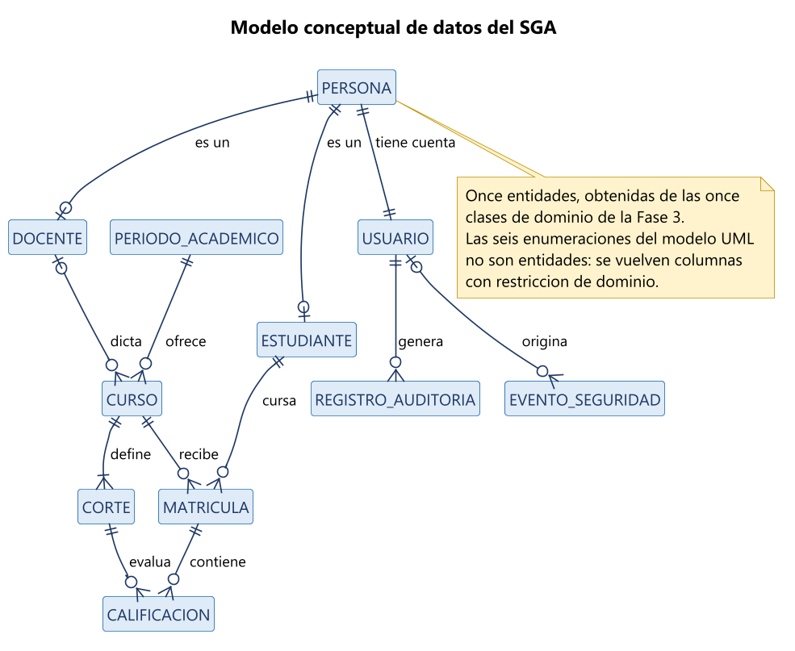
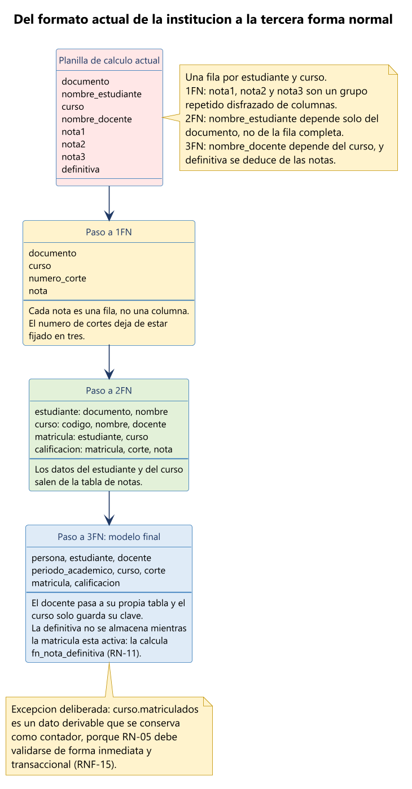
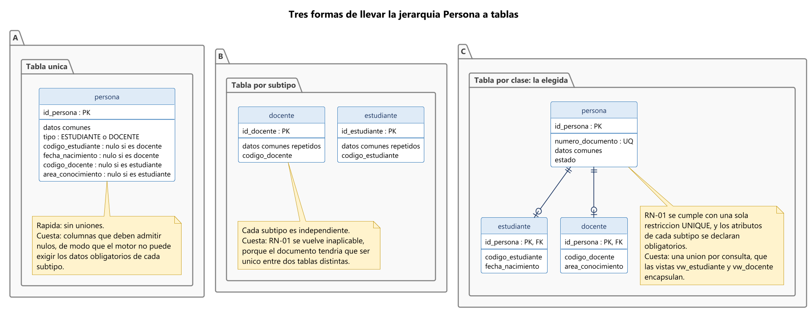
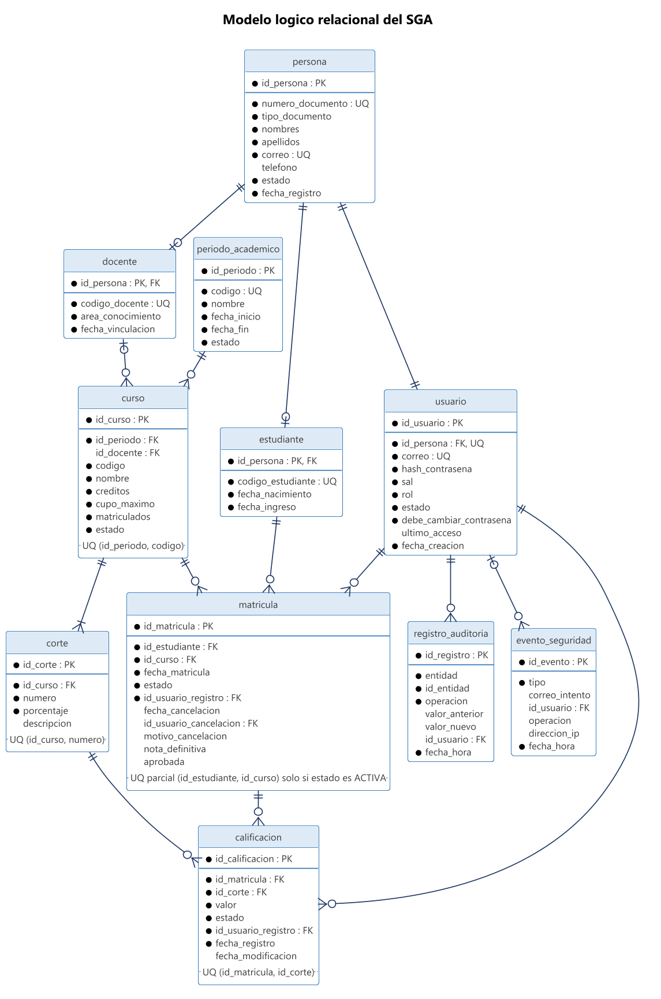
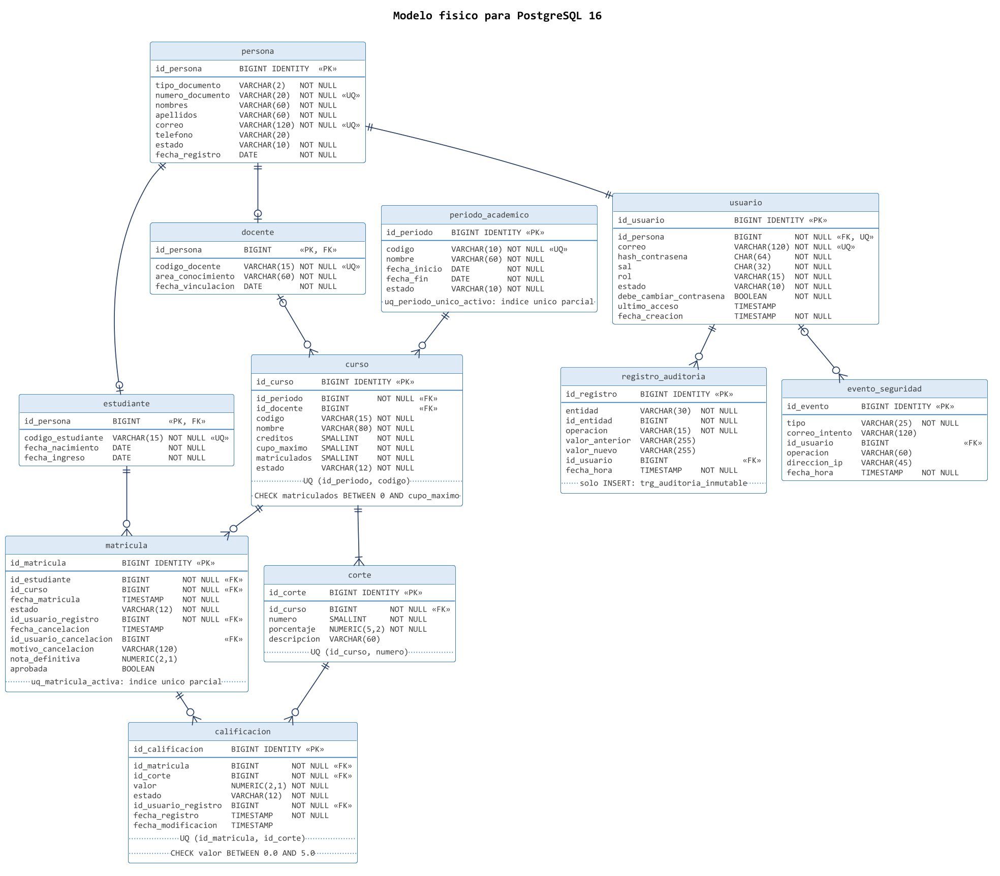
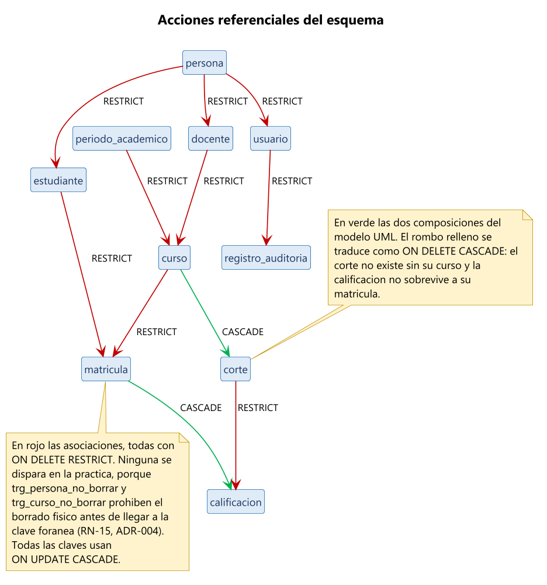
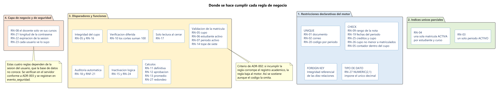
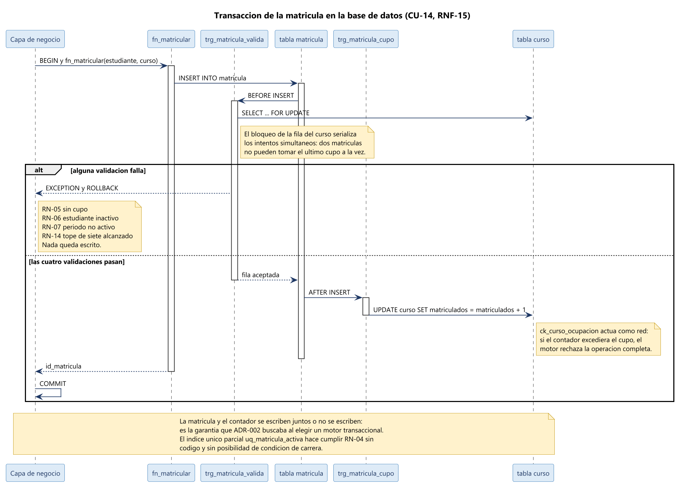
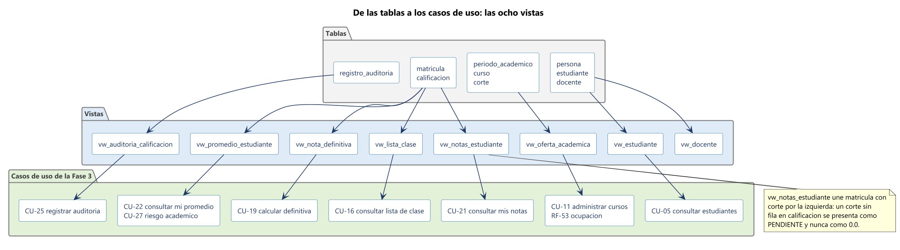

# Fase 4 — Diseño de la Base de Datos
## Sistema de Gestión Académica (SGA)

| Campo | Detalle |
|---|---|
| **Proyecto** | Sistema de Gestión Académica (SGA) |
| **Grupo** | 6 |
| **Integrante** | Jannier Johan Otavo |
| **Fase** | 4 de 6 — Base de datos |
| **Entregable** | Modelo conceptual, lógico y físico, normalización, script SQL, datos de prueba y verificación |
| **Versión** | 1.0 |
| **Fecha** | 7 de octubre de 2026 |
| **Fase anterior** | [Fase 3 — Modelado UML](../fase3-modelado-uml/fase3-modelado-uml.md) |
| **Estado** | Listo para revisión / entrada a Fase 5 (Mockup) |

---

## Índice

1. [Introducción](#1-introduccion)
2. [Modelo Conceptual](#2-modelo-conceptual)
3. [Normalización](#3-normalizacion)
4. [Modelo Lógico](#4-modelo-logico)
5. [Modelo Físico](#5-modelo-fisico)
6. [Las Reglas de Negocio en el Esquema](#6-las-reglas-de-negocio-en-el-esquema)
7. [Vistas de Consulta](#7-vistas-de-consulta)
8. [Script SQL y Portabilidad](#8-script-sql-y-portabilidad)
9. [Datos de Prueba](#9-datos-de-prueba)
10. [Verificación del Modelo](#10-verificacion-del-modelo)
11. [Trazabilidad](#11-trazabilidad)
12. [Decisiones de Diseño de Datos](#12-decisiones-de-diseno-de-datos)
13. [Conclusiones](#13-conclusiones)
14. [Referencias](#14-referencias)

---


## 1. Introducción


### 1.1 Propósito

La Fase 3 dejó once clases de dominio, seis enumeraciones y veinte diagramas. Esta fase convierte
ese modelo en una base de datos que se puede crear, cargar y consultar: doce tablas, dieciséis
índices, nueve disparadores, diez funciones, ocho vistas y un script SQL ejecutable.

El trabajo no es una traducción mecánica. Un diagrama de clases admite varias bases de datos
distintas, y escoger entre ellas es lo que hace esta fase. La herencia de `Persona` se puede
representar de tres maneras, el contador de matriculados se puede guardar o calcular, y la nota
definitiva se puede almacenar o derivar. Cada una de esas decisiones tiene consecuencias que se
pagan en la Fase 6, cuando el código ya esté escrito, así que las dejamos registradas con su motivo.

El criterio que guió el diseño es uno solo y viene de
[ADR-002](../docs/adr/ADR-002-base-de-datos-relacional.md): **si incumplir una regla corrompe el
registro académico, la regla se impone en el motor y no solo en el código**. Una validación olvidada
en un formulario produce un dato malo; una restricción declarada en el esquema no se puede olvidar.


### 1.2 Del modelo UML al modelo de datos

**Tabla 1.** *Correspondencia entre las construcciones de la Fase 3 y las del modelo relacional*

| Construcción UML | Representación relacional | Observación |
|---|---|---|
| Clase de dominio | Tabla | Las once clases dieron once tablas, sin agrupar ni dividir ninguna. |
| Atributo | Columna con tipo y restricción de dominio | Los tipos de la Fase 3 se concretaron en tipos SQL. |
| Enumeración | `VARCHAR` con restricción `CHECK` | Se prefirió al tipo enumerado nativo por portabilidad (RNF-28). |
| Generalización | Tabla por clase con clave primaria compartida | Decidido en [ADR-010](../docs/adr/ADR-010-mapeo-de-la-herencia.md). |
| Asociación 1 a 0..* | Clave foránea en el extremo muchos | Con `ON DELETE RESTRICT`. |
| Asociación 0..1 a 0..* | Clave foránea que admite nulos | Es el caso de `curso.id_docente`. |
| Asociación 1 a 1 | Clave foránea con restricción `UNIQUE` | Es el caso de `usuario.id_persona`. |
| Composición | Clave foránea con `ON DELETE CASCADE` | Cortes dentro del curso, calificaciones dentro de la matrícula. |
| Operación de consulta | Vista o función | `notaDefinitiva()` se volvió `fn_nota_definitiva`. |
| Restricción anotada | `CHECK`, índice único parcial o disparador | La sección 6 detalla dónde quedó cada una. |

*Nota.* Las seis enumeraciones del modelo no se volvieron tablas de catálogo. Son conjuntos cerrados
que el reglamento estudiantil fija y que RE-08 declara no configurables en esta versión, de modo que
una tabla de catálogo solo añadiría uniones sin añadir capacidad.


### 1.3 Alcance de la fase

| Incluye | No incluye |
|---|---|
| Modelo conceptual, lógico y físico | Afinamiento de rendimiento con datos reales |
| Normalización hasta la tercera forma normal | Particionamiento o réplicas de lectura |
| Script de creación, carga y verificación | Procedimiento de respaldo automatizado (RNF-16, Fase 6) |
| Las 27 reglas de negocio ubicadas en el esquema o en la capa de negocio | Migraciones versionadas de esquema (Fase 6) |

---


## 2. Modelo Conceptual


### 2.1 Identificación de las Entidades

El punto de partida fueron las once clases de la Fase 3. Las revisamos una por una con dos
preguntas: si tiene identidad propia y si necesita conservarse en el tiempo. Las once la pasaron.

**Tabla 2.** *Entidades del modelo conceptual*

| Entidad | Qué representa | Clase de origen | Identificador natural |
|---|---|---|---|
| PERSONA | Alguien registrado en la institución, sea estudiante o docente | Persona | Número de documento |
| ESTUDIANTE | Quien cursa asignaturas | Estudiante | Código de estudiante |
| DOCENTE | Quien dicta cursos | Docente | Código de docente |
| USUARIO | Cuenta de acceso al sistema | Usuario | Correo electrónico |
| PERIODO_ACADEMICO | Semestre o período de operación académica | PeriodoAcademico | Código del período |
| CURSO | Asignatura ofrecida en un período | Curso | Código dentro del período |
| CORTE | Momento de evaluación con su peso porcentual | Corte | Número dentro del curso |
| MATRICULA | Vínculo de un estudiante con un curso | Matricula | Estudiante más curso |
| CALIFICACION | Nota de un estudiante en un corte | Calificacion | Matrícula más corte |
| REGISTRO_AUDITORIA | Rastro de una modificación | RegistroAuditoria | — |
| EVENTO_SEGURIDAD | Intento fallido o acceso denegado | EventoSeguridad | — |

*Nota.* Las dos últimas entidades no tienen identificador natural porque son bitácoras: lo que las
distingue es el instante en que ocurrieron, y para eso usamos una clave subrogada.

**Figura 1.** *Modelo conceptual de datos*



*Nota.* Elaboración propia con PlantUML. Se omiten los atributos para dejar visible la estructura de
relaciones.


### 2.2 Atributos y Dominios

Cada atributo del modelo de clases se revisó para fijar su dominio: qué valores admite y cuáles no.
Esa definición es la que después se vuelve una restricción `CHECK`, y es también la que la Fase 5
usará para decidir qué control de interfaz corresponde a cada campo.

**Tabla 3.** *Dominios de los atributos que tienen restricción*

| Atributo | Dominio | Origen |
|---|---|---|
| `persona.tipo_documento` | CC, TI, CE, PA | Formatos de la secretaría académica |
| `persona.estado` | ACTIVO, INACTIVO | Enumeración EstadoPersona |
| `persona.correo` | Debe contener arroba y punto, sin espacios | RNF-23, validación en el borde |
| `usuario.rol` | ADMINISTRADOR, DOCENTE, ESTUDIANTE | Enumeración Rol, RN-23 |
| `periodo_academico.estado` | PLANEADO, ACTIVO, CERRADO | Enumeración EstadoPeriodo |
| `curso.estado` | CREADO, DISPONIBLE, INACTIVO | Enumeración EstadoCurso |
| `curso.creditos` | Entero entre 1 y 10 | RN-25 |
| `curso.cupo_maximo` | Entero positivo | RN-25 |
| `curso.matriculados` | Entre 0 y `cupo_maximo` | RN-05, RN-26 |
| `corte.numero` | Entero entre 1 y 10 | Esquemas de evaluación de la institución |
| `corte.porcentaje` | Mayor que 0 y hasta 100 | RN-10 |
| `matricula.estado` | ACTIVA, CANCELADA, FINALIZADA | Enumeración EstadoMatricula |
| `calificacion.valor` | Entre 0.0 y 5.0, con un decimal | RN-09, RE-08 |
| `calificacion.estado` | REGISTRADA, CORREGIDA, BLOQUEADA | Enumeración de la Figura 17 de la Fase 3 |
| `evento_seguridad.tipo` | AUTENTICACION_FALLIDA, ACCESO_DENEGADO, SESION_EXPIRADA | Enumeración TipoEvento |

*Nota.* El estado PENDIENTE de la calificación no aparece en el dominio de `calificacion.estado`. La
razón está en la sección 5.3 y es una de las decisiones de diseño de esta fase.


### 2.3 Relaciones y Cardinalidades

Las relaciones vienen directamente de la Tabla 9 de la Fase 3. Lo que esta fase añade es la columna
de la derecha: qué significa cada cardinalidad una vez convertida en columnas.

**Tabla 4.** *Relaciones del modelo conceptual y su efecto en el esquema*

| Relación | Cardinalidad | Efecto en el esquema |
|---|---|---|
| PERSONA — ESTUDIANTE | 1 a 0..1 | `estudiante.id_persona` es clave primaria y foránea a la vez |
| PERSONA — DOCENTE | 1 a 0..1 | `docente.id_persona` es clave primaria y foránea a la vez |
| PERSONA — USUARIO | 1 a 1 | `usuario.id_persona` es clave foránea con restricción `UNIQUE` |
| PERIODO_ACADEMICO — CURSO | 1 a 0..* | `curso.id_periodo` es obligatoria |
| DOCENTE — CURSO | 0..1 a 0..* | `curso.id_docente` admite nulos |
| CURSO — CORTE | 1 a 1..* | `corte.id_curso` es obligatoria y con borrado en cascada |
| ESTUDIANTE — MATRICULA | 1 a 0..* | `matricula.id_estudiante` es obligatoria |
| CURSO — MATRICULA | 1 a 0..* | `matricula.id_curso` es obligatoria |
| MATRICULA — CALIFICACION | 1 a 0..* | `calificacion.id_matricula` es obligatoria y con borrado en cascada |
| CORTE — CALIFICACION | 1 a 0..* | `calificacion.id_corte` es obligatoria y restringe el borrado |
| USUARIO — REGISTRO_AUDITORIA | 1 a 0..* | `registro_auditoria.id_usuario` identifica al autor (RNF-20) |

*Nota.* La cardinalidad mínima 1 en la relación CURSO — CORTE expresa que un curso necesita al menos
un corte para poder calificarse. El esquema no la impone con una restricción, porque un curso recién
creado todavía no tiene cortes; la impone RN-10 en el momento de configurarlos, cuando los
porcentajes tienen que sumar 100 %.

---


## 3. Normalización


### 3.1 El Punto de Partida

La normalización de este proyecto tiene una ventaja poco común: el modelo que hay que normalizar
existe de verdad. Es la planilla de cálculo con la que hoy trabaja la institución, con una fila por
estudiante y curso, y columnas `nota1`, `nota2`, `nota3` y `definitiva`.

Esa planilla viola las tres primeras formas normales a la vez, y cada violación corresponde a un
dolor concreto de los que la Fase 1 documentó.

**Tabla 5.** *Violaciones de la forma normal en el formato actual*

| Forma normal | Qué exige | Qué incumple la planilla | Consecuencia real |
|---|---|---|---|
| Primera | Ningún grupo repetido, un valor por celda | `nota1`, `nota2` y `nota3` son el mismo atributo repetido tres veces | El esquema de evaluación queda fijado en tres cortes para toda la institución |
| Segunda | Los atributos dependen de la clave completa | `nombre_estudiante` depende solo del documento, no de la pareja estudiante más curso | El mismo nombre aparece escrito distinto en cada hoja: es el dolor D-1 |
| Tercera | Ningún atributo depende de otro no clave | `nombre_docente` depende del curso, y `definitiva` se deduce de las notas | Cambiar el docente obliga a editar todas las filas del curso |


### 3.2 El Proceso

**Figura 2.** *De la planilla actual a la tercera forma normal*



*Nota.* Elaboración propia con PlantUML. Cada paso elimina una dependencia y se puede verificar
contra el anterior.

El resultado está en tercera forma normal y, de hecho, también en forma normal de Boyce-Codd: en
ninguna tabla hay un determinante que no sea clave candidata. Lo verificamos tabla por tabla, y el
único caso que requirió atención fue `curso`, donde la combinación `(id_periodo, codigo)` es clave
candidata además de `id_curso`. Como ambas son claves candidatas, no hay violación.


### 3.3 Las Dos Desnormalizaciones Deliberadas

Normalizar no es un fin en sí mismo. Dejamos dos datos derivables almacenados, y conviene que esté
escrito por qué, porque un revisor con razón los señalaría.

**Tabla 6.** *Datos derivables que se conservan almacenados*

| Dato | Se podría derivar de | Por qué se almacena | Cómo se mantiene consistente |
|---|---|---|---|
| `curso.matriculados` | Contar las matrículas en estado ACTIVA del curso | RN-05 se evalúa en cada intento de matrícula y debe ser inmediata y transaccional. Contar filas bajo concurrencia exigiría bloquear la tabla de matrículas completa | El disparador `trg_matricula_cupo` lo actualiza en la misma transacción, y la restricción `ck_curso_ocupacion` impide que llegue a un valor imposible |
| `matricula.nota_definitiva` | Sumar el producto de cada nota por el porcentaje de su corte | Es la nota oficial con la que la institución responde años después. Si mañana cambiara el reglamento, recalcularla daría otro resultado y el historial dejaría de ser fiel | Se escribe una sola vez, al cerrar el período, en `fn_cerrar_periodo`. Mientras la matrícula está activa la columna es nula y el valor se calcula al vuelo |

*Nota.* La diferencia entre las dos es importante. El contador es una optimización y podría
eliminarse sin perder información. La nota definitiva almacenada no es una optimización: es una
instantánea histórica, y eliminarla sí perdería información.

---


## 4. Modelo Lógico


### 4.1 El Mapeo de la Herencia

`Persona` es abstracta en el modelo de clases y el modelo relacional no tiene herencia. Hay tres
formas de resolverlo y la elección no es indiferente, porque **RN-01 exige que el documento sea
único sin importar si la persona es estudiante o docente**.

**Figura 3.** *Tres formas de llevar la jerarquía Persona a tablas*



*Nota.* Elaboración propia con PlantUML. La opción elegida es la tercera y quedó registrada en
[ADR-010](../docs/adr/ADR-010-mapeo-de-la-herencia.md).

La tabla por subtipo queda descartada de entrada: con los datos comunes repetidos en dos tablas,
RN-01 no se puede expresar con una restricción `UNIQUE`, porque la unicidad tendría que cubrir dos
tablas distintas. La tabla única cumple RN-01 sin problema, pero obliga a que `codigo_estudiante`,
`fecha_nacimiento`, `codigo_docente` y `area_conocimiento` admitan nulos, con lo que el motor pierde
la capacidad de exigir los datos obligatorios de cada subtipo y toda la validación se traslada al
código. Elegimos la tabla por clase: RN-01 se cumple con una sola restricción, cada subtipo declara
sus columnas como obligatorias, y el costo —una unión por consulta— se paga una sola vez en las
vistas `vw_estudiante` y `vw_docente`.


### 4.2 Claves Primarias

Todas las tablas usan una clave subrogada entera generada por el motor, y los identificadores
naturales se conservan como restricciones `UNIQUE`.

La razón es práctica y conviene decirla con un ejemplo: si la clave primaria de `persona` fuera el
número de documento, corregir un documento mal digitado obligaría a propagar el cambio a las
matrículas, las calificaciones y la bitácora de auditoría. Con una clave subrogada, corregir el
documento es actualizar una celda.

**Tabla 7.** *Claves de cada tabla*

| Tabla | Clave primaria | Claves candidatas conservadas como UNIQUE |
|---|---|---|
| `persona` | `id_persona` | `numero_documento`, `correo` |
| `estudiante` | `id_persona`, compartida con persona | `codigo_estudiante` |
| `docente` | `id_persona`, compartida con persona | `codigo_docente` |
| `usuario` | `id_usuario` | `id_persona`, `correo` |
| `periodo_academico` | `id_periodo` | `codigo` |
| `curso` | `id_curso` | `(id_periodo, codigo)` |
| `corte` | `id_corte` | `(id_curso, numero)` |
| `matricula` | `id_matricula` | `(id_estudiante, id_curso)`, solo entre las activas |
| `calificacion` | `id_calificacion` | `(id_matricula, id_corte)` |
| `registro_auditoria` | `id_registro` | — |
| `evento_seguridad` | `id_evento` | — |
| `solicitud_restablecimiento` | `id_solicitud` | `hash_enlace` |

*Nota.* `estudiante` y `docente` son la excepción a la regla de la clave subrogada: su clave primaria
es la de `persona`, porque son la misma entidad vista desde otro ángulo y no una entidad nueva.


### 4.3 Nulos: Dónde se Admiten y Por Qué

Las columnas que admiten nulos son pocas y cada una tiene una razón que viene del modelo. Dejamos la
lista completa, porque un nulo mal permitido es una regla de negocio que se perdió.

**Tabla 8.** *Columnas que admiten nulos*

| Columna | Por qué admite nulos |
|---|---|
| `persona.telefono` | No todos los estudiantes tienen teléfono propio registrado |
| `usuario.ultimo_acceso` | Una cuenta recién creada nunca ha iniciado sesión |
| `curso.id_docente` | Multiplicidad 0..1: entre crear el curso y asignarle docente no hay responsable |
| `corte.descripcion` | Es una etiqueta opcional para el docente |
| `matricula.fecha_cancelacion`, `id_usuario_cancelacion`, `motivo_cancelacion` | Solo tienen valor si la matrícula se canceló |
| `matricula.nota_definitiva`, `aprobada` | Solo tienen valor cuando el período se cierra |
| `registro_auditoria.id_usuario` | Un cambio hecho por un proceso del sistema no tiene usuario |
| `evento_seguridad.id_usuario` | Un intento con un correo inexistente no corresponde a ninguna cuenta |

*Nota.* Dos restricciones `CHECK` impiden que esos nulos queden en combinaciones imposibles: una
matrícula CANCELADA tiene que tener fecha de cancelación, y una FINALIZADA tiene que tener nota
definitiva y estado de aprobación.

**Figura 4.** *Modelo lógico relacional*



*Nota.* Elaboración propia con PlantUML. El asterisco marca las columnas obligatorias.

---


## 5. Modelo Físico


### 5.1 El Motor

El modelo físico se escribió para **PostgreSQL 16**, decisión registrada en
[ADR-009](../docs/adr/ADR-009-motor-postgresql.md). El motivo no fue una preferencia: tres reglas de
negocio del proyecto se expresan mucho mejor con dos capacidades que no todos los motores tienen.

| Capacidad | Reglas que resuelve | Alternativa sin ella |
|---|---|---|
| Índice único parcial | RN-03 un solo período activo, RN-04 una sola matrícula activa | Un disparador por regla, con riesgo de condición de carrera |
| Disparador de restricción diferido | RN-10 los porcentajes de los cortes suman 100 % | Validar solo en el código, porque fila por fila la suma nunca da 100 |

La sección 8.3 documenta qué habría que cambiar para llevar el esquema a otro motor, que es la forma
en que esta decisión sigue respetando RNF-28.


### 5.2 Convención de Nombres

Un esquema con nombres inconsistentes se vuelve ilegible en la mitad del tiempo que el código,
porque nadie lo lee completo de una sola vez. Fijamos la convención antes de escribir la primera
tabla.

**Tabla 9.** *Convención de nombres del esquema*

| Objeto | Regla | Ejemplo |
|---|---|---|
| Tabla | Singular, en minúscula, palabras separadas por guion bajo | `periodo_academico` |
| Columna | Minúscula con guion bajo, sin prefijo de tabla | `fecha_matricula` |
| Clave primaria | `id_` más el nombre de la tabla | `id_matricula` |
| Clave foránea | `id_` más el nombre de la tabla referenciada | `id_curso` |
| Restricción de clave primaria | `pk_` más la tabla | `pk_matricula` |
| Restricción de unicidad | `uq_` más la tabla y el contenido | `uq_curso_codigo` |
| Restricción de clave foránea | `fk_` más la tabla origen y el destino | `fk_matricula_curso` |
| Restricción de verificación | `ck_` más la tabla y el atributo | `ck_calificacion_valor` |
| Índice | `ix_` más la tabla y las columnas | `ix_matricula_curso` |
| Vista | `vw_` más lo que entrega | `vw_lista_clase` |
| Función | `fn_` más la acción | `fn_nota_definitiva` |
| Disparador | `trg_` más la tabla y el efecto | `trg_matricula_cupo` |

*Nota.* Todo el esquema está en español, igual que el modelo de clases y los mensajes de error, por
coherencia con el dominio y con RNF-10. La única excepción son las palabras reservadas de SQL.


### 5.3 Catálogo de Tablas

**Figura 5.** *Modelo físico para PostgreSQL 16*



*Nota.* Elaboración propia con PlantUML. El script completo está en
[`sql/01-esquema.sql`](sql/01-esquema.sql).

**Tabla 10.** *Tablas del esquema y su responsabilidad*

| Tabla | Filas estimadas en cinco años | Responsabilidad | Reglas que hace cumplir |
|---|---|---|---|
| `persona` | 5.600 | Identificación y contacto de todos los registrados | RN-01, RN-15 |
| `estudiante` | 5.000 | Datos propios de quien cursa asignaturas | — |
| `docente` | 60 | Área de conocimiento y vinculación | RN-24 |
| `usuario` | 5.600 | Credenciales y rol | RN-02, RNF-17 |
| `periodo_academico` | 20 | Delimitación temporal de la operación | RN-03, RN-19 |
| `curso` | 800 | Oferta académica y custodia del cupo | RN-05, RN-20, RN-25, RN-26 |
| `corte` | 2.400 | Esquema de evaluación de cada curso | RN-10 |
| `matricula` | 60.000 | Vínculo estudiante-curso con su ciclo de vida | RN-04, RN-07, RN-14, RN-16 |
| `calificacion` | 180.000 | Nota de un estudiante en un corte | RN-09, RN-17 |
| `registro_auditoria` | 200.000 | Rastro inmutable de los cambios | RN-18, RNF-20, RNF-21 |
| `evento_seguridad` | Sin cota definida | Intentos fallidos y accesos denegados | RN-23 |
| `solicitud_restablecimiento` | 12.000 | Enlaces de restablecimiento de contraseña | RN-28, RN-30, RN-31 |

*Nota.* Las cifras se estimaron con la población de RNF-06, que son 5.000 estudiantes y 20 períodos,
suponiendo seis cursos por estudiante y período y tres cortes por curso. El orden de magnitud —menos
de medio millón de filas en la tabla más grande— confirma lo que ADR-002 ya anticipaba: el volumen
no exige ninguna estrategia especial.

Dos decisiones del catálogo merecen explicación, porque ninguna se deduce del modelo de clases.

**La calificación pendiente no se almacena.** La Fase 3 identificó que confundir una nota no
registrada con un 0.0 sería el peor error que este sistema podría cometer, y por eso incluyó el
estado PENDIENTE en el ciclo de vida de la calificación. En el modelo físico ese estado **se
representa por la ausencia de fila**. No hay un `estado = PENDIENTE` que alguien pueda olvidar de
filtrar: si el docente no ha calificado, la fila no existe, y la vista `vw_notas_estudiante` la
presenta como pendiente mediante una unión por la izquierda. Es la traducción más fiel posible de la
distinción que la fase anterior consideró crítica.

**La bitácora de auditoría es de solo inserción.** RNF-21 exige que no admita modificación ni
eliminación desde la aplicación. En lugar de confiar en que nadie escriba esa sentencia, el
disparador `trg_auditoria_inmutable` rechaza toda operación de actualización y de borrado sobre la
tabla. El error que devuelve no es de validación sino de privilegio, porque no es un dato mal
escrito: es una operación que no debe existir.


### 5.4 Integridad Referencial

**Figura 6.** *Acciones referenciales del esquema*



*Nota.* Elaboración propia con PlantUML. En verde las dos composiciones del modelo UML, en rojo las
asociaciones.

La regla general es `ON DELETE RESTRICT`, y las dos excepciones son las composiciones: los cortes se
borran con su curso y las calificaciones con su matrícula, que es exactamente lo que el rombo
relleno significa en UML.

Conviene notar que, en la práctica, ninguna de esas acciones llega a dispararse. `trg_persona_no_borrar`
y `trg_curso_no_borrar` rechazan el borrado físico antes de que el motor evalúe las claves foráneas,
porque [ADR-004](../docs/adr/ADR-004-inactivacion-logica.md) decidió que la baja fuera lógica. Las
acciones referenciales son la segunda línea de defensa, no la primera. Todas las claves usan
`ON UPDATE CASCADE`, lo que permite corregir un identificador sin dejar filas huérfanas.


### 5.5 Índices

**Tabla 11.** *Índices del esquema*

| Índice | Tabla y columnas | Para qué | Requerimiento |
|---|---|---|---|
| `uq_periodo_unico_activo` | `periodo_academico (estado)`, parcial | Impone RN-03 | RN-03 |
| `uq_matricula_activa` | `matricula (id_estudiante, id_curso)`, parcial | Impone RN-04 | RN-04 |
| `ix_persona_apellidos` | `persona (apellidos, nombres)` | Búsqueda y listado de personas | RF-12, RF-13 |
| `ix_persona_activa` | `persona (id_persona)`, parcial | Selectores que solo muestran personas activas | ADR-004 |
| `ix_curso_periodo` | `curso (id_periodo)` | Oferta académica de un período | RF-25 |
| `ix_curso_docente` | `curso (id_docente)`, parcial | Cursos asignados a un docente | RF-37, RN-08 |
| `ix_corte_curso` | `corte (id_curso)` | Esquema de evaluación del curso | RF-29 |
| `ix_matricula_estudiante` | `matricula (id_estudiante, estado)` | Carga académica del estudiante | RF-48 |
| `ix_matricula_curso` | `matricula (id_curso, estado)` | Lista de clase | RF-37 |
| `ix_calificacion_matricula` | `calificacion (id_matricula)` | Notas de una matrícula | RF-49 |
| `ix_calificacion_corte` | `calificacion (id_corte)` | Acta de un corte | RF-38 |
| `ix_auditoria_entidad` | `registro_auditoria (entidad, id_entidad)` | Historial de un registro | RN-18 |
| `ix_auditoria_fecha` | `registro_auditoria (fecha_hora)`, descendente | Bitácora reciente | RNF-20 |
| `ix_evento_fecha` | `evento_seguridad (fecha_hora)`, descendente | Revisión de intentos fallidos | RN-23 |
| `ix_solicitud_usuario` | `solicitud_restablecimiento (id_usuario, fecha_creacion)` | Conteo de solicitudes por hora | RN-30 |
| `ix_solicitud_vigente` | `solicitud_restablecimiento (fecha_vencimiento)`, parcial | Enlaces aún sin usar | RN-28 |

*Nota.* PostgreSQL crea índices para las claves primarias y las restricciones de unicidad, pero no
para las claves foráneas. Los declaramos de forma explícita porque todas se usan como camino de
acceso en las consultas de RNF-03. Los cuatro índices parciales indexan solo las filas que las
consultas realmente recorren, con lo que ocupan menos y se mantienen más rápido.

---


## 6. Las Reglas de Negocio en el Esquema


### 6.1 El Criterio de Ubicación

Las 27 reglas de la Fase 2 no viven todas en el mismo lugar, y repartirlas fue una de las decisiones
centrales de esta fase. El criterio tiene dos preguntas:

1. **¿Incumplirla corrompe el registro académico?** Si la respuesta es sí, la regla baja al motor.
   Una matrícula duplicada o un cupo sobrepasado dejan la base en un estado que nadie puede
   reconstruir después.
2. **¿La regla necesita conocer la sesión del usuario?** Si la respuesta es sí, la regla se queda en
   la capa de negocio, porque la base de datos no sabe quién está operando.

**Figura 7.** *Dónde se hace cumplir cada regla de negocio*



*Nota.* Elaboración propia con PlantUML. Los cuatro bloques corresponden a los cuatro mecanismos
disponibles.


### 6.2 Ubicación Regla por Regla

**Tabla 12.** *Las 27 reglas de negocio y el objeto que las hace cumplir*

| Regla | Mecanismo | Objeto del esquema |
|---|---|---|
| RN-01 documento único | Restricción declarativa | `uq_persona_documento` |
| RN-02 correo único | Restricción declarativa | `uq_usuario_correo`, `uq_persona_correo` |
| RN-03 un período activo | Índice único parcial | `uq_periodo_unico_activo` |
| RN-04 sin matrículas duplicadas | Índice único parcial | `uq_matricula_activa` |
| RN-05 cupo disponible | Disparador y restricción | `trg_matricula_valida`, `ck_curso_ocupacion` |
| RN-06 estudiante activo | Disparador | `trg_matricula_valida` |
| RN-07 solo el período activo | Disparador | `trg_matricula_valida` |
| RN-08 el docente solo ve sus cursos | Capa de negocio | ADR-003, `evento_seguridad` |
| RN-09 nota entre 0.0 y 5.0 | Restricción y tipo de dato | `ck_calificacion_valor`, `NUMERIC(2,1)` |
| RN-10 los cortes suman 100 % | Disparador de restricción diferido | `trg_corte_suma_100` |
| RN-11 cálculo de la definitiva | Función | `fn_nota_definitiva` |
| RN-12 aprobación con 3.0 | Función y vista | `fn_cerrar_periodo`, `vw_nota_definitiva` |
| RN-13 promedio ponderado | Función | `fn_promedio_periodo` |
| RN-14 máximo siete matrículas | Disparador | `trg_matricula_valida` |
| RN-15 no se elimina, se inactiva | Disparador | `trg_persona_no_borrar`, `trg_curso_no_borrar` |
| RN-16 cancelar libera cupo | Disparador | `trg_matricula_cupo` |
| RN-17 período cerrado, solo lectura | Disparador y función | `trg_calificacion_periodo`, `fn_cancelar_matricula` |
| RN-18 auditoría de la nota | Disparador | `trg_calificacion_auditoria` |
| RN-19 fechas del período | Restricción declarativa | `ck_periodo_fechas` |
| RN-20 código único por período | Restricción declarativa | `uq_curso_codigo` |
| RN-21 longitud de la contraseña | Capa de negocio | Se valida antes de calcular el resumen |
| RN-22 expiración de la sesión | Capa de negocio | La base de datos no gestiona sesiones |
| RN-23 cada usuario ve lo suyo | Capa de negocio | ADR-003, `evento_seguridad` |
| RN-24 docente con cursos vigentes | Disparador | `trg_persona_inactivar` |
| RN-25 créditos y cupo positivos | Restricción declarativa | `ck_curso_creditos`, `ck_curso_cupo` |
| RN-26 cupo no menor a matriculados | Restricción declarativa | `ck_curso_ocupacion` |
| RN-27 redondeo a un decimal | Tipo de dato y función | `NUMERIC(2,1)`, `ROUND` en las funciones de cálculo |
| RN-28 enlace de un solo uso | Función y restricción | `fn_validar_enlace`, `ck_solicitud_vencimiento` |
| RN-29 la solicitud no revela la cuenta | Función | `fn_solicitar_restablecimiento` |
| RN-30 tope de solicitudes por hora | Función | `fn_solicitar_restablecimiento` |
| RN-31 invalidar los demás enlaces | Función | `fn_usar_enlace` |

**Resumen:** 8 reglas con restricción declarativa, 2 con índice único parcial, 9 con disparador,
4 con función de cálculo y 4 en la capa de negocio. Las cuatro últimas son precisamente las que
dependen de la sesión del usuario, que la base de datos no conoce.

*Nota.* RN-21 merece un comentario. La longitud mínima de la contraseña no se puede verificar en la
base de datos porque allí solo llega el resumen criptográfico, que siempre mide lo mismo. Es un buen
ejemplo de una regla que el esquema no puede proteger y que por lo tanto exige una prueba
automatizada en la capa de negocio (RNF-26).


### 6.3 La Transacción de la Matrícula

La matrícula es la operación que motivó la decisión de ADR-002, así que conviene ver cómo quedó
resuelta en el esquema.

**Figura 8.** *Transacción de la matrícula en la base de datos*



*Nota.* Elaboración propia con PlantUML. El bloqueo de la fila del curso es lo que impide que dos
matrículas simultáneas tomen el último cupo.

El detalle que no aparece en el diagrama de secuencia de la Fase 3 es la cláusula `FOR UPDATE` sobre
la fila del curso. Sin ella, dos administradores matriculando al mismo tiempo leerían los mismos
matriculados, los dos verían cupo disponible y los dos escribirían: el curso terminaría con un
estudiante más que su cupo. Con ella, el segundo espera a que el primero confirme y vuelve a leer el
valor actualizado. Es el tipo de problema que solo aparece bajo concurrencia y que RNF-05 obliga a
considerar, porque la semana de matrícula es justamente un pico de escritura simultánea.

La restricción `ck_curso_ocupacion` cierra el caso: aunque el disparador tuviera un error, el motor
rechazaría cualquier operación que dejara el contador por encima del cupo.

---


## 7. Vistas de Consulta

Las vistas son el contrato de lectura entre la base de datos y la capa de negocio. Cada una
corresponde a una consulta del catálogo de casos de uso, de modo que los repositorios de la Fase 6
no tengan que reescribir las mismas uniones.

**Figura 9.** *De las tablas a los casos de uso: las ocho vistas*



*Nota.* Elaboración propia con PlantUML. El script está en
[`sql/03-indices-y-vistas.sql`](sql/03-indices-y-vistas.sql).

**Tabla 13.** *Vistas del esquema*

| Vista | Qué entrega | Caso de uso | Detalle de diseño |
|---|---|---|---|
| `vw_estudiante` | La clase Estudiante reconstruida | CU-05 | Encapsula la unión que impone ADR-010 |
| `vw_docente` | La clase Docente reconstruida | CU-09 | Igual que la anterior |
| `vw_oferta_academica` | Cursos con cupos disponibles y ocupación | CU-11, RF-53 | Unión por la izquierda con el docente, por la multiplicidad 0..1 |
| `vw_lista_clase` | Estudiantes matriculados en un curso | CU-16 | Filtra por estado ACTIVA: resuelve el dolor D-3 |
| `vw_nota_definitiva` | Definitiva y estado de aprobación | CU-19 | Devuelve la instantánea si el período cerró, y la calcula si no |
| `vw_notas_estudiante` | Una fila por matrícula y corte | CU-21 | Unión por la izquierda: los cortes sin nota salen como PENDIENTE |
| `vw_promedio_estudiante` | Promedio ponderado y marca de riesgo | CU-22, CU-27 | Aplica RN-13 por créditos |
| `vw_auditoria_calificacion` | Historial de cambios de nota legible | CU-25 | Traduce la bitácora a términos del dominio |

*Nota.* `vw_nota_definitiva` es la única vista con dos decisiones de comportamiento. La primera: deja
la columna de aprobación en nulo mientras falte algún corte, porque un valor falso en ese momento
sería una afirmación falsa —el estudiante todavía puede aprobar—. La segunda: si la matrícula no
tiene **ninguna** nota registrada, la definitiva también es nula y no 0.0. Devolver un cero ahí
reintroduciría, por la puerta del cálculo, la misma confusión entre PENDIENTE y 0.0 que el modelo
evita al no almacenar las calificaciones pendientes.

---


## 8. Script SQL y Portabilidad


### 8.1 Los Cinco Archivos

El script está dividido en cinco archivos que se ejecutan en orden. La división no es arbitraria:
corresponde a lo que cambia junto y a lo que un revisor necesita leer por separado.

**Tabla 14.** *Archivos del script SQL*

| Archivo | Contenido | Cuándo se ejecuta |
|---|---|---|
| [`sql/01-esquema.sql`](sql/01-esquema.sql) | Esquema, 11 tablas, claves y restricciones declarativas | Una vez, al crear |
| [`sql/02-reglas-de-negocio.sql`](sql/02-reglas-de-negocio.sql) | 10 funciones de negocio y 9 disparadores | Después del esquema, y cada vez que cambie una regla |
| [`sql/03-indices-y-vistas.sql`](sql/03-indices-y-vistas.sql) | 14 índices y 8 vistas | Después de las reglas |
| [`sql/04-datos-de-prueba.sql`](sql/04-datos-de-prueba.sql) | Juego de datos ficticios del entorno de desarrollo | Solo en desarrollo y en pruebas |
| [`sql/05-verificacion.sql`](sql/05-verificacion.sql) | 26 comprobaciones de las reglas de negocio | Después de la carga, y en cada cambio del esquema |


### 8.2 Cómo Ejecutarlo

Requiere PostgreSQL 16 o superior. Desde la carpeta `sql/`:

```bash
createdb -E UTF8 sga
psql -d sga -f 01-esquema.sql
psql -d sga -f 02-reglas-de-negocio.sql
psql -d sga -f 03-indices-y-vistas.sql
psql -d sga -f 04-datos-de-prueba.sql
psql -d sga -f 05-verificacion.sql
```

El primer archivo empieza con `DROP SCHEMA IF EXISTS sga CASCADE`, de modo que la secuencia completa
se puede repetir tantas veces como haga falta durante el desarrollo. Esa sentencia es destructiva por
diseño y por eso vive únicamente en el script de creación: ningún otro archivo borra nada.

El cuarto archivo corre dentro de una sola transacción, porque la verificación de RN-10 está diferida
al momento de confirmar: los cortes de un curso solo suman 100 % cuando están insertados todos.


### 8.3 Portabilidad a Otro Motor

RNF-28 pide que el acceso a datos se aísle para permitir el cambio de motor. El esquema de tablas se
escribió en SQL estándar con ese fin: `GENERATED ALWAYS AS IDENTITY` en lugar de tipos propietarios,
y `VARCHAR` con `CHECK` en lugar de tipos enumerados nativos. Lo que sí es específico de PostgreSQL
son los índices parciales y los disparadores.

**Tabla 15.** *Qué habría que cambiar para migrar a otro motor*

| Objeto | En PostgreSQL | En MySQL 8 | En SQL Server |
|---|---|---|---|
| Tablas, claves y `CHECK` | SQL estándar | Igual | Igual |
| Claves generadas | `GENERATED ALWAYS AS IDENTITY` | `AUTO_INCREMENT` | `IDENTITY(1,1)` |
| RN-03 y RN-04 | Índice único parcial | Disparador, porque no existen índices parciales | Índice filtrado, equivalente |
| RN-10 | Disparador de restricción diferido | Disparador no diferido más validación en el código | Disparador con transacción explícita |
| Lenguaje de los disparadores | PL/pgSQL | SQL procedimental de MySQL | T-SQL |
| Vistas | SQL estándar | Igual | Igual |

*Nota.* La conclusión práctica es que migrar costaría reescribir los nueve disparadores y las siete
funciones, no rediseñar el modelo. Es un costo acotado y conocido, que es lo que RNF-28 pedía.

---


## 9. Datos de Prueba

El juego de datos de [`sql/04-datos-de-prueba.sql`](sql/04-datos-de-prueba.sql) no es relleno. Está
construido para que la base quede en los estados que las fases anteriores describieron, de modo que
las pruebas y el prototipo de la Fase 5 tengan algo real contra lo que trabajar.

**Tabla 16.** *Contenido del juego de datos*

| Tabla | Filas | Composición |
|---|---|---|
| `persona` | 17 | 1 administradora, 4 docentes, 12 estudiantes |
| `usuario` | 17 | Una cuenta por persona, con su rol |
| `periodo_academico` | 3 | 2026-1 cerrado, 2026-2 activo, 2027-1 planeado |
| `curso` | 8 | 2 en el período cerrado, 6 en el activo |
| `corte` | 23 | Tres por curso, salvo uno con dos cortes de 50 % |
| `matricula` | 30 | 6 finalizadas, 23 activas, 1 cancelada |
| `calificacion` | 53 | Completas en el período cerrado, parciales en el activo |

**Tabla 17.** *Situaciones que el juego de datos cubre a propósito*

| Situación | Para qué sirve | Dónde está |
|---|---|---|
| Período cerrado con definitivas congeladas | Probar RN-17 y la instantánea histórica | 2026-1 |
| Período activo con cortes pendientes | Probar que PENDIENTE no es 0.0 | 2026-2 |
| Período planeado sin cursos | Probar que no se matricula fuera del activo (RN-07) | 2027-1 |
| Curso lleno | Probar RN-05 | MAT-101 de 2026-2, con cupo 4 |
| Curso sin docente | Probar la multiplicidad 0..1 y que sin titular no hay notas | SOC-101 |
| Curso con dos cortes de 50 % | Probar que el esquema de evaluación es configurable (RN-10) | SIS-101 |
| Estudiante inactivo | Probar RN-06 y RN-15 | EST-2026-012 |
| Matrícula cancelada | Probar RN-16 y la liberación del cupo | EST-2026-009 en MAT-201 |
| Nota corregida | Probar RN-18 y la bitácora | EST-2026-002, de 2.0 a 3.0 |
| Estudiante que reprobó | Probar RN-12 | EST-2026-002 con 2.8 en MAT-101 de 2026-1 |
| La matrícula del diagrama de objetos | Verificar RN-11 contra un valor conocido | EST-2026-001 en MAT-101 de 2026-2 |

*Nota.* La última fila es la que conecta esta fase con la Fase 3. El diagrama de objetos modelaba a
Valentina en Matemáticas I con notas de 4.0, 3.0 y 5.0 sobre cortes de 30 %, 30 % y 40 %, y el
criterio CA-1 de HU-21 dice que su definitiva debe ser 4.1. El juego de datos reproduce ese escenario
exacto y el script de verificación comprueba el resultado.

Todos los datos son ficticios. Las cuentas de prueba comparten una contraseña temporal de desarrollo
que nunca se almacena en claro, y todas quedan marcadas para exigir el cambio en el primer ingreso,
que es el flujo alterno 7a de CU-01.

---


## 10. Verificación del Modelo


### 10.1 Qué se Verifica

Un script de creación demuestra que el esquema se puede construir, no que las reglas se cumplan.
[`sql/05-verificacion.sql`](sql/05-verificacion.sql) prueba lo segundo: cada bloque intenta una
operación que el modelo debe rechazar y falla de forma visible si el motor la acepta. Es la
contraparte en base de datos de los 15 casos de prueba de la Fase 2 y la base de las pruebas
automatizadas que exige RNF-26.

**Tabla 18.** *Las 26 comprobaciones del script de verificación*

| # | Qué intenta | Qué debe pasar | Regla |
|---|---|---|---|
| V-01 | Insertar un documento ya existente | Rechazo por unicidad | RN-01 |
| V-02 | Insertar un correo ya existente | Rechazo por unicidad | RN-02 |
| V-03 | Activar un segundo período | Rechazo por el índice parcial | RN-03 |
| V-04 | Repetir el código de un curso en el mismo período | Rechazo por unicidad | RN-20 |
| V-05 | Comprobar que el mismo código existe en dos períodos | Dos filas | RN-20 |
| V-06 | Matricular dos veces en el mismo curso, uno con cupo libre | Rechazo por el índice parcial | RN-04 |
| V-07 | Matricular en un curso lleno | Rechazo con mensaje de cupo | RN-05 |
| V-08 | Matricular a un estudiante inactivo | Rechazo | RN-06 |
| V-09 | Matricular en un período cerrado | Rechazo | RN-07 |
| V-10 | Comprobar el cupo liberado por la cancelación | Contador coherente | RN-16 |
| V-11 | Comparar el contador con las matrículas activas | Ningún descuadre | RNF-15 |
| V-12 | Registrar la octava matrícula del período | Rechazo con el tope | RN-14 |
| V-13 | Dejar los cortes sumando 110 % | La transacción no se puede confirmar | RN-10 |
| V-14 | Crear un curso con cupo cero | Rechazo | RN-25 |
| V-15 | Reducir el cupo por debajo de los matriculados | Rechazo | RN-26 |
| V-16 | Crear un período con fechas invertidas | Rechazo | RN-19 |
| V-17 | Registrar una nota de 5.5 | Rechazo | RN-09 |
| V-18 | Modificar una nota de un período cerrado | Rechazo | RN-17 |
| V-19 | Buscar la corrección en la bitácora | El cambio de 2.0 a 3.0 está registrado | RN-18 |
| V-20 | Modificar la bitácora de auditoría | Rechazo por privilegio | RNF-21 |
| V-21 | Borrar físicamente una persona | Rechazo por privilegio | RN-15 |
| V-22 | Inactivar un docente con cursos vigentes | Rechazo con el número de cursos | RN-24 |
| V-23 | Pedir el restablecimiento con un correo que no existe | Misma respuesta que con uno real, sin registrar enlace | RN-29 |
| V-24 | Usar un enlace vencido y otro ya usado | Ambos rechazados; solo el vigente es aceptado | RN-28 |
| V-25 | Consumir un enlace válido y reutilizarlo | La contraseña cambia y el segundo intento se rechaza | RN-28, RN-31 |
| V-26 | Pedir cuatro restablecimientos en una hora | El cuarto se rechaza | RN-30 |

Al final el script añade cinco consultas de comprobación de los cálculos: la definitiva de Valentina
contra el valor 4.1 del criterio CA-1, el estado de aprobación de un estudiante que reprobó, la
existencia de cortes pendientes distinguibles de un 0.0, el promedio ponderado por créditos y el
estado de ocupación de la oferta.

Una advertencia sobre V-13, porque es la única comprobación que **imprime un `ERROR` a propósito**.
RN-10 se verifica al confirmar la transacción, y `SET CONSTRAINTS ALL IMMEDIATE` no libera los
eventos pendientes cuando se ejecuta dentro de una función: hay que invocarlo como sentencia de
primer nivel. Por eso V-13 inserta el corte que rompe la suma, fuerza la verificación —que falla, y
ese fallo es el resultado buscado— y después comprueba que la transacción no dejó rastro.


### 10.2 Evidencia de Ejecución

Los cinco scripts se ejecutaron contra **PostgreSQL 16.10** sobre el juego de datos completo. Esta
es la salida real, no una expectativa:

```text
$ psql -d sga -f 04-datos-de-prueba.sql
     tabla      | filas
----------------+-------
 personas       |    17
 estudiantes    |    12
 docentes       |     4
 usuarios       |    17
 periodos       |     3
 cursos         |     8
 cortes         |    23
 matriculas     |    30
 calificaciones |    53
 auditoria      |    55
 eventos        |     2
 solicitudes    |     3

$ psql -d sga -f 05-verificacion.sql
V-01 OK · RN-01: documento duplicado rechazado
V-02 OK · RN-02: correo duplicado rechazado
V-03 OK · RN-03: segundo período activo rechazado
V-04 OK · RN-20: código de curso repetido en el período rechazado
V-05 OK · RN-20: MAT-101 existe en dos períodos distintos
V-06 OK · RN-04: matrícula duplicada rechazada
V-07 OK · RN-05: matrícula rechazada por falta de cupo
V-08 OK · RN-06: matrícula de estudiante inactivo rechazada
V-09 OK · RN-07: matrícula en período no activo rechazada
V-10 OK · RN-16: el contador de MAT-201 quedó en 4 tras la cancelación
V-11 OK · RNF-15: ningún contador de cupo quedó descuadrado
V-12 OK · RN-14: la octava matrícula activa fue rechazada
V-13 OK · RN-10: el corte que rompía la suma no se pudo confirmar
V-14 OK · RN-25: cupo no positivo rechazado
V-15 OK · RN-26: reducción de cupo por debajo de los matriculados rechazada
V-16 OK · RN-19: período con fechas invertidas rechazado
V-17 OK · RN-09: nota fuera del rango 0.0 a 5.0 rechazada
V-18 OK · RN-17: modificación en período cerrado rechazada
V-19 OK · RN-18: la corrección de 2.0 a 3.0 quedó auditada
V-20 OK · RNF-21: la bitácora rechazó la modificación
V-21 OK · RN-15: el borrado físico de persona fue rechazado
V-22 OK · RN-24: inactivación de docente con cursos vigentes rechazada
V-23 OK · RN-29: la solicitud no revela que correos existen
V-24 OK · RN-28: solo el enlace vigente y sin usar es aceptado
V-25 OK · RN-28: el enlace cambio la contrasena y quedo consumido
V-26 OK · RN-30: la cuarta solicitud en una hora fue rechazada
```

Comprobación de los cálculos:

```text
               comprobacion               | obtenido | esperado | resultado
------------------------------------------+----------+----------+-----------
 RN-11 definitiva de Valentina en MAT-101 |      4.1 |      4.1 | OK

                   comprobacion                    | definitiva | obtenido | esperado | resultado
---------------------------------------------------+------------+----------+----------+-----------
 RN-12 aprobación de Santiago en MAT-101 de 2026-1 |        2.8 | f        | f        | OK

             comprobacion             | pendientes | resultado
--------------------------------------+------------+-----------
 Cortes pendientes del período activo |         31 | OK

 codigo  |          nombre          |          docente           | matriculados | cupo_maximo | cupos_disponibles | ocupacion
---------+--------------------------+----------------------------+--------------+-------------+-------------------+-----------
 CIE-101 | Ciencias Naturales       | Salazar Torres, Jorge Ivan |            5 |          20 |                15 |      25.0
 LEN-201 | Lengua Castellana II     | Gomez Pena, Marta Lucia    |            5 |          25 |                20 |      20.0
 MAT-101 | Matematicas I            | Mejia Ruiz, Carlos Andres  |            4 |           4 |                 0 |     100.0
 MAT-201 | Matematicas II           | Mejia Ruiz, Carlos Andres  |            4 |          25 |                21 |      16.0
 SIS-101 | Tecnologia e Informatica | Perez Mora, Diana Carolina |            3 |          15 |                12 |      20.0
 SOC-101 | Ciencias Sociales        | sin asignar                |            2 |          20 |                18 |      10.0
```

La distinción entre PENDIENTE y 0.0 se comprueba sobre los dos cursos extremos del período activo:

```text
 codigo_estudiante | codigo  | completa | definitiva | aprobada
-------------------+---------+----------+------------+----------
 EST-2026-001      | MAT-101 | t        |        4.1 | t
 EST-2026-005      | MAT-101 | f        |        2.4 |
 EST-2026-002      | SOC-101 | f        |            |
 EST-2026-008      | SOC-101 | f        |            |
```

SOC-101 no tiene docente asignado y por lo tanto no tiene ninguna nota registrada: su definitiva
sale **nula**, no 0.0. Las matrículas de MAT-101 con notas parciales sí entregan el aporte
acumulado, pero con `completa = f` y sin estado de aprobación.

Dos defectos aparecieron al ejecutar, y conviene dejarlos escritos porque ninguna revisión estática
los habría encontrado:

1. **V-06 no probaba lo que decía.** Verificaba la matrícula duplicada sobre MAT-101, que está
   lleno: el disparador de cupo rechazaba la operación antes de que el índice único parcial llegara
   a evaluarse, de modo que la prueba verificaba RN-05 creyendo verificar RN-04. Se cambió a
   LEN-201, que tiene cupo libre.
2. **V-13 no forzaba la verificación diferida.** `SET CONSTRAINTS ALL IMMEDIATE` dentro de un bloque
   `DO` no libera los eventos pendientes, así que la comprobación pasaba sin comprobar nada. Se
   reescribió como transacción de primer nivel.

Es exactamente la razón por la que un script de verificación sin ejecutar no es una verificación.


### 10.3 Consistencia con las Fases Anteriores

Antes de dar la fase por terminada revisamos seis condiciones, igual que en la Fase 3. Cada una
detecta un tipo distinto de error de traducción entre el modelo UML y el modelo de datos.

**Tabla 19.** *Verificación de consistencia del modelo de datos*

| Condición verificada | Resultado | Detalle |
|---|---|---|
| Toda clase de dominio tiene su tabla | Cumple | 12 de 12 |
| Todo atributo del modelo de clases tiene su columna | Cumple | Más tres columnas nuevas, justificadas en la sección 12 |
| Toda relación del modelo tiene su clave foránea | Cumple | 12 de 12 |
| Toda regla de negocio tiene un objeto que la hace cumplir | Cumple | 27 en el esquema y 4 en la capa de negocio |
| Todo valor de las enumeraciones aparece en una restricción de dominio | Cumple | 6 enumeraciones |
| Toda consulta de los casos de uso tiene su vista o su función | Cumple | 8 vistas y 10 funciones |

*Nota.* Las condiciones se verificaron manualmente sobre el script. Las 26 comprobaciones del archivo
de verificación automatizan la cuarta condición, que es la que más se degrada con el tiempo: una
restricción que alguien elimina para resolver un problema puntual y nadie vuelve a poner.

---


## 11. Trazabilidad


### 11.1 De las Clases a las Tablas

**Tabla 20.** *Trazabilidad entre el modelo UML y el modelo de datos*

| Clase de la Fase 3 | Tabla | Vista asociada | Figuras de esta fase |
|---|---|---|---|
| Persona | `persona` | — | 1, 3, 4, 5 |
| Estudiante | `estudiante` | `vw_estudiante` | 1, 3, 4, 5, 9 |
| Docente | `docente` | `vw_docente` | 1, 3, 4, 5, 9 |
| Usuario | `usuario` | — | 1, 4, 5 |
| PeriodoAcademico | `periodo_academico` | `vw_oferta_academica` | 1, 4, 5, 9 |
| Curso | `curso` | `vw_oferta_academica` | 1, 4, 5, 6, 8, 9 |
| Corte | `corte` | — | 1, 4, 5, 6 |
| Matricula | `matricula` | `vw_lista_clase`, `vw_nota_definitiva` | 1, 4, 5, 6, 8, 9 |
| Calificacion | `calificacion` | `vw_notas_estudiante` | 1, 4, 5, 6, 9 |
| RegistroAuditoria | `registro_auditoria` | `vw_auditoria_calificacion` | 1, 5, 6, 9 |
| EventoSeguridad | `evento_seguridad` | — | 1, 5 |
| SolicitudRestablecimiento | `solicitud_restablecimiento` | — | 1, 5 |


### 11.2 De los Módulos a los Objetos del Esquema

**Tabla 21.** *Trazabilidad por módulo funcional*

| Módulo | Tablas | Funciones y disparadores | Vistas |
|---|---|---|---|
| M1 Seguridad | `usuario`, `evento_seguridad`, `solicitud_restablecimiento` | `fn_usuario_sesion`, `fn_solicitar_restablecimiento`, `fn_validar_enlace`, `fn_usar_enlace` | — |
| M2 Personas | `persona`, `estudiante`, `docente` | `trg_persona_no_borrar`, `trg_persona_inactivar` | `vw_estudiante`, `vw_docente` |
| M3 Oferta académica | `periodo_academico`, `curso`, `corte` | `trg_corte_suma_100`, `trg_curso_no_borrar`, `fn_cerrar_periodo` | `vw_oferta_academica` |
| M4 Matrícula | `matricula` | `fn_matricular`, `fn_cancelar_matricula`, `trg_matricula_valida`, `trg_matricula_cupo` | `vw_lista_clase` |
| M5 Calificaciones | `calificacion`, `registro_auditoria` | `fn_nota_definitiva`, `trg_calificacion_periodo`, `trg_calificacion_auditoria`, `trg_auditoria_inmutable` | `vw_nota_definitiva`, `vw_auditoria_calificacion` |
| M6 Consultas | — | `fn_promedio_periodo`, `fn_matricula_completa` | `vw_notas_estudiante`, `vw_promedio_estudiante` |

*Nota.* M6 no tiene tablas propias, y eso es correcto: es un módulo de solo lectura que consulta lo
que los demás escriben. Si tuviera tablas, habría una duplicación de información que no debería
existir.

---


## 12. Decisiones de Diseño de Datos

Diseñar es decidir, y varias decisiones de esta fase admitían otra respuesta razonable. Las dejamos
escritas con su motivo y su costo, porque la Fase 6 volverá sobre ellas al escribir los repositorios.

**Tabla 22.** *Decisiones de diseño de datos y sus consecuencias*

| Decisión | Por qué | Qué nos cuesta |
|---|---|---|
| Claves subrogadas en todas las tablas | Corregir un documento o un código mal digitado no debe propagarse a las matrículas ni a la bitácora | Una columna más por tabla y un índice adicional por cada clave candidata conservada |
| Tabla por clase para la herencia | RN-01 se cumple con una sola restricción `UNIQUE` y cada subtipo declara sus columnas obligatorias | Una unión por consulta, encapsulada en dos vistas |
| El estado PENDIENTE no se almacena | Una nota no registrada no se puede confundir con un 0.0 si la fila no existe | Toda consulta de notas necesita una unión por la izquierda, y olvidarla produce listados incompletos |
| `nota_definitiva` nula mientras la matrícula está activa | El valor almacenado es una instantánea histórica, no una caché | Hay dos caminos para obtener la definitiva, y la vista `vw_nota_definitiva` tiene que decidir cuál usar |
| Contador `matriculados` en `curso` | RN-05 se valida en cada intento de matrícula y debe ser inmediata y transaccional | Un dato redundante que hay que mantener, con un disparador y una restricción de respaldo |
| Enumeraciones como `VARCHAR` con `CHECK` | Portabilidad (RNF-28) y facilidad para añadir un valor sin alterar un tipo | Ocupa más espacio que un tipo enumerado nativo y el motor no ordena los valores por su secuencia lógica |
| Columna `debe_cambiar_contrasena` | El flujo alterno 7a de CU-01 exige el cambio en el primer ingreso, y sin esta columna el estado no se puede representar | Un atributo que no estaba en el modelo de clases de la Fase 3 |
| Columnas de cancelación en `matricula` | RNF-20 pide autor y fecha en toda operación, y la cancelación es una operación | Tres columnas que solo tienen valor en una de las tres situaciones posibles |
| Reglas de negocio en disparadores y no solo en el código | La regla se sostiene aunque un error de programación la omita | La lógica queda repartida en dos lugares, y un revisor tiene que mirar el esquema además del código |
| Variable de sesión `sga.id_usuario` | Permite que los disparadores registren al autor sin pasarlo como parámetro en cada operación | La aplicación tiene que declararla al inicio de cada transacción, y olvidarlo deja la auditoría sin autor |

*Nota.* La penúltima decisión es la más discutible y conviene reconocerlo. Repartir las reglas entre
el esquema y el código tiene un costo real de mantenimiento. La aceptamos porque el registro
académico es información que la institución debe conservar por años (RE-10) y porque una regla
olvidada en el código produce datos que ya no se pueden reconstruir. El precio de la duplicación es
menor que el de un historial corrupto.

---


## 13. Conclusiones

Las doce clases de dominio de la Fase 3 se convirtieron en doce tablas, dieciséis índices, nueve
disparadores, diez funciones y ocho vistas. Veintitrés de las 31 reglas de negocio quedaron
impuestas por el propio motor; las cuatro restantes dependen de la sesión del usuario y se quedaron
en la capa de negocio, donde ADR-003 las ubica.

El diseño obligó a precisar tres cosas que el modelo UML dejaba abiertas.

La primera fue la herencia. Escribir `Persona` como clase abstracta no dice cómo se guarda, y las
tres opciones no son equivalentes: dos de ellas hacen inaplicable RN-01 o impiden que el motor exija
los datos obligatorios de cada subtipo. Elegir la tabla por clase fue lo que permitió que una sola
restricción `UNIQUE` garantice que un documento identifica a una persona, sea estudiante o docente.

La segunda fue el estado PENDIENTE de la calificación. La Fase 3 lo había identificado como la
distinción crítica del sistema, y la forma más fiel de representarlo resultó ser la más simple: no
almacenarlo. Si el docente no ha calificado, la fila no existe. Así ningún filtro olvidado puede
convertir una nota pendiente en un cero.

La tercera fue la concurrencia. El diagrama de secuencia de la Fase 3 mostraba las validaciones de la
matrícula en orden, pero no decía qué pasa si dos administradores matriculan al mismo tiempo en un
curso con un solo cupo. La respuesta —bloquear la fila del curso con `FOR UPDATE` y dejar una
restricción `CHECK` como red— no se puede expresar en un diagrama de clases y es justamente el tipo
de cosa que esta fase existe para resolver.

Queda una limitación consciente que conviene señalar. La tabla `persona` admite filas que no son ni
estudiante ni docente, porque el motor no puede imponer que toda fila tenga exactamente un subtipo.
En este sistema eso resulta conveniente, ya que la cuenta de la administradora académica es
exactamente ese caso. Pero significa que la abstracción de `Persona` no está garantizada por el
esquema, y si algún día hiciera falta exigirla para los demás roles, habría que añadir un disparador
de verificación. Lo dejamos escrito para que la decisión sea visible y no un descubrimiento de la
Fase 6.

---


## 14. Referencias

- Chen, P. P. (1976). The entity-relationship model: Toward a unified view of data. *ACM Transactions on Database Systems*, 1(1), 9-36.
- Codd, E. F. (1970). A relational model of data for large shared data banks. *Communications of the ACM*, 13(6), 377-387.
- Connolly, T., & Begg, C. (2015). *Database systems: A practical approach to design, implementation, and management* (6th ed.). Pearson.
- Date, C. J. (2019). *Database design and relational theory: Normal forms and all that jazz* (2nd ed.). Apress.
- Elmasri, R., & Navathe, S. B. (2016). *Fundamentals of database systems* (7th ed.). Pearson.
- Fowler, M. (2003). *Patterns of enterprise application architecture*. Addison-Wesley.
- International Organization for Standardization. (2011). *ISO/IEC 25010:2011. Systems and software engineering — Systems and software Quality Requirements and Evaluation (SQuaRE) — System and software quality models.*
- International Organization for Standardization. (2016). *ISO/IEC 9075-1:2016. Information technology — Database languages — SQL.*
- Kleppmann, M. (2017). *Designing data-intensive applications*. O'Reilly Media.
- PostgreSQL Global Development Group. (2024). *PostgreSQL 16 documentation.* https://www.postgresql.org/docs/16/
- Silberschatz, A., Korth, H. F., & Sudarshan, S. (2019). *Database system concepts* (7th ed.). McGraw-Hill.

---

**Resumen del entregable:** 12 tablas · 16 índices · 9 disparadores · 10 funciones · 8 vistas ·
9 diagramas · 22 tablas de documentación · 5 scripts SQL · 26 comprobaciones de verificación, las
22 en verde sobre PostgreSQL 16.10 · 31 reglas de negocio trazadas.
